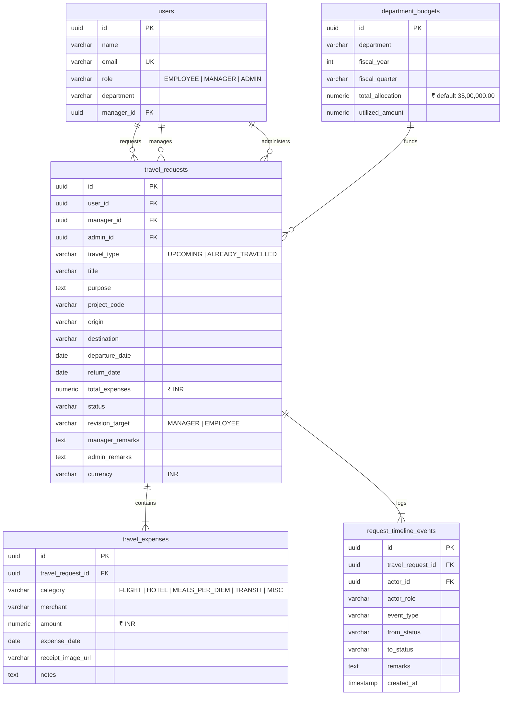

# TripFlow — Corporate Travel & Expense Governance Platform

> An enterprise-grade, multi-tier corporate travel authorization and expense governance system built with **React 19**, **TypeScript**, **Tailwind CSS v4**, **Node.js**, **Express 5**, and **PostgreSQL**, styled with the bespoke **Warm Storycraft** design system.

---

## 🧭 Executive Summary & Core Workflows

**TripFlow** enforces an auditable, two-tier approval workflow for enterprise corporate travel:
- **Tier 1 (Line Manager)**: Evaluates travel necessity, dates, itineraries, and itemized expenses with supporting photo evidence.
- **Tier 2 (Admin / Executive & Finance)**: Validates departmental budget impact, policy compliance, grants final pre-trip clearance, and authorizes post-trip reimbursement disbursements.

### Two Dedicated Operational Cases

```mermaid
flowchart TD
    subgraph Case1["Case 1: Already Travelled (Post-Trip Reimbursement)"]
        E1["Employee"] -->|"Submits completed travel + actual expenses + receipt photos"| M1["Manager Review"]
        M1 -->|"Request Changes"| E1
        M1 -->|"Approve & Forward"| A1["Admin / Finance Review"]
        A1 -->|"Revise Route A (via Manager)"| M1
        A1 -->|"Revise Route B (Direct to Employee)"| E1
        E1 -->|"Resubmit Alterations (Always returns to Manager)"| M1
        A1 -->|"Authorize Payout"| S1["SETTLED (Reimbursement Disbursed)"]
    end

    subgraph Case2["Case 2: Upcoming Travel (Pre-Trip Authorization)"]
        E2["Employee"] -->|"Submits travel plan + estimated expenses + quotation photos"| M2["Manager Review"]
        M2 -->|"Request Changes"| E2
        M2 -->|"Approve & Forward"| A2["Admin / Executive Review"]
        A2 -->|"Revise Route A (via Manager)"| M2
        A2 -->|"Revise Route B (Direct to Employee)"| E2
        E2 -->|"Resubmit Alterations (Always returns to Manager)"| M2
        A2 -->|"Grant Clearance"| S2["APPROVED (Cleared for Booking)"]
    end

    classDef primary fill:#8A582B,stroke:#6B4320,stroke-width:2px,color:#FFFFFF;
    classDef surface fill:#FFFFFF,stroke:#E8DFD3,stroke-width:1.5px,color:#2B231D;
    classDef success fill:#2D5A27,stroke:#1E3E1A,stroke-width:2px,color:#FFFFFF;

    class E1,E2,M1,M2,A1,A2 surface;
    class S1,S2 success;
```



---

## 🔑 Core Business Invariants

1. **Unified Upfront Expenses & Proof**:
   - Both **Upcoming** and **Already Travelled** requests require itemized expenses with image attachments (flight/hotel quote screenshots or tax invoice receipts) at the time of initial submission.
2. **Two-Tier Verification Authority**:
   - Direct Line **Managers** act as Tier 1 operational reviewers.
   - **Admins** act as Tier 2 executive clearance & finance payout authorities.
3. **Manager Verification Invariant on Revision**:
   - When an Admin requests revisions, they can route instructions either **Route A (via Manager)** or **Route B (direct to Employee)**.
   - In **both cases**, upon Employee resubmission, the request **always returns to the Manager first for re-verification** before escalating back to Admin.
4. **Indian Rupee (`₹` / `INR`) Currency Standard**:
   - All financial figures are denominated in Indian Rupees (`INR`), displayed as `₹` with monospace tabular digits (`font-mono tabular-nums`) adhering to Indian numbering conventions (e.g., `₹1,48,000.00`).
5. **Warm Storycraft Anti-AI-Slop Aesthetics**:
   - Natural canvas `#F7F4EE`, deep ink `#2B231D`, warm brass accent `#8A582B`, hairline border `#E8DFD3`, Poppins typography, and clean typographic status tags (**zero colored circular status dots `●`**).

---

## 🏛️ System Architecture

TripFlow is structured around a decoupled full-stack architecture with strict separation of concerns:

```
TripFlow/
├── client/                               # Frontend (React 19 + Vite + Tailwind CSS v4)
│   ├── src/
│   │   ├── components/                   # UI components (Warm Storycraft design tokens)
│   │   │   ├── auth/                     # Authentication cards (SignIn, SignUp, Forgot, Reset)
│   │   │   └── travel/                   # Travel request components, cards, drawers, & modals
│   │   ├── context/                      # AuthContext, TravelContext
│   │   ├── services/                     # Axios API clients (authApi, travelApi)
│   │   ├── types/                        # TypeScript domain contracts
│   │   └── App.tsx                       # Client-side routing with role-based access guards
│   └── docs/                             # Frontend documentation & design token guides
├── server/                               # Backend (Node.js 20+ + Express 5 + PostgreSQL)
│   ├── src/
│   │   ├── config/                       # Database pool (pg) & environment configurations
│   │   ├── controllers/                  # TravelController, AuthController
│   │   ├── middleware/                   # JWT auth guard, role-based authorization guards
│   │   ├── repositories/                 # TravelRepository (parameterized SQL queries)
│   │   ├── services/                     # TravelService (state machine & transition guards)
│   │   ├── types/                        # Server domain & DTO interfaces
│   │   └── validations/                  # Zod validation schemas
│   ├── migrations/                       # PostgreSQL SQL migration scripts
│   │   ├── 001_create_users_table.sql    # Base authentication & users
│   │   └── 002_create_travel_governance_tables.sql # Travel requests, expenses, budgets, timeline
│   └── tests/                            # Automated unit, integration, and E2E test suites
└── docs/                                 # Central project documentation
    ├── superpowers/specs/                # Approved architectural specifications
    ├── superpowers/plans/                # Step-by-step TDD implementation plans
    └── mockups/                          # Interactive visual mockups
```

---

## 🗄️ Database Architecture

TripFlow uses PostgreSQL with relational integrity, foreign key cascades, and check constraints:



---

## 🔄 Travel Request Lifecycle & Status Dictionary

| Status Code | Applicable Flow | Description | Actionable By |
| :--- | :--- | :--- | :--- |
| `DRAFT` | Both | Travel request initialized; expenses/receipts being assembled | Requester (Employee) |
| `PENDING_MANAGER_REVIEW` | Both | Submitted with expenses & proof; awaiting Tier 1 Manager audit | Direct Manager |
| `REVISION_REQUESTED_BY_MANAGER` | Both | Manager returned request with revision instructions | Requester (Employee) |
| `PENDING_ADMIN_APPROVAL` | Both | Manager audited & approved; awaiting Tier 2 Admin executive review | Admin / Finance |
| `REVISION_REQUESTED_BY_ADMIN_TO_MANAGER` | Both | Admin returned request to Manager with policy/budget instructions | Manager |
| `REVISION_REQUESTED_BY_ADMIN_TO_EMPLOYEE` | Both | Admin dispatched revision instructions directly to Employee | Requester (Employee) |
| `APPROVED` | Upcoming | Admin granted final travel clearance; ready for ticket issuance | Terminal |
| `SETTLED` | Past | Admin authorized payment disbursement; reimbursement completed | Terminal |
| `REJECTED` | Both | Formally denied by Manager or Admin with audit rationale | Terminal |
| `CANCELLED` | Both | Request withdrawn by Requester prior to approval | Terminal |

---

## 📡 REST API Specifications

### Authentication Endpoints
| Method | Endpoint | Access | Purpose |
| :--- | :--- | :--- | :--- |
| `POST` | `/api/auth/signup` | Public | Register new user account (`EMPLOYEE`, `MANAGER`, `ADMIN`) |
| `POST` | `/api/auth/signin` | Public | Authenticate with credentials; issue HttpOnly session cookie |
| `POST` | `/api/auth/signout` | Public | Clear session cookie |
| `GET` | `/api/auth/me` | Protected | Retrieve authenticated user profile and permissions |
| `POST` | `/api/auth/forgot-password` | Public | Anti-enumeration password recovery email trigger |
| `POST` | `/api/auth/reset-password` | Public | Reset password via single-use SHA-256 token |

### Travel Governance Endpoints
| Method | Endpoint | Role Guard | Description |
| :--- | :--- | :--- | :--- |
| `GET` | `/api/travel/requests` | All Roles | Fetch travel requests (filtered by user/team/all depending on role) |
| `GET` | `/api/travel/requests/:id` | All Roles | Fetch comprehensive request details, itemized expenses, and timeline |
| `POST` | `/api/travel/requests` | `EMPLOYEE` | Create new travel request with itemized expenses & receipt images |
| `PUT` | `/api/travel/requests/:id/submit` | `EMPLOYEE` | Submit draft travel request for Manager review |
| `POST` | `/api/travel/requests/:id/manager-review` | `MANAGER` | Tier 1 review: `APPROVE_AND_FORWARD` or `REQUEST_REVISION` |
| `POST` | `/api/travel/requests/:id/manager-forward-revision` | `MANAGER` | Forward Admin revision instructions to Employee with added notes |
| `POST` | `/api/travel/requests/:id/admin-review` | `ADMIN` | Tier 2 review: `APPROVE`, `SETTLE`, `REJECT`, or `REQUEST_REVISION` (Route A or B) |
| `POST` | `/api/travel/requests/:id/resubmit` | `EMPLOYEE` | Resubmit modified request (always routes back to Manager for re-verification) |
| `GET` | `/api/travel/budgets` | `ADMIN`, `MANAGER` | Fetch department budget utilization vs fiscal allocations |

---

## 💻 Client Routes & Views

| Path | Access | Component | Purpose |
| :--- | :--- | :--- | :--- |
| `/signin` | Public | `SignInCard` | Secure user sign-in |
| `/signup` | Public | `SignUpCard` | New employee/manager/admin onboarding |
| `/forgot-password` | Public | `ForgotPasswordCard` | Password recovery flow |
| `/reset-password` | Public | `ResetPasswordCard` | Token-guarded credential update |
| `/travel/employee` | `EMPLOYEE` | `EmployeeTravelPage` | Travel overview, new request modal, itemized expense builder, revision inbox |
| `/travel/manager` | `MANAGER` | `ManagerQueuePage` | Line manager audit queue, proof inspector, revision dialog |
| `/travel/admin` | `ADMIN` | `AdminGovernancePage` | Executive governance dashboard, budget meters, dual-route revision dispatch, payout settlement drawer |

---

## ⚡ Quickstart & Local Setup

### Prerequisites
- **Node.js** v20.0+
- **npm** v10.0+
- **PostgreSQL** v14+ running locally with database `TripFlow`

### 1. Database Configuration
Ensure PostgreSQL is active and create the database:
```sql
CREATE DATABASE "TripFlow";
```

### 2. Backend Setup
```bash
cd server

# Install dependencies
npm install

# Configure environment variables
cp .env.example .env
# Edit .env to set DB_NAME=TripFlow, DB_USER, DB_PASSWORD, JWT_SECRET

# Execute database migrations
npm run migrate

# Start development server
npm run dev
```
*Backend service listens on `http://localhost:5000`.*

### 3. Frontend Setup
```bash
cd client

# Install dependencies
npm install

# Start Vite development server
npm run dev
```
*Frontend application opens on `http://localhost:5173`.*

---

## 🧪 Automated Testing

TripFlow includes full-spectrum test suites covering authentication, relational constraints, state machine transitions, and dual-tier governance flows:

```bash
cd server

# Run base unit & auth test suite
npm test

# Run Day 2 cryptographic password reset verification
npm run test:day2

# Run full end-to-end travel governance lifecycle tests
npm run test:e2e
```

---

## 🎨 Warm Storycraft Design Tokens

TripFlow adheres strictly to the **Warm Storycraft** design philosophy:

| Token | Hex Value | Application |
| :--- | :--- | :--- |
| **Canvas** | `#F7F4EE` | Global background & warm page foundation |
| **Pure Surface** | `#FFFFFF` | Cards, modals, drawers, input containers |
| **Muted Surface** | `#FAF8F5` | Secondary panels, table headers, hover states |
| **Hairline Border** | `#E8DFD3` | Card borders, dividers, subtle separators |
| **Warm Accent** | `#8A582B` | Primary CTAs, active highlights, key metrics |
| **Deep Ink** | `#2B231D` | Primary typography & high-contrast titles |
| **Muted Ink** | `#7A6B5D` | Secondary labels, captions, metadata |
| **Status Tag Text** | Typographic | Muted pill tags without colored circular dots (`●`) |
| **Currency Font** | Monospace | `font-mono tabular-nums` for precise alignment of `₹` figures |

---

## 📄 License & Attribution

Internal corporate software developed under the enterprise governance initiative. All rights reserved.
