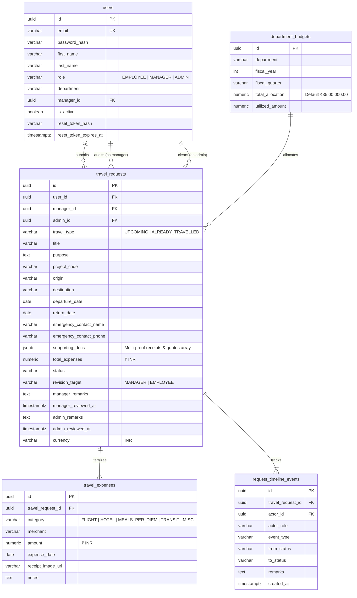

# TripFlow — Corporate Travel & Expense Governance Platform

> An enterprise-grade, multi-tier corporate travel authorization, manager audit, and expense governance platform built with **React 19**, **TypeScript**, **Tailwind CSS v4**, **Vite 8**, **Node.js**, **Express 5**, and **PostgreSQL**, styled with the bespoke **Stripe Design System**.

---

## 🧭 Executive Summary & Core Workflows

**TripFlow** enforces an auditable, two-tier approval state machine for corporate travel governance:
- **Tier 1 (Line Manager)**: Evaluates travel necessity, itinerary dates, policy compliance, and itemized expenses with supporting photo/document proof.
- **Tier 2 (Admin / Executive & Finance)**: Validates departmental budget impact, grants final pre-trip authorization (`APPROVED`), and authorizes post-trip expense disbursements (`SETTLED`).

### Two Dedicated Operational Lifecycles

```mermaid
flowchart TD
    subgraph Case1["Case 1: Upcoming Travel (Pre-Trip Authorization)"]
        E1["Employee (Submission)"] -->|"Submit Travel Plan + Quotation Proofs"| M1["Line Manager (Tier 1 Review)"]
        M1 -->|"Request Revision"| E1
        M1 -->|"Approve & Forward"| A1["Admin / Finance (Tier 2 Review)"]
        A1 -->|"Route A: Revise via Manager"| M1
        A1 -->|"Route B: Revise Direct to Employee"| E1
        E1 -->|"Resubmit Alterations (Strict Re-routing)"| M1
        A1 -->|"Grant Travel Clearance"| S1["APPROVED (Cleared for Booking)"]
    end

    subgraph Case2["Case 2: Already Travelled (Post-Trip Reimbursement)"]
        E2["Employee (Submission)"] -->|"Submit Completed Travel + Actual Receipts"| M2["Line Manager (Tier 1 Review)"]
        M2 -->|"Request Revision"| E2
        M2 -->|"Approve & Forward"| A2["Admin / Finance (Tier 2 Review)"]
        A2 -->|"Route A: Revise via Manager"| M2
        A2 -->|"Route B: Revise Direct to Employee"| E2
        E2 -->|"Resubmit Alterations (Strict Re-routing)"| M2
        A2 -->|"Authorize Payment Disbursement"| S2["SETTLED (Reimbursement Disbursed)"]
    end

    classDef primary fill:#533AFD,stroke:#4834DB,stroke-width:2px,color:#FFFFFF;
    classDef surface fill:#FFFFFF,stroke:#CBD5E1,stroke-width:1.5px,color:#061B31;
    classDef success fill:#00D66F,stroke:#00A857,stroke-width:2px,color:#061B31;

    class E1,E2,M1,M2,A1,A2 surface;
    class S1,S2 success;
```



---

## 🔑 Core Business & Architectural Invariants

1. **Strict Manager Re-routing Invariant**:
   - When an Admin requests revisions, they can route instructions either **Route A (via Manager)** or **Route B (direct to Employee)**.
   - In **both cases**, upon Employee resubmission, the request **always re-routes back to the Line Manager first** (`PENDING_MANAGER_REVIEW`) for re-verification. An employee cannot bypass the Line Manager directly to Admin approval.
2. **Dual Terminal States**:
   - `APPROVED`: Pre-trip upcoming travel is authorized and cleared for airline/hotel reservations.
   - `SETTLED`: Post-trip reimbursement has been audited against uploaded receipts and disbursed.
3. **Multi-Proof Cloudinary Attachment Hub**:
   - Travel requests store an array of supporting documents (flight quotes, hotel vouchers, tax invoices) in PostgreSQL as a `JSONB` array (`supporting_docs`) with a GIN index, backed by Cloudinary uploads and local disk fallbacks.
4. **Indian Rupee (`INR` / `₹`) Currency Standard**:
   - All financial figures are denominated in Indian Rupees (`INR`), formatted as `₹` with monospace tabular digits (`font-mono tabular-nums`) adhering to Indian numbering conventions (e.g., `₹1,48,000.00`).
5. **Real-Time Department Budget Headroom**:
   - Departmental spending is tracked against quarterly fiscal allocations (`department_budgets`), with live velocity tracking, category mix charts, and headroom calculations.
6. **Stripe Design System**:
   - Clean, high-density corporate aesthetics featuring cool canvas (`#F2F7FE`), card surfaces (`#FFFFFF`), blurple primary (`#533AFD`), typography powered by **Plus Jakarta Sans** and **JetBrains Mono**, 5 elevation tiers, and 5 border radii.

---

## 🏛️ System Architecture

TripFlow is organized into a modular full-stack monorepo with clear feature boundaries:

```
TripFlow/
├── client/                               # Frontend Application (React 19 + Vite 8 + Tailwind v4)
│   ├── src/
│   │   ├── features/
│   │   │   ├── auth/                     # Authentication & recovery (SignIn, ForgotPassword, ResetPassword)
│   │   │   ├── dashboard/                # Dynamic role dashboard orchestrator (Employee, Manager, Admin)
│   │   │   ├── travel/                   # Travel request workstations, portals, analytics, and modals
│   │   │   └── users/                    # Admin user directory, provisioning, and status management
│   │   ├── routes/                       # AppRoutes (code-split lazy routes) & ProtectedRoute gates
│   │   ├── shared/                       # Accessible UI primitives (Button, Input, Card, Chart, Alert)
│   │   ├── App.tsx                       # Root component with AuthProvider & TravelProvider
│   │   └── index.css                     # Tailwind v4 configuration, font imports & Stripe tokens
│   ├── tests/                            # 45+ standalone assertion verification suites
│   └── package.json
├── server/                               # Backend Service (Node.js 20+ + Express 5 + PostgreSQL)
│   ├── src/
│   │   ├── config/                       # Type-safe environment variables (env.ts)
│   │   ├── features/
│   │   │   ├── auth/                     # JWT session, bcrypt hashing, SHA-256 password recovery
│   │   │   ├── travel/                   # State machine, travel repository, audit actions, budgets
│   │   │   └── users/                    # Admin user CRUD, status toggling, deletion safeguards
│   │   ├── shared/
│   │   │   ├── db/                       # Connection pool & migrations (001 to 004)
│   │   │   ├── middleware/               # Auth guard, role RBAC guard, upload middleware, error handler
│   │   │   └── services/                 # Cloudinary upload service & Nodemailer email service
│   │   ├── app.ts                        # Express pipeline, CORS, cookie parser, route mounting
│   │   └── index.ts                      # Server bootstrap
│   ├── tests/                            # Comprehensive backend test suites (state machine, repos, APIs)
│   └── package.json
└── docs/                                 # Architectural specifications and visual mockups
```

---

## 🗄️ Database Architecture

TripFlow uses PostgreSQL with relational integrity, foreign key cascades, check constraints, and GIN indexing:



### Applied Schema Migrations (`server/src/shared/db/migrations/`)
1. **`001_create_users_table.sql`**: Base users table, bcrypt password hash, and SHA-256 reset token storage.
2. **`002_create_travel_governance_tables.sql`**: Roles hierarchy, `department_budgets`, `travel_requests`, `travel_expenses`, and `request_timeline_events`.
3. **`003_add_supporting_docs.sql`**: Multi-proof `supporting_docs` JSONB column with GIN index on `travel_requests`.
4. **`004_add_user_lifecycle.sql`**: User activation flag (`is_active`) and index for governance lifecycle.

---

## 🔄 Travel Request Lifecycle & Status Dictionary

| Status Code | Applicable Flow | Description | Actionable By |
| :--- | :--- | :--- | :--- |
| `DRAFT` | Both | Request initialized; itinerary and expenses being assembled | Requester (Employee) |
| `PENDING_MANAGER_REVIEW` | Both | Submitted with itemized expenses & receipts; awaiting Tier 1 Manager audit | Direct Manager |
| `REVISION_REQUESTED_BY_MANAGER` | Both | Manager requested alterations with inline remarks | Requester (Employee) |
| `PENDING_ADMIN_APPROVAL` | Both | Manager approved; awaiting Tier 2 Admin executive & budget review | Admin / Finance |
| `REVISION_REQUESTED_BY_ADMIN_TO_MANAGER` | Both | Admin returned request to Line Manager (Route A) for clarification | Line Manager |
| `REVISION_REQUESTED_BY_ADMIN_TO_EMPLOYEE` | Both | Admin returned request directly to Employee (Route B) | Requester (Employee) |
| `APPROVED` | Upcoming | Admin granted pre-trip clearance; cleared for ticket booking | Terminal |
| `SETTLED` | Past | Admin authorized payment disbursement; reimbursement disbursed | Terminal |
| `REJECTED` | Both | Denied by Manager or Admin with formal audit rationale | Terminal |
| `CANCELLED` | Both | Withdrawn by Requester prior to final approval | Terminal |

---

## 🎨 Visual Philosophy: Stripe Design System

TripFlow replaces generic templates with an information-dense, high-legibility enterprise design system:

| Token Category | Token / Value | Application |
| :--- | :--- | :--- |
| **Canvas** | `#F2F7FE` | Cool neutral page canvas |
| **Surface** | `#FFFFFF` | Workstation cards, data tables, modals |
| **Subtle Surface** | `#F8FAFC` | Table headers, secondary panels |
| **Primary** | `#533AFD` | Interactive CTAs, active segmented tabs, focal highlights |
| **Ink** | `#061B31` / `#1A2C44` | High-contrast typography & headings |
| **Muted / Faint** | `#334155` / `#50617A` | Captions, secondary labels, helper text |
| **Hairline Border** | `#CBD5E1` | Card borders, inputs, and table dividers |
| **Success** | `#00D66F` | Approved/settled badges, positive budget headroom |
| **Destructive** | `#DC2626` | Rejections, cancellations, budget deficit alerts |
| **Typography (UI)** | `Plus Jakarta Sans` | Primary clean interface typography |
| **Typography (Data)** | `JetBrains Mono` | Monospace tabular numbers for `₹` amounts and dates |
| **Elevation** | `--shadow-xs` to `--shadow-xl` | 5 elevation tiers with navy-tinted drop shadows |
| **Border Radii** | `--radius-xs` to `--radius-full` | 5 border radii (1px, 4px, 8px, 16px, 100px) |

---

## 💻 Client Routes & Workstation Map

| Path | Access Tier | Component | Purpose |
| :--- | :--- | :--- | :--- |
| `/signin` | Public | `SignInCard` | Secure user sign-in with HttpOnly cookie persistence |
| `/signup` | Public | *Redirect to `/signin`* | User registration is managed by Admin governance |
| `/forgot-password` | Public | `ForgotPasswordCard` | Request password reset token with anti-enumeration |
| `/reset-password` | Public | `ResetPasswordCard` | Token-guarded credential update |
| `/dashboard` | **Protected** | `DashboardPage` | Role-based dashboard (`EMPLOYEE`, `MANAGER`, `ADMIN`) |
| `/dashboard?tab=analytics` | **Protected** | `SpendAnalytics` | Role-specific spend velocity & budget analytics |
| `/travel/new` | **Protected** | `NewTravelRequestPage` | Create travel request (Upcoming travel or reimbursement) |
| `/travel/requests/:id` | **Protected** | `TravelDetailPage` | Detailed inspection, receipts viewer & audit actions |
| `/travel/requests/:id/edit` | **Protected** | `ResubmitTravelRequestPage` | Revise and resubmit request based on audit remarks |
| `/admin/users/new` | **Protected (Admin)** | `NewUserPage` | Provision new employee, manager, or admin user |
| `/` | Public | *Redirect to `/dashboard`* | Default entry point routing to authenticated dashboard |

---

## 📡 REST API Specifications

### 1. Authentication (`/api/auth`)
| Method | Endpoint | Access | Purpose |
| :--- | :--- | :--- | :--- |
| `POST` | `/api/auth/signin` | Public | Authenticates credentials and sets HttpOnly JWT cookie |
| `POST` | `/api/auth/signup` | Public | User registration endpoint |
| `POST` | `/api/auth/signout` | Public | Clears authentication session cookie |
| `GET` | `/api/auth/me` | Authenticated | Retrieves current authenticated user profile & role |
| `POST` | `/api/auth/forgot-password` | Public | Dispatches 1-hour password recovery token via email |
| `POST` | `/api/auth/reset-password` | Public | Updates password using validated SHA-256 token |

### 2. Travel & Governance (`/api/travel`)
| Method | Endpoint | Role Guard | Description |
| :--- | :--- | :--- | :--- |
| `POST` | `/api/travel/upload` | Authenticated | Uploads receipt/quotation proof to Cloudinary |
| `POST` | `/api/travel/requests` | Authenticated | Creates new travel request with itemized expenses & proofs |
| `GET` | `/api/travel/requests` | Authenticated | Retrieves requests scoped to authenticated user or team |
| `GET` | `/api/travel/requests/:id` | Authenticated | Retrieves full request details, line items, and audit trail |
| `POST` | `/api/travel/requests/:id/manager-review` | `MANAGER`, `ADMIN` | Tier 1 Line Manager review (Approve, Revise, Reject) |
| `POST` | `/api/travel/requests/:id/admin-review` | `ADMIN` | Tier 2 Admin clearance (Approve, Settle, Revise Route A/B) |
| `POST` | `/api/travel/requests/:id/resubmit` | Authenticated | Resubmits revised request (strictly re-routes to Manager) |
| `POST` | `/api/travel/requests/:id/cancel` | Authenticated | Cancels draft or pending travel request |
| `GET` | `/api/travel/manager-queue` | `MANAGER`, `ADMIN` | Retrieves pending review queue for direct subordinates |
| `GET` | `/api/travel/admin-queue` | `ADMIN` | Retrieves corporate clearance and settlement queue |
| `GET` | `/api/travel/budgets` | Authenticated | Retrieves department budget allocation for a given quarter |
| `GET` | `/api/travel/budgets/overview` | `ADMIN` | Comprehensive multi-quarter department budget ledger |
| `PUT` | `/api/travel/budgets` | `ADMIN` | Creates or updates quarterly department budget allocation |

### 3. User Administration (`/api/users`)
| Method | Endpoint | Role Guard | Description |
| :--- | :--- | :--- | :--- |
| `GET` | `/api/users` | `ADMIN` | Lists all corporate users, roles, and status |
| `POST` | `/api/users` | `ADMIN` | Provisions a new user account with role and department |
| `PATCH` | `/api/users/:id/status` | `ADMIN` | Activates or deactivates user account access (`is_active`) |
| `PATCH` | `/api/users/:id` | `ADMIN` | Updates user details, department, or manager assignment |
| `DELETE` | `/api/users/:id` | `ADMIN` | Deletes user account with cascade and safety checks |

### 4. Health Check
| Method | Endpoint | Access | Description |
| :--- | :--- | :--- | :--- |
| `GET` | `/api/health` | Public | Returns database connection status and server timestamp |

---

## ⚡ Quickstart & Local Setup

### Prerequisites
- **Node.js** v20.0 or higher
- **PostgreSQL** v14+ running locally on port `5432`

### 1. Database Configuration
Create the PostgreSQL database:
```sql
CREATE DATABASE tripflow;
```

### 2. Backend Setup
```bash
cd server

# Install dependencies
npm install

# Configure environment variables
cp .env.example .env
# Edit .env with your DATABASE_URL, JWT_SECRET, and Cloudinary keys

# Execute database migrations
npm run migrate

# Start development server
npm run dev
```
*Backend service listens on `http://localhost:5000`.*

### 3. Frontend Setup
```bash
cd client

# Install dependencies
npm install

# Start Vite development server
npm run dev
```
*Frontend application opens on `http://localhost:5173`.*

---

## 🧪 Automated Testing Suite

TripFlow includes automated testing across state machine invariants, database repositories, API endpoints, and client UI components:

```bash
# --- Backend Test Suites ---
cd server

# 1. State machine transition invariants (47 tests)
npm run test:fsm

# 2. Database migration integrity
npm run test:migration

# 3. Travel repository & transaction rollbacks
npm run test:repo

# 4. Travel service logic & calculations
npm run test:service

# 5. Travel API endpoints & RBAC enforcement
npm run test:api

# 6. Date validation & timezone handling
npm run test:dates

# 7. Authentication lifecycle
npm test
npm run test:day2
npm run test:e2e

# --- Frontend Test Suites ---
cd ../client

# Run UI theme token & contrast verification
npx tsx tests/stripe-theme-tokens.test.ts
npx tsx tests/stripe-contrast-readability.test.ts

# Run form date boundaries & validation tests
npx tsx tests/travel-form-date-validation.test.ts
npx tsx tests/expense-date-boundaries.test.ts

# Run department budget analytics tests
npx tsx tests/department-budget-redesign.test.ts
```

---

## 📄 License & Attribution

Internal corporate software developed under the enterprise governance initiative. All rights reserved.
