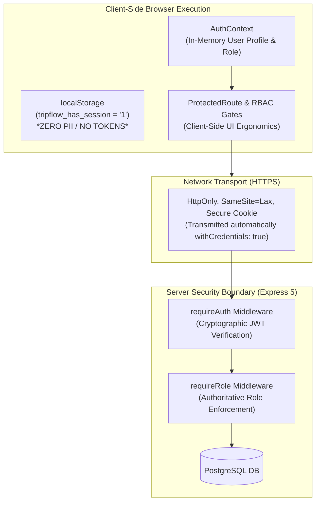

# TripFlow Client Authentication & Security Architecture

This document outlines the authentication lifecycle, session persistence model, defense-in-depth protections, input validation rules, and client-side security policies implemented in the **TripFlow Web Client**.

---

## 🛡️ Security Principles & Zero-Trust Model

The TripFlow client operates under strict corporate security and financial compliance constraints:



### Core Tenets
1. **Authoritative Server Security**: Client-side role checks and route guards exist strictly for **user ergonomics and smooth UI flows**. All business logic, state transitions, and authorization gates are authoritatively verified on the Express backend.
2. **Zero Sensitive Data in Browser Storage**: TripFlow strictly bans storing JSON Web Tokens (JWTs), refresh tokens, user passwords, or Personally Identifiable Information (PII) in `localStorage` or `sessionStorage`.
3. **HttpOnly Cookie Session Model**: Authentication credentials reside in browser-managed HttpOnly cookies, completely eliminating the primary vector for Cross-Site Scripting (XSS) token theft.

---

## 🔐 HttpOnly Cookie Authentication & Hydration

TripFlow handles authentication state via [client/src/features/auth/context/AuthContext.tsx](file:///c:/Users/SudalaimaniKannan/Documents/Codings/Readventure/client/src/features/auth/context/AuthContext.tsx).

```mermaid
sequenceDiagram
    autonumber
    actor User
    participant Browser
    participant AuthContext
    participant Backend as Express Server (/api/auth)

    User->>Browser: Enters email & password
    Browser->>Backend: POST /api/auth/signin { email, password }
    Backend->>Backend: Validates credentials & signs JWT
    Backend-->>Browser: 200 OK + Set-Cookie: jwt=...; HttpOnly; SameSite=Lax; Secure
    Browser->>AuthContext: Stores tripflow_has_session = '1' in localStorage
    AuthContext->>AuthContext: Sets user profile in-memory & isAuthenticated: true
    Browser-->>User: Redirects to /dashboard

    Note over User,Backend: Subsequent Page Reload / Browser Refresh

    User->>Browser: Reloads page (F5)
    AuthContext->>AuthContext: Reads tripflow_has_session === '1' -> isLoading: true
    Browser->>Backend: GET /api/auth/me (Cookie sent automatically)
    alt Session Valid
        Backend-->>Browser: 200 OK { data: { user: { id, email, role, department } } }
        AuthContext->>AuthContext: Hydrates user state & sets isLoading: false
        Browser-->>User: Renders protected workstation without flicker
    else Session Expired / Invalid
        Backend-->>Browser: 401 Unauthorized
        AuthContext->>AuthContext: Removes tripflow_has_session & sets user: null
        Browser-->>User: Cleanly redirects to /signin
    end
```

### Zero-PII Session Hint (`tripflow_has_session`)
In modern single-page applications, reading authentication state from HttpOnly cookies during initial page mount presents a UX challenge: JavaScript cannot inspect `document.cookie` to know whether a user is logged in before making an asynchronous network request.

To avoid either:
* Flashing an unauthenticated sign-in screen on every refresh, or
* Storing sensitive tokens in vulnerable web storage,

TripFlow implements a **Zero-PII Session Hint**:
* Upon successful authentication, the client saves a boolean flag:
  ```typescript
  localStorage.setItem('tripflow_has_session', '1');
  ```
* On initial component mounting:
  ```typescript
  const [isLoading, setIsLoading] = useState<boolean>(() => {
    return localStorage.getItem('tripflow_has_session') === '1';
  });
  ```
* The client performs a background `GET /auth/me` call:
  - If successful: Hydrates the in-memory user state and sets `isLoading = false`.
  - If failed (cookie expired or cleared): Cleans up the flag via `localStorage.removeItem('tripflow_has_session')` and redirects to `/signin`.
* **Security Guarantee**: The flag contains zero user data, zero email addresses, and zero credentials. It is solely an operational loading hint.

---

## 🔑 Password Recovery & Anti-Enumeration Protection

Located in [client/src/features/auth/components/ForgotPasswordCard.tsx](file:///c:/Users/SudalaimaniKannan/Documents/Codings/Readventure/client/src/features/auth/components/ForgotPasswordCard.tsx) and [client/src/features/auth/components/ResetPasswordCard.tsx](file:///c:/Users/SudalaimaniKannan/Documents/Codings/Readventure/client/src/features/auth/components/ResetPasswordCard.tsx).

### 1. Anti-Enumeration Design
To prevent attackers from discovering valid corporate email addresses by analyzing error responses:
* The password reset request endpoint `/api/auth/forgot-password` always returns a generic, neutral confirmation message:
  > *"If an account with that email address exists, instructions to reset your password have been sent."*
* The client displays this positive confirmation regardless of whether the email exists in the corporate database.

### 2. URL Token Guarding
The password reset page strictly validates the incoming recovery token:
```tsx
const [searchParams] = useSearchParams();
const token = searchParams.get('token');

useEffect(() => {
  if (!token) {
    navigate('/signin', { replace: true });
  }
}, [token, navigate]);
```
* Requests without a cryptographic token parameter are immediately redirected to the sign-in portal.

### 3. Real-Time Password Strength Meter
Configured in [client/src/features/auth/components/PasswordStrengthMeter.tsx](file:///c:/Users/SudalaimaniKannan/Documents/Codings/Readventure/client/src/features/auth/components/PasswordStrengthMeter.tsx):
* Evaluates password complexity before submission:
  - Minimum 8 characters
  - Lowercase and uppercase characters
  - Numeric digits
  - Special symbols (`!@#$%^&*`)
* Provides immediate visual score feedback (Weak, Fair, Strong) with Stripe-standard semantic indicators.

---

## 🦺 Cross-Site Scripting (XSS) Defenses

1. **Contextual Escaping**: React 19 JSX automatically escapes all dynamic string bindings before rendering them to the DOM, neutralizing basic script injection vectors.
2. **Zero `dangerouslySetInnerHTML`**: The entire client codebase strictly avoids `dangerouslySetInnerHTML`.
3. **Sanitized User Remarks**: Trip purposes, expense notes, and manager remarks are rendered as plain text nodes within styled typography containers.
4. **Sandboxed Document Previews**: The Cloudinary multi-proof viewer [client/src/features/travel/components/audit/ProofInspectorViewer.tsx](file:///c:/Users/SudalaimaniKannan/Documents/Codings/Readventure/client/src/features/travel/components/audit/ProofInspectorViewer.tsx) mounts PDFs using sandboxed `<object>` elements with safe fallback anchor attributes (`rel="noopener noreferrer"`).

---

## 🛑 Cross-Site Request Forgery (CSRF) Defenses

1. **SameSite Cookie Policy**: Backend session cookies are configured with `SameSite: 'Lax'` (or `'Strict'`), instructing compliant browsers to withhold cookies on untrusted cross-origin requests.
2. **Pre-flight CORS Enforcement**: All state-modifying requests send `Content-Type: application/json` or `multipart/form-data`, requiring a CORS pre-flight `OPTIONS` handshake that rejects unauthorized third-party origins.
3. **CORS Origin Locking**: The backend API restricts permitted access to trusted web origins (`http://localhost:5173` in development, corporate domain in production).

---

## 📝 Runtime Form Validation (Zod + React Hook Form)

Client forms use type-safe [Zod](https://zod.dev/) schemas paired with [React Hook Form](https://react-hook-form.com/) via `@hookform/resolvers/zod`:

### 1. Pre-Flight Validation Schemas
Located in:
* Authentication: [client/src/features/auth/schemas/auth.schemas.ts](file:///c:/Users/SudalaimaniKannan/Documents/Codings/Readventure/client/src/features/auth/schemas/auth.schemas.ts)
* User Provisioning: [client/src/features/users/schemas/userForm.schema.ts](file:///c:/Users/SudalaimaniKannan/Documents/Codings/Readventure/client/src/features/users/schemas/userForm.schema.ts)

```typescript
export const travelRequestSchema = z.object({
  title: z.string().min(3, 'Title must be at least 3 characters'),
  travelType: z.enum(['UPCOMING', 'ALREADY_TRAVELLED']),
  departureDate: z.string().regex(/^\d{4}-\d{2}-\d{2}$/, 'Valid departure date required'),
  returnDate: z.string().regex(/^\d{4}-\d{2}-\d{2}$/, 'Valid return date required'),
  origin: z.string().min(2, 'Origin city required'),
  destination: z.string().min(2, 'Destination city required'),
  emergencyContactPhone: z.string().min(8, 'Valid phone number required'),
  expenses: z.array(z.object({
    category: z.enum(['FLIGHT', 'HOTEL', 'MEALS_PER_DIEM', 'TRANSIT', 'MISC']),
    merchant: z.string().min(1, 'Merchant name required'),
    amount: z.number().positive('Amount must be positive'),
    expenseDate: z.string(),
  })).min(1, 'At least one expense line item is required'),
}).refine((data) => data.returnDate >= data.departureDate, {
  message: 'Return date cannot precede departure date',
  path: ['returnDate'],
});
```

### 2. Clean Input Validation Ergonomics (`mode: 'onBlur'`)
* Forms validate on blur (`mode: 'onBlur'`) rather than on every keystroke, preventing annoying premature error alerts while users type.
* Inputs display crisp slate borders (`#CBD5E1`) by default and highlight in high-contrast crimson (`#DC2626`) only when invalid.
* Redundant persistent helper text has been replaced with error-only feedback (`refactor(forms): clean input fields with validation errors only`).

---

## 🚪 Client-Side Role-Based Access Control (RBAC)

TripFlow governs access across three enterprise roles:

| Role | Permitted Workstations | Prohibited Workstations |
| :--- | :--- | :--- |
| **`EMPLOYEE`** | `/dashboard?tab=trips`, `/dashboard?tab=drafts`, `/dashboard?tab=analytics`, `/travel/new`, `/travel/requests/:id`, `/travel/requests/:id/edit` | Admin user creation, Manager audit queues |
| **`MANAGER`** | `/dashboard?tab=team`, `/dashboard?tab=revisions`, `/dashboard?tab=analytics`, `/travel/requests/:id` | Admin budget allocations, corporate user directory |
| **`ADMIN`** | `/dashboard?tab=governance`, `/dashboard?tab=budgets`, `/dashboard?tab=users`, `/admin/users/new`, `/travel/requests/:id` | Restricted employee draft actions |

### 1. The `ProtectedRoute` Guard
Located in [client/src/routes/ProtectedRoute.tsx](file:///c:/Users/SudalaimaniKannan/Documents/Codings/Readventure/client/src/routes/ProtectedRoute.tsx):
* Guards all private workstations against unauthenticated access.
* Renders a clean loading placeholder while the session hint is verified against `/api/auth/me`.

### 2. In-Situ Role-Gated Action Cards
In [client/src/features/travel/pages/TravelDetailPage.tsx](file:///c:/Users/SudalaimaniKannan/Documents/Codings/Readventure/client/src/features/travel/pages/TravelDetailPage.tsx):
* `ManagerDecisionCard` is mounted **only** when `user.role === 'MANAGER'` AND the request is currently in `PENDING_MANAGER_REVIEW`.
* `AdminClearanceCard` is mounted **only** when `user.role === 'ADMIN'` AND the request is currently in `PENDING_ADMIN_APPROVAL`.
* Unauthorized users viewing the request cannot see or interact with review decision controls.
