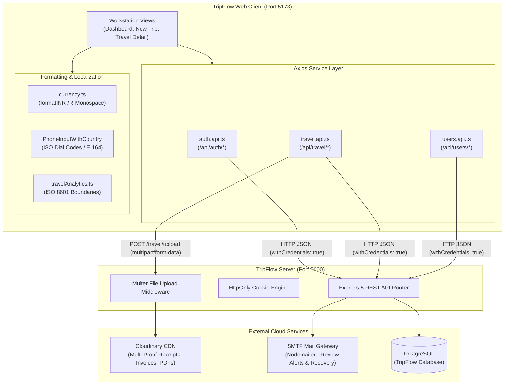
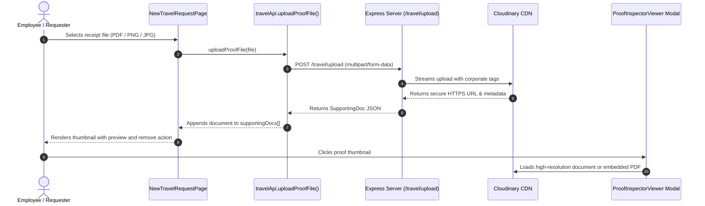

# TripFlow Client Integrations Architecture

This document details the external service integrations, HTTP API contracts, Cloudinary multi-proof attachment pipeline, internationalization formatters, and network orchestration implemented in the **TripFlow Web Client**.

---

## 🌐 Integration Topology

The TripFlow client acts as a high-density corporate workstation that interfaces with backend microservices, cloud media storage, email gateways, and localized formatting engines:



---

## ⚡ HTTP API Architecture & Axios Configuration

Client-side HTTP communication is managed via dedicated Axios instances configured with session cookie propagation and standardized response unpacking.

### 1. Client Instances
* **Authentication API**: [client/src/features/auth/services/auth.api.ts](file:///c:/Users/SudalaimaniKannan/Documents/Codings/Readventure/client/src/features/auth/services/auth.api.ts)
* **Travel Governance API**: [client/src/features/travel/services/travel.api.ts](file:///c:/Users/SudalaimaniKannan/Documents/Codings/Readventure/client/src/features/travel/services/travel.api.ts)
* **User Governance API**: [client/src/features/users/services/users.api.ts](file:///c:/Users/SudalaimaniKannan/Documents/Codings/Readventure/client/src/features/users/services/users.api.ts)

### 2. Common Configuration
```typescript
export const travelApiClient: AxiosInstance = axios.create({
  baseURL: 'http://localhost:5000/api',
  headers: {
    'Content-Type': 'application/json',
  },
  // Automatically sends and receives HttpOnly JWT cookies across requests
  withCredentials: true,
});
```

### 3. Response Envelope Structure
All backend responses conform to the type-safe `ApiResponse<T>` contract:
```typescript
export interface ApiResponse<T = unknown> {
  success: boolean;
  message: string;
  data: T;
  errors?: unknown;
}
```

### 4. Uniform Error Handling Pattern
The client uses an error extractor pattern that unpacks backend messages while gracefully falling back to default operational alerts:
```typescript
private handleError(err: unknown, defaultMessage: string): never {
  if (isAxiosError(err)) {
    const responseData = err.response?.data as ApiResponse | undefined;
    const message = responseData?.message || err.message || defaultMessage;
    throw new Error(message);
  }
  if (err instanceof Error) {
    throw err;
  }
  throw new Error(defaultMessage);
}
```

---

## 📑 Core REST API Integration Contracts

### 1. Authentication & Session Services (`/api/auth`)
| Method | Endpoint | Request Payload | Response Data | Purpose |
| :--- | :--- | :--- | :--- | :--- |
| `POST` | `/auth/signin` | `{ email, password }` | `{ user: User }` | Authenticates credentials; sets HttpOnly JWT session cookie. |
| `GET` | `/auth/me` | *None* | `{ user: User }` | Validates session cookie and hydrates user profile. |
| `POST` | `/auth/signout` | *None* | `null` | Clears HttpOnly cookie and invalidates server session. |
| `POST` | `/auth/forgot-password` | `{ email }` | `{ message, previewUrl? }` | Requests password recovery link with anti-enumeration protection. |
| `POST` | `/auth/reset-password` | `{ token, newPassword }` | `{ message }` | Resets password using single-use cryptographic URL token. |

### 2. Travel & Expense Governance Services (`/api/travel`)
| Method | Endpoint | Request Payload | Response Data | Purpose |
| :--- | :--- | :--- | :--- | :--- |
| `POST` | `/travel/requests` | `CreateTravelRequestInput` | `TravelRequest` | Creates new request (Upcoming clearance or reimbursement). |
| `GET` | `/travel/requests` | Params: `scope=personal`, `status?` | `TravelRequest[]` | Retrieves authenticated user's personal travel history. |
| `GET` | `/travel/requests/:id`| Params: `id` | `TravelRequest` | Returns complete request details, expenses, and timeline ledger. |
| `GET` | `/travel/manager-queue` | *None* | `TravelRequest[]` | Returns direct subordinates' pending audit submissions (Tier 1). |
| `POST` | `/travel/requests/:id/manager-review` | `{ action, remarks }` | `TravelRequest` | Submits manager decision (`APPROVE`, `REVISE`, `REJECT`). |
| `GET` | `/travel/admin-queue` | *None* | `TravelRequest[]` | Returns executive clearance and settlement queue (Tier 2). |
| `POST` | `/travel/requests/:id/admin-review` | `{ action, remarks, revisionTarget, forceOverride }` | `TravelRequest` | Submits admin action (`APPROVE`, `SETTLE`, `REVISE`, `REJECT`). |
| `POST` | `/travel/requests/:id/resubmit` | `ResubmitRequestInput` | `TravelRequest` | Resubmits revised request (**Strictly re-routes to Line Manager**). |
| `POST` | `/travel/requests/:id/cancel` | `{ remarks? }` | `TravelRequest` | Cancels draft or returned request by the requester. |
| `GET` | `/travel/budgets` | Params: `department, year, quarter` | `DepartmentBudget` | Returns department allocation and available real-time headroom. |
| `GET` | `/travel/budgets/overview` | Params: `year?, quarter?` | `DepartmentBudgetOverview` | Returns all corporate department budgets for Admin governance. |
| `PUT` | `/travel/budgets` | `UpsertBudgetInput` | `DepartmentBudget` | Creates or updates quarterly departmental budget allocation. |
| `POST` | `/travel/upload` | `FormData (file: File)` | `SupportingDoc` | Uploads receipt or quote proof to Cloudinary. |

### 3. Corporate User Governance Services (`/api/users`)
| Method | Endpoint | Request Payload | Response Data | Purpose |
| :--- | :--- | :--- | :--- | :--- |
| `GET` | `/users` | *None* | `{ users: DirectoryUser[] }` | Retrieves company team directory for Admin portal. |
| `POST` | `/users` | `CreateUserPayload` | `{ user: DirectoryUser }` | Provisions new corporate account with assigned role and department. |
| `PATCH`| `/users/:id` | `UpdateUserPayload` | `{ user: DirectoryUser }` | Updates employee metadata (name, department, role). |
| `PATCH`| `/users/:id/status` | `{ isActive: boolean }` | `{ user: DirectoryUser }` | Toggles corporate access (deactivation/reactivation). |
| `DELETE`| `/users/:id` | *None* | `null` | Deletes user record (requires confirmation). |

---

## ☁️ Cloudinary Multi-Proof Document Storage Integration

TripFlow enables users to attach multi-proof receipts, flight quotes, and hotel booking vouchers. To maintain security, client files are uploaded through the backend server proxy:



### 1. Document Model (`SupportingDoc`)
```typescript
export interface SupportingDoc {
  id: string;
  type: 'LINK' | 'FILE';
  name: string;
  url: string;
  format?: string;
  size?: number;
  uploadedAt?: string;
}
```

### 2. High-Fidelity Proof Inspector (`ProofInspectorViewer.tsx`)
Configured in [client/src/features/travel/components/audit/ProofInspectorViewer.tsx](file:///c:/Users/SudalaimaniKannan/Documents/Codings/Readventure/client/src/features/travel/components/audit/ProofInspectorViewer.tsx):
* **Image Lightbox**: Renders PNG, JPG, and WEBP formats with interactive zoom controls (`+`, `-`, reset) and rotation controls (`90°`).
* **PDF Document Viewer**: Embeds PDFs directly using an `<object>` container with full browser document controls and fallback download links.
* **Secure Downloads**: Triggers direct file downloads with original filenames via secure fetch blob conversion.

---

## 🇮🇳 Localization & Data Formatting Integrations

### 1. Indian Rupee (`INR`) Currency Formatter
Defined in [client/src/features/travel/utils/currency.ts](file:///c:/Users/SudalaimaniKannan/Documents/Codings/Readventure/client/src/features/travel/utils/currency.ts):
```typescript
export function formatINR(amount: number | string | null | undefined): string {
  const numeric = typeof amount === 'number' ? amount : parseFloat(String(amount || 0));
  if (isNaN(numeric)) return '₹0.00';

  return new Intl.NumberFormat('en-IN', {
    style: 'currency',
    currency: 'INR',
    minimumFractionDigits: 2,
    maximumFractionDigits: 2,
  }).format(numeric);
}
```
* Adheres to Indian numbering grouping conventions: `₹1,48,000.00`.
* Paired with monospace font styling (`font-mono tabular-nums`) across all financial tables.

### 2. International Phone Dial Codes (`PhoneInputWithCountry.tsx`)
Located in [client/src/features/travel/components/forms/PhoneInputWithCountry.tsx](file:///c:/Users/SudalaimaniKannan/Documents/Codings/Readventure/client/src/features/travel/components/forms/PhoneInputWithCountry.tsx):
* Provides international ISO-3166 dial codes (e.g., `+91` India, `+1` United States, `+44` UK, `+65` Singapore).
* Automatically merges country prefix with user input into standardized E.164 phone numbers for emergency contacts.

### 3. Date Formatting & Fiscal Quarter Derivation
Located in [client/src/features/travel/utils/travelAnalytics.ts](file:///c:/Users/SudalaimaniKannan/Documents/Codings/Readventure/client/src/features/travel/utils/travelAnalytics.ts):
* Automatically maps travel departure dates to the relevant Indian corporate fiscal quarter:
  - **Q1**: April – June
  - **Q2**: July – September
  - **Q3**: October – December
  - **Q4**: January – March

---

## 🛠️ Development Proxy & Production Deployment

### 1. Vite Development Proxy
In development, the Vite server forwards `/api` requests to the Express backend running on port 5000:
```typescript
// client/vite.config.ts
export default defineConfig({
  plugins: [react(), tailwindcss()],
  server: {
    port: 5173,
    proxy: {
      '/api': {
        target: 'http://localhost:5000',
        changeOrigin: true,
        secure: false,
      },
    },
  },
});
```

### 2. Production Deployment Guidelines
In production, the client SPA and Express API are typically deployed behind an Nginx or cloud reverse proxy:
* **Same-Origin Delivery**: Routing `example.com/api` to Express and `example.com/*` to the built Vite static assets.
* **Cookie Propagation**: Guarantees HttpOnly cookies are treated as `SameSite: Lax` first-party cookies without cross-origin blocking.
