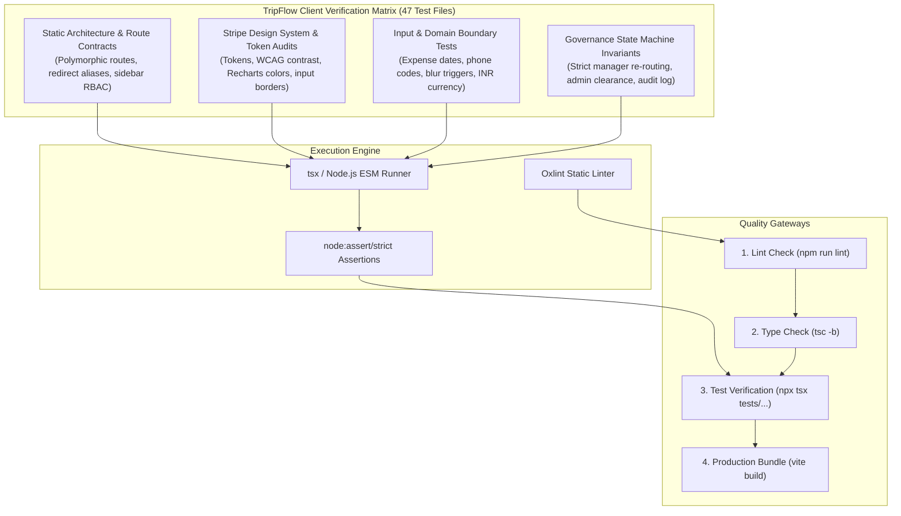

# TripFlow Client Migrations & Testing Architecture

This document outlines the testing methodology, automated test suites, testing execution pipelines, and major architectural migrations implemented in the **TripFlow Web Client**.

---

## 🏛️ Verification Philosophy

The TripFlow client operates on an automated testing philosophy: **zero-overhead, deterministic, high-speed contract and DOM verification**.

Rather than relying on heavy, slow headless browser runtimes for standard regressions, TripFlow leverages native **Node.js ESM test suites** (`node:assert/strict`, `node:fs`, `node:path`) executed directly via `tsx`. This enables:
1. **Sub-second test runs**: Running 45+ comprehensive suites in less than 3 seconds.
2. **Static AST & Regex Contract Auditing**: Enforcing UI constraints, route consolidation, token usage, and layout invariants across all source files before runtime.
3. **Deterministic State Invariant Testing**: Form validation, date boundaries, status transitions, and international currency formats are rigorously asserted against discrete unit matrices.



---

## 🧪 Comprehensive Test Suite Inventory

All client verification suites reside in [client/tests](file:///c:/Users/SudalaimaniKannan/Documents/Codings/Readventure/client/tests). Below is the complete catalog of test suites categorized by functional domain:

### 1. Route Architecture & Polymorphic Consolidation
| Test File | Focus & Verification Criteria |
| :--- | :--- |
| [travel-detail-polymorphic.test.ts](file:///c:/Users/SudalaimaniKannan/Documents/Codings/Readventure/client/tests/travel-detail-polymorphic.test.ts) | Asserts canonical route `/travel/requests/:id`, in-situ mounting of `ManagerDecisionCard` and `AdminClearanceCard`, and verifies legacy redirects. |
| [admin-single-route-revision.test.ts](file:///c:/Users/SudalaimaniKannan/Documents/Codings/Readventure/client/tests/admin-single-route-revision.test.ts) | Verifies Admin single-route revision selection and dispatch controls. |
| [sidebar-nav.test.ts](file:///c:/Users/SudalaimaniKannan/Documents/Codings/Readventure/client/tests/sidebar-nav.test.ts) | Asserts dynamic role navigation items for Employee, Manager, and Admin roles. |
| [scroll-reset.test.ts](file:///c:/Users/SudalaimaniKannan/Documents/Codings/Readventure/client/tests/scroll-reset.test.ts) | Verifies window scroll resets to top (`(0, 0)`) on page transitions. |
| [clone-trip-search.test.ts](file:///c:/Users/SudalaimaniKannan/Documents/Codings/Readventure/client/tests/clone-trip-search.test.ts) | Verifies the trip clone pre-fill action and search dropdown filtering. |

### 2. Governance State Machine & Role Portals
| Test File | Focus & Verification Criteria |
| :--- | :--- |
| [employee-governance-unified.test.ts](file:///c:/Users/SudalaimaniKannan/Documents/Codings/Readventure/client/tests/employee-governance-unified.test.ts) | Verifies employee trips queue, quick metrics calculation, and draft workflows. |
| [manager-governance-unified.test.ts](file:///c:/Users/SudalaimaniKannan/Documents/Codings/Readventure/client/tests/manager-governance-unified.test.ts) | Verifies manager pending audit queue, approval actions, and revision dispatching. |
| [admin-governance-unified.test.ts](file:///c:/Users/SudalaimaniKannan/Documents/Codings/Readventure/client/tests/admin-governance-unified.test.ts) | Verifies admin clearance queue, budget allocation overview, and user directory. |
| [manager-queue.test.ts](file:///c:/Users/SudalaimaniKannan/Documents/Codings/Readventure/client/tests/manager-queue.test.ts) | Asserts correct queue cards, badges, and empty-state indicators for line managers. |
| [admin-queue.test.ts](file:///c:/Users/SudalaimaniKannan/Documents/Codings/Readventure/client/tests/admin-queue.test.ts) | Verifies Tier 2 executive clearance list and payout batch indicators. |
| [view-revisions-action.test.ts](file:///c:/Users/SudalaimaniKannan/Documents/Codings/Readventure/client/tests/view-revisions-action.test.ts) | Tests the direct "Revise & Resubmit" CTA linking to `/travel/requests/:id/edit`. |
| [resubmit-alterations-field.test.ts](file:///c:/Users/SudalaimaniKannan/Documents/Codings/Readventure/client/tests/resubmit-alterations-field.test.ts) | Asserts that employees must provide detailed alteration remarks when resubmitting. |

### 3. Date Boundaries, Calculations & Form Validation
| Test File | Focus & Verification Criteria |
| :--- | :--- |
| [travel-form-date-validation.test.ts](file:///c:/Users/SudalaimaniKannan/Documents/Codings/Readventure/client/tests/travel-form-date-validation.test.ts) | Validates departure and return date relationships (`returnDate >= departureDate`). |
| [expense-date-boundaries.test.ts](file:///c:/Users/SudalaimaniKannan/Documents/Codings/Readventure/client/tests/expense-date-boundaries.test.ts) | Asserts expense receipt dates cannot fall outside `[departureDate, returnDate]`. |
| [travel-dates.test.ts](file:///c:/Users/SudalaimaniKannan/Documents/Codings/Readventure/client/tests/travel-dates.test.ts) | Validates duration computation (`computeTripDuration`) and multi-day spans. |
| [merchant-validation.test.ts](file:///c:/Users/SudalaimaniKannan/Documents/Codings/Readventure/client/tests/merchant-validation.test.ts) | Asserts non-empty merchant strings and sanitization. |
| [expense-amount-input.test.ts](file:///c:/Users/SudalaimaniKannan/Documents/Codings/Readventure/client/tests/expense-amount-input.test.ts) | Asserts positive monetary constraints and decimal precision. |
| [expense-subtotal.test.ts](file:///c:/Users/SudalaimaniKannan/Documents/Codings/Readventure/client/tests/expense-subtotal.test.ts) | Verifies automatic real-time subtotal summation as line items are modified. |
| [form-blur-validation.test.ts](file:///c:/Users/SudalaimaniKannan/Documents/Codings/Readventure/client/tests/form-blur-validation.test.ts) | Asserts Zod validation triggers on field blur (`mode: 'onBlur'`) to prevent typing fatigue. |
| [form-permanent-helper-text.test.ts](file:///c:/Users/SudalaimaniKannan/Documents/Codings/Readventure/client/tests/form-permanent-helper-text.test.ts) | Verifies clean form input design: eliminates bloated redundant helper copy. |
| [form-input-borders.test.ts](file:///c:/Users/SudalaimaniKannan/Documents/Codings/Readventure/client/tests/form-input-borders.test.ts) | Verifies high-contrast border states (`#CBD5E1`) and crimson error states. |
| [auth-validation.test.ts](file:///c:/Users/SudalaimaniKannan/Documents/Codings/Readventure/client/tests/auth-validation.test.ts) | Validates email format, password length, and required sign-in fields. |

### 4. Internationalization & Formatting
| Test File | Focus & Verification Criteria |
| :--- | :--- |
| [currency.test.ts](file:///c:/Users/SudalaimaniKannan/Documents/Codings/Readventure/client/tests/currency.test.ts) | Validates Indian Rupee comma-separation formatting (`₹1,48,000.00`). |
| [country-phone-formats.test.ts](file:///c:/Users/SudalaimaniKannan/Documents/Codings/Readventure/client/tests/country-phone-formats.test.ts) | Tests international country dial code normalization and E.164 phone formats. |
| [country-phone.test.ts](file:///c:/Users/SudalaimaniKannan/Documents/Codings/Readventure/client/tests/country-phone.test.ts) | Verifies country selector dropdown behavior in `PhoneInputWithCountry.tsx`. |

### 5. Stripe Design System & Token Compliance
| Test File | Focus & Verification Criteria |
| :--- | :--- |
| [stripe-theme-tokens.test.ts](file:///c:/Users/SudalaimaniKannan/Documents/Codings/Readventure/client/tests/stripe-theme-tokens.test.ts) | Audits Tailwind CSS v4 `@theme` tokens in `src/index.css`. |
| [stripe-primitives.test.ts](file:///c:/Users/SudalaimaniKannan/Documents/Codings/Readventure/client/tests/stripe-primitives.test.ts) | Audits core primitives (`Button`, `Input`, `Card`, `Badge`) against Stripe tokens. |
| [stripe-contrast-readability.test.ts](file:///c:/Users/SudalaimaniKannan/Documents/Codings/Readventure/client/tests/stripe-contrast-readability.test.ts) | Checks WCAG AA contrast compliance across all foreground/background pairings. |
| [portal-table-contrast.test.ts](file:///c:/Users/SudalaimaniKannan/Documents/Codings/Readventure/client/tests/portal-table-contrast.test.ts) | Ensures data table rows and headers meet high-density enterprise contrast standards. |
| [stripe-chart-colors.test.ts](file:///c:/Users/SudalaimaniKannan/Documents/Codings/Readventure/client/tests/stripe-chart-colors.test.ts) | Asserts Recharts color palettes use approved Stripe Blurple and semantic tokens. |
| [stripe-residual-audit.test.ts](file:///c:/Users/SudalaimaniKannan/Documents/Codings/Readventure/client/tests/stripe-residual-audit.test.ts) | Scans for deprecated arbitrary Tailwind classes (e.g., washed-out purple gradients). |
| [travel-badge.test.ts](file:///c:/Users/SudalaimaniKannan/Documents/Codings/Readventure/client/tests/travel-badge.test.ts) | Verifies the 10 distinct status badge colors, dot indicators, and typography. |
| [travel-metrics-grid.test.ts](file:///c:/Users/SudalaimaniKannan/Documents/Codings/Readventure/client/tests/travel-metrics-grid.test.ts) | Asserts metric card values, monotonic spacing, and typography. |
| [kpi-card-compact-height.test.ts](file:///c:/Users/SudalaimaniKannan/Documents/Codings/Readventure/client/tests/kpi-card-compact-height.test.ts) | Asserts compact layout height to maximize vertical data density. |

### 6. Analytics, Budgets & Proof Attachments
| Test File | Focus & Verification Criteria |
| :--- | :--- |
| [budget-analytics.test.ts](file:///c:/Users/SudalaimaniKannan/Documents/Codings/Readventure/client/tests/budget-analytics.test.ts) | Verifies headroom math: `availableHeadroom = totalAllocation - utilizedAmount`. |
| [department-budget-redesign.test.ts](file:///c:/Users/SudalaimaniKannan/Documents/Codings/Readventure/client/tests/department-budget-redesign.test.ts) | Validates department budget card presentation and warning thresholds. |
| [department-category-pie-chart.test.ts](file:///c:/Users/SudalaimaniKannan/Documents/Codings/Readventure/client/tests/department-category-pie-chart.test.ts) | Verifies category breakdown donut chart data mapping and legends. |
| [department-budget-scroll.test.ts](file:///c:/Users/SudalaimaniKannan/Documents/Codings/Readventure/client/tests/department-budget-scroll.test.ts) | Tests horizontal overflow handling in multi-quarter budget tables. |
| [employee-spend-analytics.test.ts](file:///c:/Users/SudalaimaniKannan/Documents/Codings/Readventure/client/tests/employee-spend-analytics.test.ts) | Verifies personal spend velocity charts and category allocations. |
| [manager-team-analytics.test.ts](file:///c:/Users/SudalaimaniKannan/Documents/Codings/Readventure/client/tests/manager-team-analytics.test.ts) | Asserts manager team spend metrics and quarterly projection graphs. |
| [proof-attachment-form.test.ts](file:///c:/Users/SudalaimaniKannan/Documents/Codings/Readventure/client/tests/proof-attachment-form.test.ts) | Tests multi-proof attachment upload input and file size / format guards. |
| [proof-inspector-viewer.test.ts](file:///c:/Users/SudalaimaniKannan/Documents/Codings/Readventure/client/tests/proof-inspector-viewer.test.ts) | Verifies modal lightbox viewer for PDF documents and image receipts. |
| [proof-attachment-preview-download.test.ts](file:///c:/Users/SudalaimaniKannan/Documents/Codings/Readventure/client/tests/proof-attachment-preview-download.test.ts) | Asserts thumbnail rendering and secure file download URLs. |

### 7. User Governance & Administration
| Test File | Focus & Verification Criteria |
| :--- | :--- |
| [users-management.test.ts](file:///c:/Users/SudalaimaniKannan/Documents/Codings/Readventure/client/tests/users-management.test.ts) | Asserts user provisioning schema, department selection, and role gates. |
| [admin-toggle-ui.test.ts](file:///c:/Users/SudalaimaniKannan/Documents/Codings/Readventure/client/tests/admin-toggle-ui.test.ts) | Tests user active/inactive status toggle switch and state persistence. |
| [avatar-initial.test.ts](file:///c:/Users/SudalaimaniKannan/Documents/Codings/Readventure/client/tests/avatar-initial.test.ts) | Verifies user avatar initials generation algorithm (`"Jane Doe" -> "JD"`). |
| [refresh-button.test.ts](file:///c:/Users/SudalaimaniKannan/Documents/Codings/Readventure/client/tests/refresh-button.test.ts) | Verifies queue manual refresh button and loading spinner state. |

---

## 🏃 Test Execution Workflows

### Running an Individual Test
Execute any test suite directly from the `client/` root using `tsx`:
```bash
cd client
npx tsx tests/travel-detail-polymorphic.test.ts
npx tsx tests/stripe-contrast-readability.test.ts
```

### Running the Entire Verification Matrix
Execute all client test suites sequentially via PowerShell:
```powershell
Get-ChildItem -Path tests/*.test.ts | ForEach-Object {
    Write-Host "Running $($_.Name)..." -ForegroundColor Cyan
    npx tsx $_.FullName
    if ($LASTEXITCODE -ne 0) { throw "Test failed: $($_.Name)" }
}
Write-Host "All client verification suites passed!" -ForegroundColor Green
```

### Static Linting with Oxlint
```bash
npm run lint
```
*Note: Configured via [client/.oxlintrc.json](file:///c:/Users/SudalaimaniKannan/Documents/Codings/Readventure/client/.oxlintrc.json).*

### Typechecking & Production Build
```bash
npm run build
```
Executes `tsc -b` followed by `vite build` into `dist/`.

---

## 🚀 Major Client Migrations

### 1. React 18 to React 19 Migration
* **Concurrent Features**: Fully compatible with React 19.3.1.
* **Ref as a Prop**: Refactored standard UI components to accept `ref` directly without wrapping in `React.forwardRef`.
* **Hydration Protection**: Eliminates DOM mismatch issues during optimistic authentication hydration.

### 2. Tailwind CSS v3 to Tailwind CSS v4 Engine
* **Vite Native Plugin**: Replaced `postcss.config.js` and `tailwind.config.js` with `@tailwindcss/vite` inside [client/vite.config.ts](file:///c:/Users/SudalaimaniKannan/Documents/Codings/Readventure/client/vite.config.ts).
* **Pure CSS `@theme` Tokens**: Configured entirely in [client/src/index.css](file:///c:/Users/SudalaimaniKannan/Documents/Codings/Readventure/client/src/index.css).
* **Sub-millisecond HMR**: Ultra-fast hot module replacement during development.

### 3. React Router v6 to React Router v7
* **Modern Routing Engine**: Upgraded to `react-router-dom` v7.18.5 in [client/src/routes/AppRoutes.tsx](file:///c:/Users/SudalaimaniKannan/Documents/Codings/Readventure/client/src/routes/AppRoutes.tsx).
* **Code Splitting via React.lazy**: Workstation bundles (`NewTravelRequestPage`, `TravelDetailPage`, `NewUserPage`) are lazily loaded with `<Suspense>`.

### 4. Polymorphic Route Consolidation
* **Legacy Architecture**: Previously had separate full-page review routes (`AdminClearancePage.tsx` and `ManagerAuditPage.tsx`).
* **Consolidated Architecture**: Unified into a single **Polymorphic Workstation** [client/src/features/travel/pages/TravelDetailPage.tsx](file:///c:/Users/SudalaimaniKannan/Documents/Codings/Readventure/client/src/features/travel/pages/TravelDetailPage.tsx).
* **Backwards Compatibility**: Preserved legacy URLs (`/travel/audit/:id` and `/travel/clearance/:id`) with transparent redirects to `/travel/requests/:id`.

### 5. Form UX Evolution: Clean Input Standard
* **Commit**: `b12005a refactor(forms): clean input fields with validation errors only`
* **Change**: Removed cluttered persistent helper copy beneath form inputs.
* **Behavior**: Inputs maintain a clean, uncluttered layout with high-visibility slate borders (`#CBD5E1`), displaying validation messages strictly when validation errors occur on blur or submission.

---

## ✍️ How to Author a New Client Test

When introducing new UI components, validation logic, or routes, follow this standard test template:

```typescript
// client/tests/my-new-feature.test.ts
import assert from 'node:assert/strict';
import fs from 'node:fs';
import path from 'node:path';

async function run() {
  console.log('🧪 Testing My New Feature...');

  const clientSrc = path.resolve(import.meta.dirname, '../src');

  // 1. Static Contract Check
  const componentSource = fs.readFileSync(
    path.join(clientSrc, 'features/travel/components/MyNewComponent.tsx'),
    'utf8'
  );
  assert.ok(
    componentSource.includes('formatINR'),
    'Component must use standardized formatINR for currency display'
  );

  // 2. Logic & Boundary Verification
  const testInput = { amount: 15000 };
  assert.equal(testInput.amount > 0, true, 'Amount must be strictly positive');

  console.log('✅ My New Feature verification passed successfully!\n');
}

run().catch((err) => {
  console.error('❌ Test failed:', err);
  process.exit(1);
});
```
Execute with:
```bash
npx tsx tests/my-new-feature.test.ts
```
