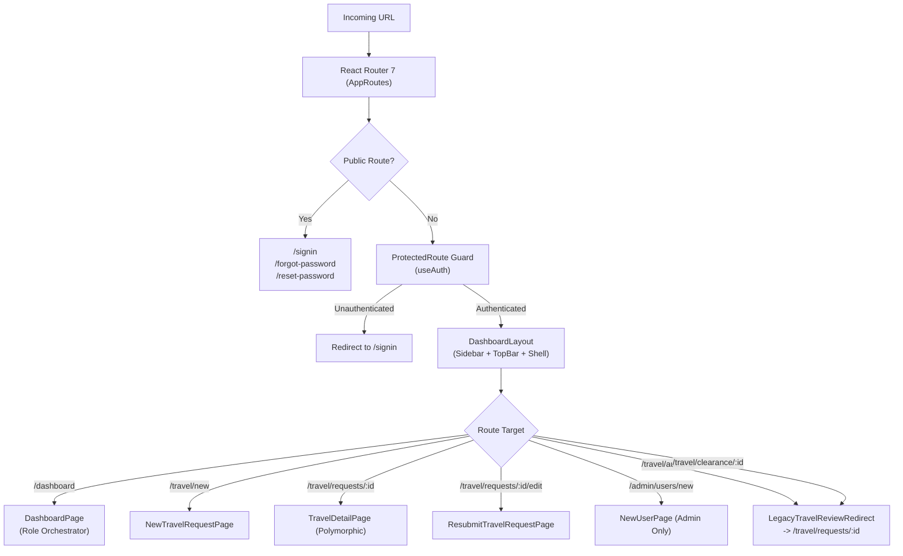

# TripFlow Client Routing & RBAC Architecture

This document describes the client-side routing model, code-splitting strategy, Role-Based Access Control (RBAC) gates, and dynamic workspace orchestration in the **TripFlow Web Client**.

---

## 🗺️ Route Architecture Overview

The TripFlow routing engine is powered by [React Router v7](https://reactrouter.com/) and configured in [client/src/routes/AppRoutes.tsx](file:///c:/Users/SudalaimaniKannan/Documents/Codings/Readventure/client/src/routes/AppRoutes.tsx).

The application divides paths into three distinct tiers:
1. **Public Authentication Routes**: Sign-in, password reset request, and password reset completion.
2. **Protected Workstations**: Wrapped by `<ProtectedRoute />` and the unified `<DashboardLayout />`.
3. **Legacy Aliases & Redirects**: Transparent backwards-compatibility routes that forward old URL formats to consolidated polymorphic workstations.



---

## 📑 Complete Route Map

| Path | Access Level | Target Component | Description |
| :--- | :--- | :--- | :--- |
| `/signin` | Public | `SignInCard` | User sign-in with email & password. |
| `/signup` | Public | *Redirect* | Automatically redirects to `/signin`. |
| `/forgot-password` | Public | `ForgotPasswordCard` | Request single-use password recovery email. |
| `/reset-password` | Public | `ResetPasswordCard` | Set new password using token from email link. |
| `/dashboard` | Protected (All Roles) | `DashboardPage` | Orchestrates role-specific portals and tabs. |
| `/travel/new` | Protected (`EMPLOYEE`) | `NewTravelRequestPage` | Create pre-trip quote request or post-trip reimbursement. |
| `/travel/requests/:id` | Protected (All Roles) | `TravelDetailPage` | Consolidated detail workstation with role-gated audit triggers. |
| `/travel/requests/:id/edit`| Protected (`EMPLOYEE`) | `ResubmitTravelRequestPage`| Employee resubmission workstation for revision requests. |
| `/travel/audit/:id` | Protected (`MANAGER`) | *Redirect* | Legacy alias redirecting to `/travel/requests/:id`. |
| `/travel/clearance/:id` | Protected (`ADMIN`) | *Redirect* | Legacy alias redirecting to `/travel/requests/:id`. |
| `/admin/users/new` | Protected (`ADMIN`) | `NewUserPage` | Admin provisioning portal for creating corporate accounts. |
| `/` | Protected | *Redirect* | Redirects to `/dashboard`. |
| `*` | Any | *Redirect* | Catch-all redirect to `/dashboard`. |

---

## 🛡️ Access Control & RBAC Gates

### 1. The `ProtectedRoute` Guard ([src/routes/ProtectedRoute.tsx](file:///c:/Users/SudalaimaniKannan/Documents/Codings/Readventure/client/src/routes/ProtectedRoute.tsx))

`<ProtectedRoute />` inspects the authenticated session managed by `AuthContext`:

```tsx
export const ProtectedRoute: React.FC = () => {
  const { isAuthenticated, isLoading } = useAuth();

  if (isLoading) {
    return (
      <div className="min-h-screen flex items-center justify-center bg-[#F2F7FE]">
        <div className="text-sm font-medium text-[#50617A]">Loading TripFlow workspace...</div>
      </div>
    );
  }

  if (!isAuthenticated) {
    return <Navigate to="/signin" replace />;
  }

  return <Outlet />;
};
```

#### Hydration & Zero-PII Session Hint:
To prevent authentication flickers or layout shifts on initial page load, `AuthContext` initializes `isLoading` by reading a zero-PII boolean hint (`tripflow_has_session`) in `localStorage`. If `1`, it displays the clean loading placeholder while `/auth/me` verifies the HttpOnly cookie.

---

### 2. Dynamic Role Dashboard Orchestration ([src/features/dashboard/DashboardPage.tsx](file:///c:/Users/SudalaimaniKannan/Documents/Codings/Readventure/client/src/features/dashboard/DashboardPage.tsx))

Rather than fracturing the application across disparate URLs, `/dashboard` dynamically resolves the user's role and renders their appropriate command center:

```tsx
const defaultTab =
  user?.role === 'ADMIN' ? 'governance' : user?.role === 'MANAGER' ? 'team' : 'trips';
const activeTab = searchParams.get('tab') || defaultTab;

switch (user.role) {
  case 'EMPLOYEE':
    return activeTab === 'analytics' ? <EmployeeSpendAnalyticsPage /> : <EmployeeTravelPortal activeTab={activeTab} />;
  case 'MANAGER':
    return activeTab === 'analytics' ? <ManagerTeamAnalyticsPage /> : <ManagerQueuePortal activeTab={activeTab} />;
  case 'ADMIN':
    return <AdminGovernancePortal activeTab={activeTab} />;
}
```

---

### 3. Dynamic Role Sidebar ([src/features/travel/layout/DynamicRoleSidebar.tsx](file:///c:/Users/SudalaimaniKannan/Documents/Codings/Readventure/client/src/features/travel/layout/DynamicRoleSidebar.tsx))

The navigation sidebar automatically adapts its tabs and primary quick-action button based on `user.role`:

#### Navigation Tabs by Role:
* **`EMPLOYEE`**:
  * `trips`: My Travel (`/dashboard?tab=trips`)
  * `analytics`: Spend Analytics (`/dashboard?tab=analytics`)
  * **Quick Action**: *New Travel Request* $\rightarrow$ `/travel/new`
* **`MANAGER`**:
  * `team`: Team Approvals (`/dashboard?tab=team`)
  * `analytics`: Team Analytics (`/dashboard?tab=analytics`)
  * `personal`: My Travel (`/dashboard?tab=personal`)
  * **Quick Action**: *New Travel Request* $\rightarrow$ `/travel/new`
* **`ADMIN`**:
  * `governance`: Travel Governance (`/dashboard?tab=governance`)
  * `budgets`: Department Budgets (`/dashboard?tab=budgets`)
  * `users`: Team & Access (`/dashboard?tab=users`)
  * **Quick Action**: *Add Member* $\rightarrow$ `/admin/users/new`

---

## ⚡ Performance & Code Splitting

### Named Export Code Splitting (`lazyNamed`)
TripFlow utilizes a custom `lazyNamed` helper to ensure proper tree-shaking and on-demand chunk loading for named exports:

```tsx
function lazyNamed<T extends Record<string, any>, K extends keyof T>(
  loader: () => Promise<T>,
  exportName: K,
) {
  return lazy(() => loader().then((mod) => ({ default: mod[exportName] as React.ComponentType<any> })));
}
```

### Route-Level Scroll Restoration (`ScrollToTop`)
When navigating between workstations or switching tabs via query parameters, `ScrollToTop` automatically resets viewport scroll positions:

```tsx
const ScrollToTop: React.FC = () => {
  const { pathname, search } = useLocation();
  useEffect(() => {
    window.scrollTo({ top: 0, left: 0, behavior: 'auto' });
  }, [pathname, search]);
  return null;
};
```
