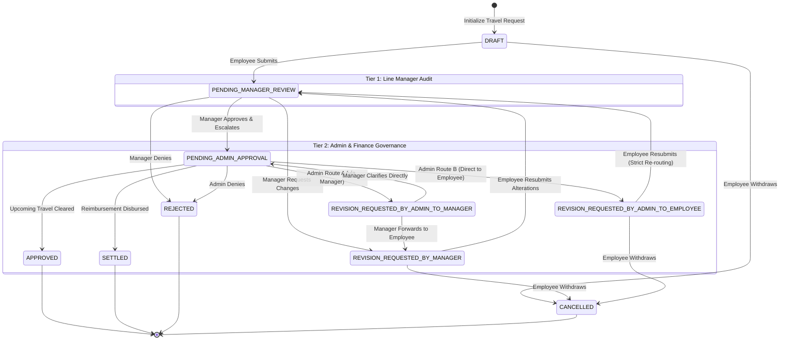
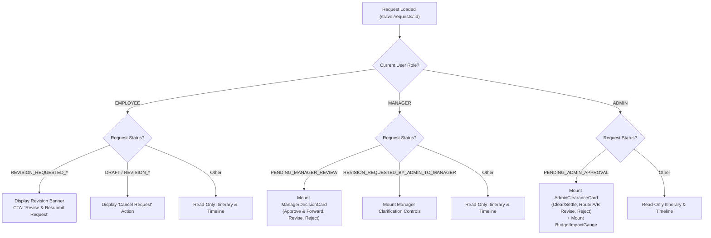

# TripFlow Client Governance State Machine

This document defines the two-tier governance finite state machine (FSM), state definitions, UI badge semantics, operational lifecycles, and client orchestration implemented in the **TripFlow Web Client**.

---

## 🧭 Governance State Machine Overview

TripFlow implements an auditable, multi-tier state machine to enforce corporate travel authorization, manager operational review, and executive financial clearance.

The platform distinguishes between two operational lifecycles:
1. **Upcoming Travel (`UPCOMING`)**: Pre-trip authorization and estimated budget approval, terminating in **`APPROVED`**.
2. **Already Travelled (`ALREADY_TRAVELLED`)**: Post-trip expense reimbursement backed by proof receipts, terminating in **`SETTLED`**.



---

## 🏷️ Complete State Catalog & UI Semantics

Configured in [client/src/features/travel/components/TravelStatusBadge.tsx](file:///c:/Users/SudalaimaniKannan/Documents/Codings/Readventure/client/src/features/travel/components/TravelStatusBadge.tsx).

| State Enum | Label in UI | Target Role | Visual Badge Styling | Dot Indicator | Operational Meaning |
| :--- | :--- | :--- | :--- | :--- | :--- |
| **`DRAFT`** | Draft | Requester | `border-border-warm bg-canvas text-muted` | Slate (`bg-muted`) | Request saved locally; not yet submitted for review. |
| **`PENDING_MANAGER_REVIEW`** | Pending Manager Review | Line Manager | `border-amber-200 bg-amber-50/80 text-amber-800` | Amber (`bg-amber-500`) | Submitted by employee; awaiting Tier 1 manager operational audit. |
| **`REVISION_REQUESTED_BY_MANAGER`** | Revision Required (Manager) | Requester | `border-orange-200 bg-orange-50/80 text-orange-900` | Stripe Amber (`bg-[#FF6118]`) | Manager requested modifications to itinerary, expenses, or quotes. |
| **`PENDING_ADMIN_APPROVAL`** | Pending Admin Clearance | Admin / Finance | `border-sky-200 bg-sky-50/80 text-sky-800` | Sky Blue (`bg-sky-500`) | Approved by manager; awaiting Tier 2 financial clearance & budget check. |
| **`REVISION_REQUESTED_BY_ADMIN_TO_MANAGER`** | Admin Revision (via Manager) | Line Manager | `border-orange-200 bg-orange-50/80 text-orange-900` | Stripe Amber (`bg-[#FF6118]`) | Admin requested clarification from Line Manager (**Route A**). |
| **`REVISION_REQUESTED_BY_ADMIN_TO_EMPLOYEE`**| Admin Revision (Direct) | Requester | `border-orange-200 bg-orange-50/80 text-orange-900` | Stripe Amber (`bg-[#FF6118]`) | Admin requested alterations directly from employee (**Route B**). |
| **`APPROVED`** | Approved | *Terminal* | `border-emerald-200 bg-emerald-50/80 text-emerald-800` | Stripe Emerald (`bg-[#00D66F]`) | Final clearance granted for upcoming travel; employee may book travel. |
| **`SETTLED`** | Settled (Paid) | *Terminal* | `border-emerald-200 bg-emerald-50/80 text-emerald-800` | Stripe Emerald (`bg-[#00D66F]`) | Past travel reimbursement authorized and funds disbursed. |
| **`REJECTED`** | Rejected | *Terminal* | `border-red-200 bg-red-50/80 text-red-800` | Crimson (`bg-red-500`) | Denied by Manager or Admin; cannot be resubmitted. |
| **`CANCELLED`** | Cancelled | *Terminal* | `border-slate-200 bg-slate-100 text-slate-600` | Faint Slate (`bg-slate-400`) | Withdrawn by requester while in draft or revision state. |

---

## 🔒 The Strict Manager Re-routing Invariant

A foundational business rule in TripFlow governance is the **Strict Manager Re-routing Invariant**:

> [!IMPORTANT]
> When an Administrator requests revisions directly from an employee (**Route B**: `REVISION_REQUESTED_BY_ADMIN_TO_EMPLOYEE`), the altered request **MUST return to the Line Manager first** (`PENDING_MANAGER_REVIEW`) upon resubmission.
> 
> Direct employee-to-admin bypass (`REVISION_REQUESTED_BY_ADMIN_TO_EMPLOYEE -> PENDING_ADMIN_APPROVAL`) is strictly forbidden by both the client form orchestrator and the backend state validator.

### Why This Invariant Matters
1. **Departmental Accountability**: A line manager owns their department's travel logistics and headcount. If an employee alters flight dates, destinations, or expense totals in response to Admin feedback, the manager must verify that the operational schedule remains valid.
2. **Anti-Collusion & Separation of Duties**: Prevents employees from circumventing direct supervisory oversight to obtain executive financial clearance.
3. **Automated Verification**: Enforced on the client and continuously validated by the test suite [client/tests/admin-single-route-revision.test.ts](file:///c:/Users/SudalaimaniKannan/Documents/Codings/Readventure/client/tests/admin-single-route-revision.test.ts).

---

## 🎛️ Polymorphic Workstation Orchestration (`TravelDetailPage.tsx`)

In [client/src/features/travel/pages/TravelDetailPage.tsx](file:///c:/Users/SudalaimaniKannan/Documents/Codings/Readventure/client/src/features/travel/pages/TravelDetailPage.tsx), the client dynamically orchestrates available actions based on `(status, userRole, travelType)`:



### 1. In-Situ Audit Cards
* **`ManagerDecisionCard.tsx`**:
  - Mounted when `isManagerAuditEligible && !isOwner`.
  - Provides quick action triggers:
    - **Approve & Forward**: Advances request to `PENDING_ADMIN_APPROVAL`.
    - **Request Revision**: Prompts for required alterations remarks; updates to `REVISION_REQUESTED_BY_MANAGER`.
    - **Reject**: Records mandatory denial reason; terminates in `REJECTED`.
* **`AdminClearanceCard.tsx`**:
  - Mounted when `isAdminClearanceEligible && !isOwner`.
  - Integrates `DualRouteSelector.tsx` to choose between:
    - **Route A**: Via Line Manager (`REVISION_REQUESTED_BY_ADMIN_TO_MANAGER`).
    - **Route B**: Direct to Employee (`REVISION_REQUESTED_BY_ADMIN_TO_EMPLOYEE`).
  - Terminal actions:
    - **Clear Request**: Updates to `APPROVED` (for `UPCOMING` trips).
    - **Disburse Payout**: Updates to `SETTLED` (for `ALREADY_TRAVELLED` claims).
* **`BudgetImpactGauge.tsx`**:
  - Displays departmental budget allocation, current spent percentage, and real-time available headroom before granting approval.

---

## 📜 Immutable Audit Ledger & Timeline Serialization

Every state transition is tracked in an append-only timeline rendered by [client/src/features/travel/components/audit/AuditTimelineLog.tsx](file:///c:/Users/SudalaimaniKannan/Documents/Codings/Readventure/client/src/features/travel/components/audit/AuditTimelineLog.tsx).

### 1. Timeline Event Interface (`TravelTimelineEvent`)
```typescript
export interface TravelTimelineEvent {
  id: string;
  travelRequestId?: string;
  actorId?: string;
  actorRole?: 'EMPLOYEE' | 'MANAGER' | 'ADMIN' | string;
  actorName?: string;
  eventType?: string;
  fromStatus?: string | null;
  toStatus?: string;
  remarks?: string | null;
  createdAt?: string;
}
```

### 2. Timeline Visualization
* **Chronological Flow**: Events are sorted chronologically from submission to terminal state.
* **Actor Badges**: Clear visual tags identifying whether an action was taken by an `EMPLOYEE`, `MANAGER`, or `ADMIN`.
* **Status Badges**: Shows the previous status transitioning to the new status via arrow indicator (`PENDING_MANAGER_REVIEW → PENDING_ADMIN_APPROVAL`).
* **Remarks & Directives**: Reviewer notes, revision instructions, or employee alteration summaries are prominently displayed within high-contrast callout boxes.
