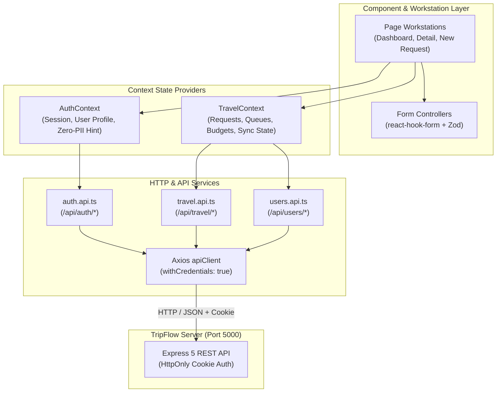
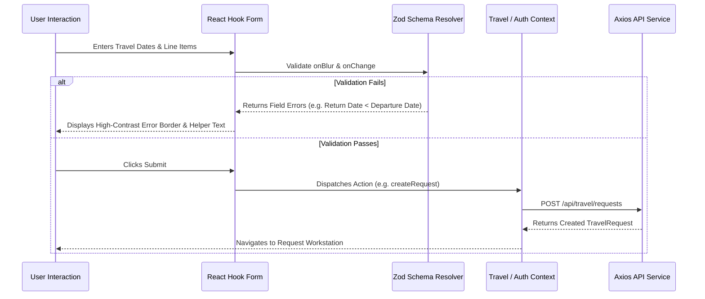

# TripFlow Client State Management & Data Fetching

This document describes the state management architecture, React Context boundaries, form validation pipelines, and HTTP data fetching patterns implemented in the **TripFlow Web Client**.

---

## 🏛️ State Architecture Overview

TripFlow balances local UI state and application-level domain state using a modular React Context architecture:



---

## 🔐 1. Authentication State (`AuthContext.tsx`)

Managed in [client/src/features/auth/context/AuthContext.tsx](file:///c:/Users/SudalaimaniKannan/Documents/Codings/Readventure/client/src/features/auth/context/AuthContext.tsx).

### State Shape
```typescript
export interface AuthContextType {
  user: User | null;
  isAuthenticated: boolean;
  isLoading: boolean;
  isAuthenticating: boolean;
  authError: string | null;
  clearAuthError: () => void;
  signin: (credentials: LoginCredentials) => Promise<void>;
  signup: (credentials: RegisterCredentials) => Promise<void>;
  signout: () => Promise<void>;
}
```

### Zero-PII Session Hint Strategy
To prevent blank screens or unexpected redirects on page refresh without exposing personal data:
* Upon successful authentication, a flag `tripflow_has_session = '1'` is saved in `window.localStorage`.
* On initialization, `isLoading` defaults to `true` if and only if `tripflow_has_session === '1'`.
* The client performs a background `GET /auth/me` request:
  - If valid: Hydrates `user` state and keeps `isAuthenticated: true`.
  - If invalid (or cookie expired): Clears `tripflow_has_session` and sets `user: null`.
* This guarantees immediate loading states without unauthenticated flash of protected content.

---

## ✈️ 2. Travel Governance State (`TravelContext.tsx`)

Managed in [client/src/features/travel/context/TravelContext.tsx](file:///c:/Users/SudalaimaniKannan/Documents/Codings/Readventure/client/src/features/travel/context/TravelContext.tsx).

### State Shape
```typescript
export interface TravelContextType {
  requests: TravelRequest[];
  selectedRequest: TravelRequest | null;
  managerQueue: TravelRequest[];
  adminQueue: TravelRequest[];
  budget: DepartmentBudget | null;
  budgetOverview: DepartmentBudgetOverview | null;
  isLoading: boolean;
  isRefreshing: boolean;
  lastSyncedAt: Date | null;
  error: string | null;
  clearError: () => void;

  // Actions
  loadRequests: (statusFilter?: TravelStatus) => Promise<void>;
  loadRequestDetails: (id: string) => Promise<TravelRequest>;
  loadManagerQueue: () => Promise<void>;
  loadAdminQueue: () => Promise<void>;
  loadBudget: (department?: string, year?: number, quarter?: string) => Promise<void>;
  loadBudgetOverview: (year?: number, quarter?: string) => Promise<void>;
  saveBudgetAllocation: (input: UpsertBudgetInput) => Promise<DepartmentBudget>;
  refresh: (scope?: RefreshScope, id?: string) => Promise<void>;
  createRequest: (input: CreateTravelRequestInput) => Promise<TravelRequest>;
  reviewAsManager: (id: string, input: ManagerReviewInput) => Promise<TravelRequest>;
  reviewAsAdmin: (id: string, input: AdminReviewInput) => Promise<TravelRequest>;
  resubmitRequest: (id: string, input: ResubmitRequestInput) => Promise<TravelRequest>;
  cancelRequest: (id: string, remarks?: string) => Promise<TravelRequest>;
}
```

### Granular Refresh Scoping (`RefreshScope`)
The `refresh()` action allows surgical re-fetching of queues without triggering full-application refetches:
* `'EMPLOYEE'`: Re-fetches the user's travel requests.
* `'MANAGER'`: Re-fetches the direct report approval queue.
* `'ADMIN'`: Re-fetches the corporate clearance ledger and budget summaries.
* `'DETAIL'`: Re-fetches a specific travel request by ID and refreshes its audit timeline.
* `'ALL'`: Re-syncs all queues and updates `lastSyncedAt`.

---

## 📋 3. Form State & Schema Validation Pipeline

Form handling uses [React Hook Form](https://react-hook-form.com/) combined with [Zod](https://zod.dev/) schemas through `@hookform/resolvers/zod`.

### Form Validation Architecture



### Core Form Invariants Enforced by Zod:
1. **Travel Date Boundaries**:
   * For **Upcoming Travel**: Departure date cannot be in the past (`departure_date >= today`).
   * For **All Travel**: Return date must be equal to or later than departure date (`return_date >= departure_date`).
   * For **Expense Items**: Each expense date must fall strictly within the trip's start and end date boundaries.
2. **Dynamic Expense Line Items**:
   * Minimum of 1 line item required.
   * Merchant name cannot be empty.
   * Expense amounts must be positive numbers formatted in Indian Rupees (`INR` / `₹`).
   * Dynamic subtotals automatically calculated and validated against `total_expenses`.
3. **Multi-Proof Attachments**:
   * Quotas and receipts uploaded to Cloudinary or linked as URLs.
   * Minimum 1 proof required for pre-trip flights/hotels and post-trip reimbursements.
4. **Resubmission Alterations**:
   * When resubmitting changes, an employee must provide non-empty alteration remarks explaining modifications made in response to reviewer comments.

---

## 🌐 4. HTTP Client Configuration (`apiClient`)

Located in [client/src/features/auth/services/auth.api.ts](file:///c:/Users/SudalaimaniKannan/Documents/Codings/Readventure/client/src/features/auth/services/auth.api.ts) and shared across all feature services:

```typescript
import axios from 'axios';

export const apiClient = axios.create({
  baseURL: 'http://localhost:5000/api',
  headers: {
    'Content-Type': 'application/json',
  },
  // Automatically attaches HttpOnly cookies (token) on all requests
  withCredentials: true,
});
```

### Standardized Error Normalization
All API services normalize errors using a consistent helper to guarantee human-readable error messages in the UI:

```typescript
private handleError(err: unknown, defaultMessage: string): never {
  if (isAxiosError(err)) {
    const responseData = err.response?.data as ApiResponse | undefined;
    const message = responseData?.message || err.message || defaultMessage;
    throw new Error(message);
  }
  if (err instanceof Error) {
    throw err;
  }
  throw new Error(defaultMessage);
}
```
