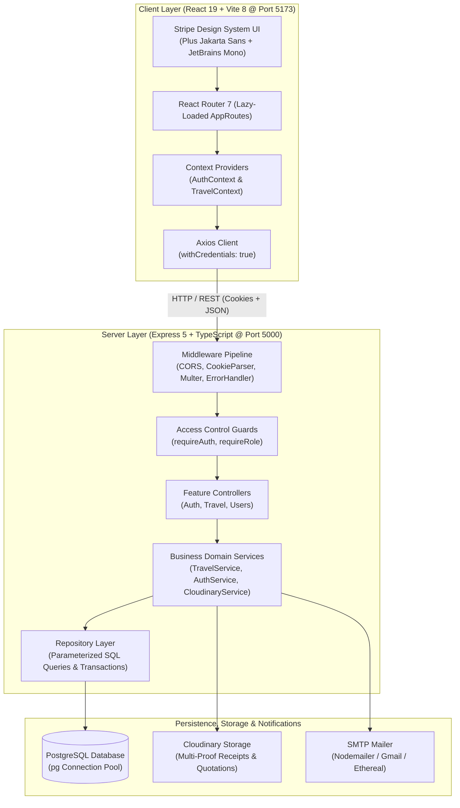
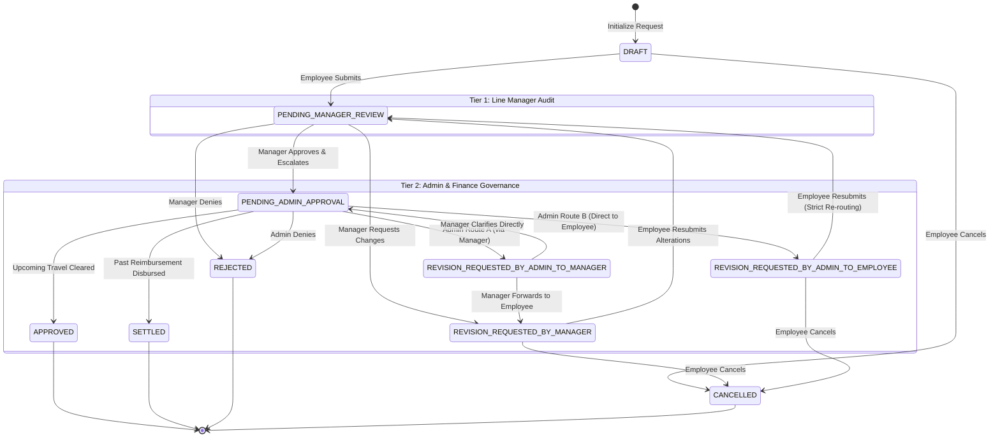
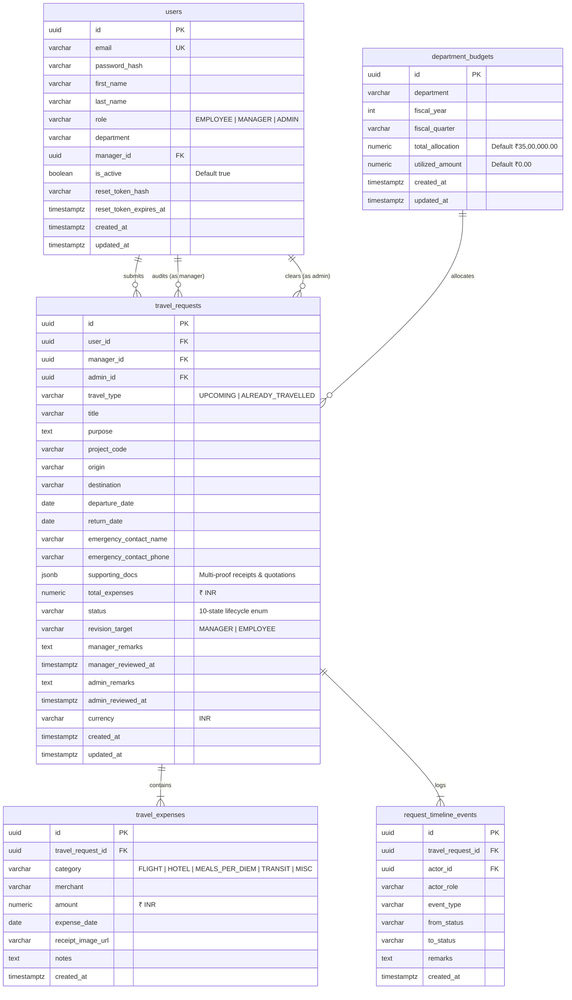
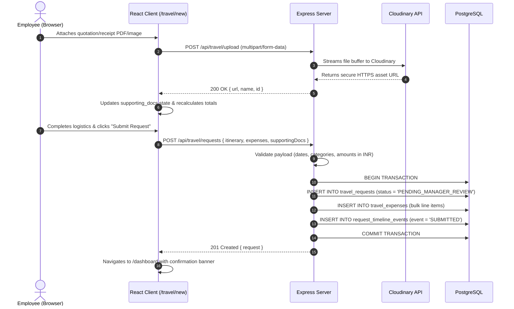
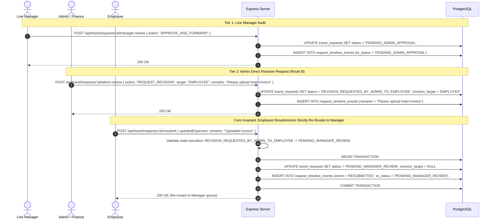

# TripFlow Full-Stack Architecture

This document describes the end-to-end system architecture, two-tier governance state machine, database schemas, security model, and component lifecycles for the **TripFlow** Corporate Travel & Expense Governance platform.

---

## 🏛️ System Overview & High-Level Topology

TripFlow is an enterprise-grade corporate travel authorization, manager audit, and expense governance platform. It couples a responsive client built with **React 19**, **Vite 8**, **Tailwind CSS v4**, and the **Stripe Design System** to a modular backend service powered by **Node.js**, **Express 5**, **TypeScript**, and **PostgreSQL**.



---

## 🧭 Two-Tier Governance State Machine & Core Invariants

TripFlow implements an auditable two-tier state machine to enforce corporate spending policy, manager operational oversight, and executive financial clearance.

### Dual Operational Lifecycles
The system accommodates two distinct travel cases with differentiated terminal states:
1. **Case 1: Upcoming Travel (Pre-Trip Clearance)**:
   - Employees submit proposed itineraries, business justifications, and itemized estimated expenses accompanied by quotation proofs.
   - Approval by Tier 1 (Line Manager) and Tier 2 (Admin) grants travel clearance, resulting in the terminal state `APPROVED`.
2. **Case 2: Already Travelled (Post-Trip Reimbursement)**:
   - Employees submit completed trip details, actual expenses incurred, and proof receipts.
   - Verification through both tiers authorizes financial payout, resulting in the terminal state `SETTLED`.



### Core Architectural Invariants
1. **Strict Manager Re-routing Invariant**:
   - When an Admin requests revisions directly from an employee (**Route B**: `REVISION_REQUESTED_BY_ADMIN_TO_EMPLOYEE`), upon resubmission, the request **MUST return to the Line Manager first** (`PENDING_MANAGER_REVIEW`).
   - An employee can **never bypass** their direct manager directly to Admin review. The state transition `REVISION_REQUESTED_BY_ADMIN_TO_EMPLOYEE -> PENDING_ADMIN_APPROVAL` is strictly forbidden by the domain state validator.
2. **Immutable Audit Ledger**:
   - Every state transition, reviewer comment, and rejection reason is appended to `request_timeline_events`. Existing events cannot be altered or deleted.
3. **Budget Headroom Validation**:
   - When reviewing requests, admins evaluate real-time utilization against quarterly departmental budgets (`department_budgets`), ensuring allocation ceilings are maintained.
4. **Currency Standardization**:
   - All financial figures are denominated in Indian Rupees (`INR` / `₹`) and rendered using monospace tabular numbers (`font-mono tabular-nums`).

---

## 📂 Frontend Layer Architecture (`client/src/`)

The client is built using a **Feature-Sliced Architecture** with strict modular isolation:

```
client/src/
├── features/
│   ├── auth/                                    # Authentication & Recovery Module
│   │   ├── components/                          # SignInCard, ForgotPasswordCard, ResetPasswordCard, PasswordStrengthMeter
│   │   ├── context/                             # AuthContext & Session Provider
│   │   ├── hooks/                               # useAuth hook
│   │   ├── schemas/                             # Zod validation schemas
│   │   └── services/                            # Axios API client (authApi)
│   ├── dashboard/                               # Dynamic Role Dashboard
│   │   ├── utils/                               # Avatar & initial generators
│   │   └── DashboardPage.tsx                    # Role-based workspace switcher (Employee, Manager, Admin)
│   ├── travel/                                  # Corporate Travel & Governance Module
│   │   ├── components/
│   │   │   ├── forms/                           # DynamicExpenseTable, ExpenseRowItem, ProofAttachmentField, PhoneInputWithCountry, CloneTripDropdown
│   │   │   ├── shared/                          # TravelMetricsGrid, RouteLabel, TravelDetailSkeleton, InlineConfirmBar
│   │   │   ├── AdminGovernancePortal.tsx        # Clearance queue, budget metrics, and user management tabs
│   │   │   ├── EmployeeTravelPortal.tsx         # Active trips, draft controls, and spend analytics tabs
│   │   │   ├── ManagerQueuePortal.tsx           # Subordinate review queue and revision dispatch
│   │   │   ├── DepartmentBudgetCard.tsx         # Department quarterly allocation summary
│   │   │   ├── DepartmentCategoryBreakdownCard.tsx # Recharts pie/donut category breakdown
│   │   │   ├── DepartmentSpendersVelocityCard.tsx  # Recharts top spenders bar chart
│   │   │   └── TravelStatusBadge.tsx            # High-contrast status pill badges
│   │   ├── context/                             # TravelContext (active requests, optimistic caching)
│   │   ├── hooks/                               # useTravel custom hook
│   │   ├── layout/                              # DashboardLayout, DynamicRoleSidebar, SidebarNavItem, SidebarUserProfile
│   │   ├── pages/                               # Full-Page Workstations
│   │   │   ├── DepartmentBudgetsPage.tsx        # Multi-quarter department budget workstation
│   │   │   ├── EmployeeSpendAnalyticsPage.tsx   # Employee spend analytics charts
│   │   │   ├── ManagerTeamAnalyticsPage.tsx     # Manager team spend analytics workstation
│   │   │   ├── NewTravelRequestPage.tsx         # Request creation workstation
│   │   │   ├── ResubmitTravelRequestPage.tsx     # Request revision workstation
│   │   │   └── TravelDetailPage.tsx             # Detailed inspection & audit workstation
│   │   ├── services/                            # travel.api.ts
│   │   ├── types/                               # TypeScript domain contracts
│   │   └── utils/                               # Currency, dial codes, budget analytics
│   └── users/                                   # User Administration Module
│       ├── components/                          # UserFormModal (create/edit user)
│       ├── pages/                               # AdminUsersPage, NewUserPage
│       ├── schemas/                             # Zod user schemas
│       ├── services/                            # users.api.ts
│       └── utils/                               # User helper formatting functions
├── routes/
│   ├── AppRoutes.tsx                            # Route registration with lazy code splitting
│   └── ProtectedRoute.tsx                       # Session & role route protection gates
├── shared/
│   ├── components/ui/                           # Primitives (button, input, card, alert, chart, label, password-input)
│   └── utils/                                   # cn class merger
├── App.tsx                                      # Root component with AuthProvider & TravelProvider
├── index.css                                    # Tailwind v4 configuration, font imports & Stripe tokens
└── main.tsx                                     # Application bootstrapping
```

### Key Frontend Architectural Patterns
1. **Dynamic Workspace Orchestration (`DashboardPage.tsx`)**:
   Instead of static disjointed pages, `/dashboard` reads the authenticated user's role and dynamically mounts the appropriate workspace (`EmployeeTravelPortal`, `ManagerQueuePortal`, or `AdminGovernancePortal`), supporting tab switches to spend analytics without full page reloads.
2. **Workstation Pattern**:
   Complex multi-step actions (e.g., creating a travel request, resubmitting a revised journey, or provisioning users) are separated into dedicated full-page workstations (`/travel/new`, `/travel/requests/:id/edit`, `/admin/users/new`) to ensure maximum focus and prevent form state loss.
3. **Stripe Design System Tokens**:
   - Palette: Cool canvas (`#F2F7FE`), card surfaces (`#FFFFFF`), primary blurple (`#533AFD`), text ink (`#061B31`), and strong hairline borders (`#CBD5E1`).
   - Typography: **Plus Jakarta Sans** for UI readability and **JetBrains Mono** for financial figures (`INR` / `₹`).
   - 5-tier elevation system (`--shadow-xs` to `--shadow-xl`) and 5 border radii (`--radius-xs` to `--radius-full`).

---

## 🗃️ Backend Layer Architecture (`server/src/`)

The backend follows an enterprise **Controller-Service-Repository** pattern with strict transactional integrity:

```
[Incoming HTTP Request]
         │
         ▼
[Express Router]               --> Verifies path & applies route-specific middleware
         │
         ▼
[Guards & Middleware]          --> requireAuth (JWT verify) & requireRole (RBAC)
         │
         ▼
[Feature Controller]           --> Validates payload with Zod & sends JSON responses
         │
         ▼
[Domain Service]               --> Enforces state machine transitions, business logic & budget checks
         │
         ▼
[Repository Layer]             --> Executes parameterized SQL & database transactions (pg pool)
         │
         ▼
[PostgreSQL Database]          --> Persists entities, constraints, and audit timeline
```

### Middleware Pipeline (`server/src/app.ts`)
- **CORS**: Configured with origin binding and `credentials: true`.
- **Cookie Parser**: Extracts signed `HttpOnly` session tokens.
- **Multer Middleware (`upload.middleware.ts`)**: Handles multipart file uploads in memory for direct streaming to Cloudinary.
- **Centralized Error Handler (`error.middleware.ts`)**: Intercepts unhandled exceptions and formats standard JSON error envelopes.

---

## 🗄️ Database Architecture & Data Schema

TripFlow relies on PostgreSQL 14+ for relational integrity, check constraints, foreign keys, and JSONB indexing:



### Multi-Proof Attachment Hub (`supporting_docs` JSONB)
Rather than limiting requests to a single URL string, migration `003` introduced a `supporting_docs` `JSONB` column indexed via a PostgreSQL **GIN index** (`idx_travel_requests_supporting_docs`). The stored structure follows this contract:

```json
[
  {
    "id": "a5e927c3-3e11-482a-9669-e054f15d9092",
    "type": "FILE",
    "name": "indigo-flight-tax-invoice.pdf",
    "url": "https://res.cloudinary.com/tripflow/image/upload/v12345/proof.pdf",
    "uploadedAt": "2026-11-18T10:00:00.000Z"
  }
]
```

---

## 🔄 End-to-End Sequence Diagrams

### Sequence 1: Travel Request Creation & Multi-Proof Upload



### Sequence 2: Two-Tier Review, Admin Route B Revision, & Strict Re-routing



---

## 🔐 Security, Session & Authorization Model

1. **HttpOnly Cookie Architecture**:
   - Authentication tokens are delivered via `HttpOnly`, `SameSite=Lax` cookies, preventing XSS-based token theft.
   - Cross-Origin Resource Sharing (CORS) is bound to `CLIENT_URL` with credentials explicitly enabled.
2. **Role-Based Access Control (RBAC)**:
   - Routes are gated using `requireAuth` and `requireRole(['MANAGER', 'ADMIN'])` middleware.
   - Users can only view requests they own, requests of subordinates they manage, or all company requests if assigned the `ADMIN` role.
3. **Cryptographic Password Recovery**:
   - Raw tokens are 32-byte cryptographically secure random values (`crypto.randomBytes`).
   - Stored in PostgreSQL strictly as **SHA-256 digests**. A database leak does not expose valid reset tokens.
   - Enforces a 1-hour expiration window and single-use invalidation.
   - Implements anti-enumeration (identical calm response whether the email exists or not).
4. **Governance Lifecycle & Erasure Safeguards**:
   - Accounts carry an `is_active` flag. Deactivated users are blocked by authentication middleware.
   - Admin user deletion requires explicit confirmation and handles database cascading cleanly.

---

## 📊 Complete Technology Matrix

| Concern | Client Layer | Server Layer | Infrastructure / Persistence |
| :--- | :--- | :--- | :--- |
| **Language** | TypeScript 5.8 / 7.0 | TypeScript 5.8.2 | SQL (PostgreSQL 14+) |
| **Framework / Runtime** | React 19.3.1 / Vite 8.3.5 | Express 5.3.0 / Node.js 20+ | Node.js runtime (`tsx`) |
| **Design System & Styling** | Tailwind CSS v4 (Stripe System) | N/A | N/A |
| **Typography** | Plus Jakarta Sans & JetBrains Mono | N/A | Google Fonts Preconnect |
| **Routing** | React Router 7.18.5 | Express Router 5.3.0 | N/A |
| **Data Visualization** | Recharts 3.10.1 | N/A | N/A |
| **Form Validation** | Zod 4.6.7 & React Hook Form | Zod / Type validators | SQL Constraints (`CHECK`, `FK`) |
| **File Storage** | Axios Multipart Upload | Multer 2.5.0 (Memory Stream) | Cloudinary API & Local Disk |
| **Database Access** | Axios REST Client | `pg` 8.13.3 Connection Pool | PostgreSQL 14+ |
| **Authentication** | HttpOnly Cookies & AuthContext | JWT (`jsonwebtoken` 9.0.3) | SHA-256 digested reset tokens |
| **Password Security** | PasswordStrengthMeter component | `bcryptjs` (10 rounds) | Bcrypt hashes in database |
| **Email Service** | N/A | Nodemailer 10.3.1 | SMTP / Gmail / Ethereal |
| **Testing Engine** | Standalone assertion suites | TSX assertion test suites | 47 FSM & validation tests |
