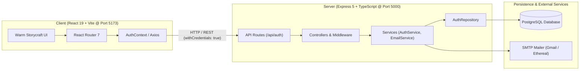
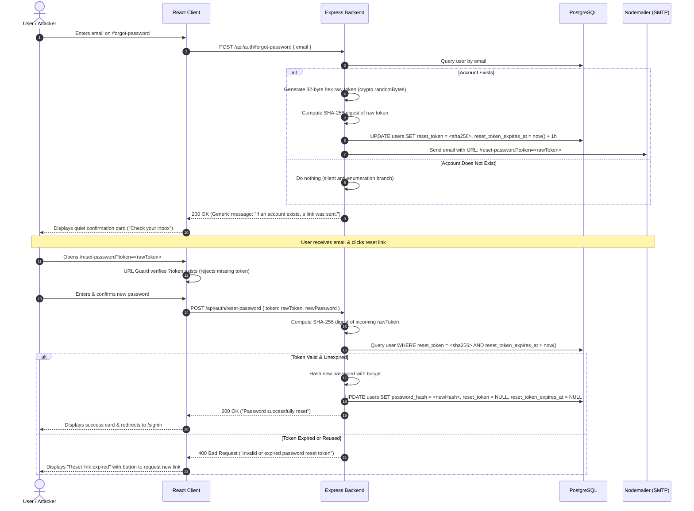

# Readventure Full-Stack Architecture

This document describes the end-to-end system architecture, security model, request lifecycle, and data flow for the **Readventure** application.

---

## 🏛️ System Overview

Readventure is a decoupled, modern full-stack web application designed for personal literary discovery, book tracking, and reading habit cadence. It couples a responsive client built with **React 19**, **Tailwind CSS v4**, and **Vite** to a modular backend service powered by **Express 5**, **TypeScript**, and **PostgreSQL**.



---

## 🔐 Authentication & Session Security Model

The system utilizes an **HttpOnly Cookie** architecture for primary session management, with support for Bearer tokens for headless or API integrations.

```mermaid
sequenceDiagram
    autonumber
    actor User as Reader (Browser)
    participant Client as React Client (Port 5173)
    participant Server as Express Server (Port 5000)
    participant DB as PostgreSQL (Port 5432)

    User->>Client: Enters credentials & submits /signin
    Client->>Server: POST /api/auth/signin { email, password }
    Server->>DB: Query user by email (idx_users_email)
    DB-->>Server: Return user row & password_hash
    Server->>Server: Verify bcrypt hash (10 rounds)
    Server->>Server: Generate signed JWT (7 days expiry)
    Server-->>Client: 200 OK + Set-Cookie: token=<jwt>; HttpOnly; SameSite=Lax
    Client->>Client: Updates AuthContext state & navigates to /dashboard
    Client->>Server: GET /api/auth/me (Cookie automatically attached)
    Server->>Server: Verify JWT signature & extract userId
    Server-->>Client: 200 OK { user profile }
```

### Key Security Invariants
1. **XSS Mitigation**: The access JWT is stored in an `HttpOnly` cookie. Malicious scripts running in the browser cannot read or exfiltrate the token.
2. **CSRF Protection**: Cookies are configured with `SameSite=Lax`. Cross-origin state-changing POST requests do not attach the cookie by default.
3. **Password Security**: Passwords are salted and hashed using `bcryptjs` with 10 salt rounds before storage. Plaintext passwords never touch logs or databases.

---

## 📬 Password Recovery Architecture

The password reset flow implements strict cryptographic standards, anti-enumeration defenses, and single-use replay protection.



### Why SHA-256 Hashed Tokens?
If an attacker obtains a read-only dump of the PostgreSQL database, they **cannot reset any user's password**. The database stores only the SHA-256 digest of the token. The raw token exists only in the recipient's private inbox.

---

## 📂 Frontend Layer Architecture

The frontend follows a **Feature-Sliced Component Architecture**:

```
client/src/
├── features/
│   ├── auth/                        # Self-contained Auth domain
│   │   ├── components/              # UI Cards (SignIn, SignUp, Forgot, Reset)
│   │   ├── context/                 # AuthContext (state, isAuthenticating, user)
│   │   ├── hooks/                   # useAuth custom hook
│   │   ├── schemas/                 # Zod validation schemas
│   │   └── services/                # Axios API service (authApi)
│   ├── dashboard/                   # Reading Hub domain
│   │   ├── components/              # Topbar, Hero, Stats, Bookshelf, Quote, Modal
│   │   ├── types/                   # Domain interfaces
│   │   └── DashboardPage.tsx        # Page orchestrator
│   └── landing/                     # Marketing domain
│       ├── components/              # HeroSection, EditorialPreview, Navbar, Footer
│       └── LandingPage.tsx          # Landing orchestrator
├── routes/                          # AppRoutes & ProtectedRoute
└── shared/                          # Shadcn-inspired UI primitives & utilities
```

### Architectural Rules:
- **Loose Coupling**: Feature folders encapsulate their own types, API clients, and schemas.
- **Orchestrator Pattern**: Page components (`LandingPage`, `DashboardPage`) remain lean (<100 lines) and coordinate independent presentational components.
- **Single Source of Truth**: Authentication state is managed globally via `AuthContext` and consumed via the `useAuth()` hook.

---

## 🗃️ Backend Layer Architecture

The backend implements a classic **Controller-Service-Repository** pattern:

```
[HTTP Request]
       │
       ▼
[Express Routes]        --> Validates path & attaches middleware
       │
       ▼
[Auth Controller]       --> Extracts request body & sends HTTP response envelopes
       │
       ▼
[Auth Service]          --> Executes business rules, token generation & hashing, SMTP
       │
       ▼
[Auth Repository]       --> Parameterized SQL queries against PostgreSQL pool
       │
       ▼
[PostgreSQL Database]   --> Persists users, password hashes, and hashed reset tokens
```

---

## 📊 Complete Technology Matrix

| Concern | Client Layer | Server Layer |
| :--- | :--- | :--- |
| **Language** | TypeScript 5.8 | TypeScript 5.8 |
| **Framework / Runtime** | React 19 / Vite 8 | Express 5 / Node.js 20+ |
| **Styling & Theme** | Tailwind CSS v4 (Warm Storycraft) | N/A |
| **Routing** | React Router 7 | Express Router |
| **State Management** | React Context API | Stateless JWT Sessions |
| **Form Validation** | Zod | Zod / Native Regex validators |
| **Database** | N/A | PostgreSQL 14+ |
| **Email Service** | N/A | Nodemailer (Gmail SMTP & Ethereal) |
| **Security** | Pre-flight validation, URL Guards | Bcrypt, JWT, SHA-256 tokens |
