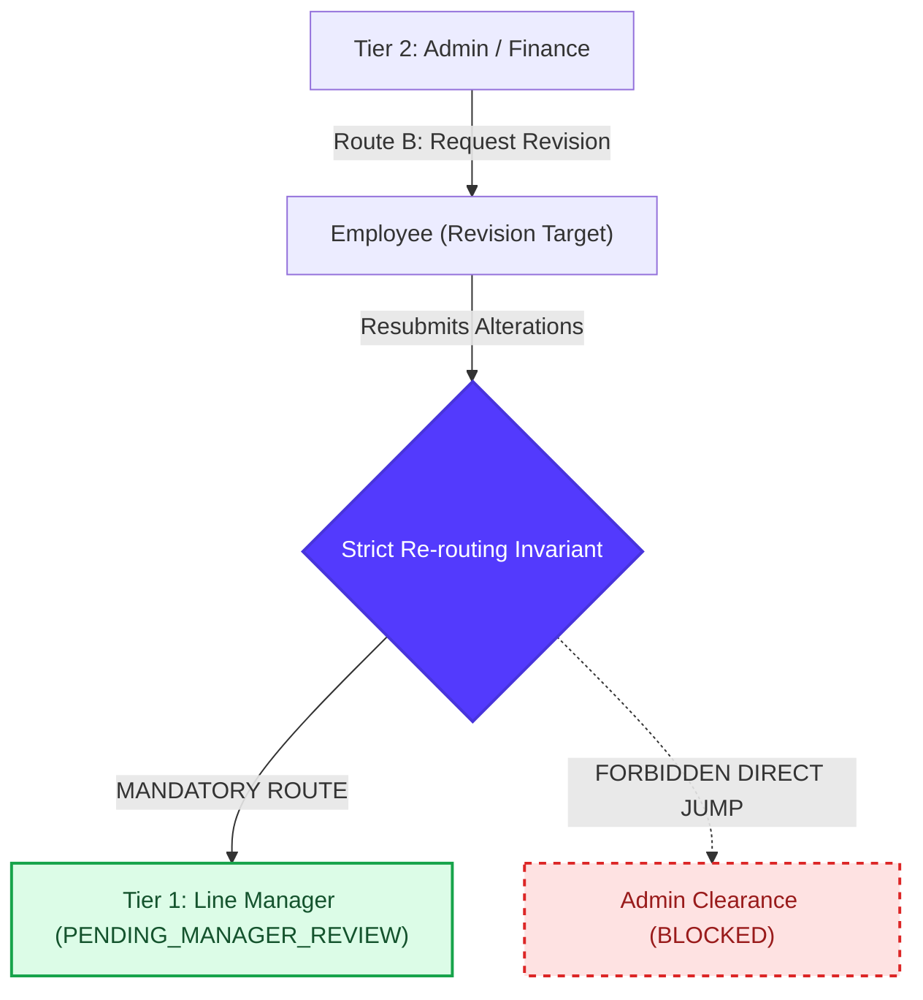
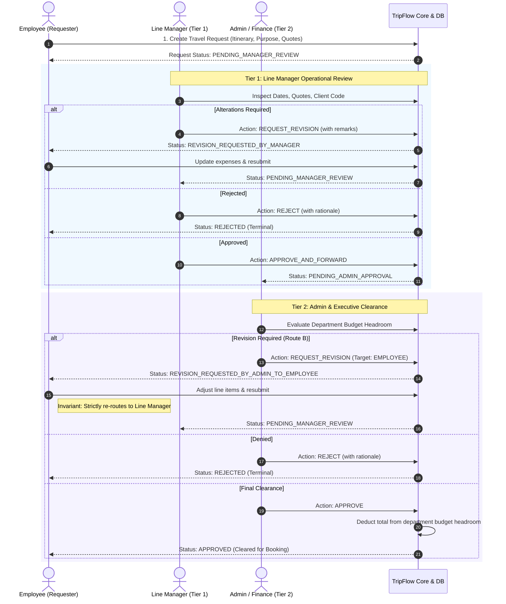
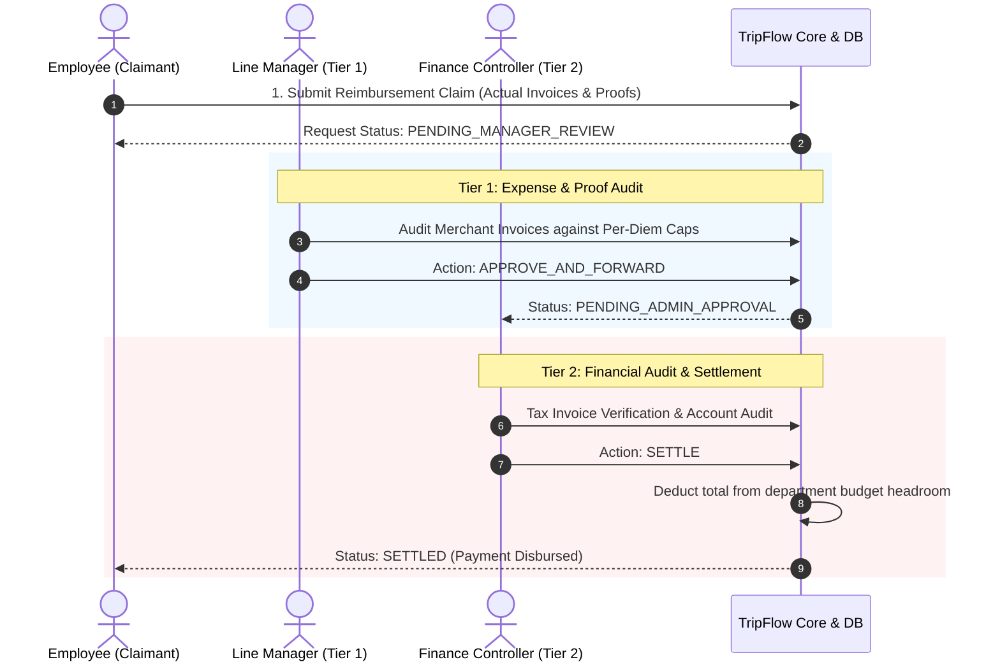
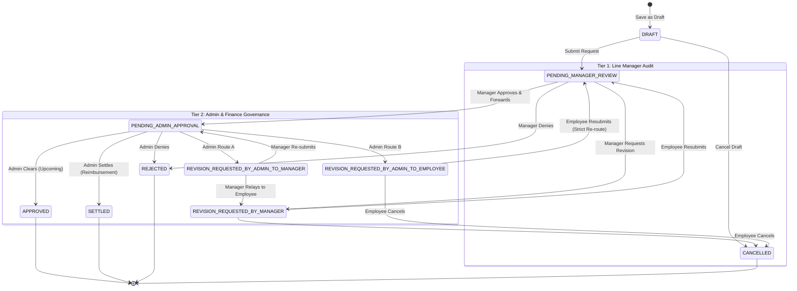

# TripFlow Corporate Travel & Expense Governance Workflows

> **Enterprise Standard Operating Procedure (SOP) & Technical Governance Specification**  
> *Version:* 2.4.0  
> *Target System:* TripFlow Corporate Governance Platform  
> *Compliance Scope:* Travel Policy Enforcement, Managerial Auditing, Financial Clearance, and Disbursement

---

## 🧭 1. Executive Summary & Governance Charter

Corporate travel represents one of the largest discretionary operating expenditures in modern enterprises. Unchecked itineraries, absent quotation validations, out-of-policy vendor bookings, and retrospective expense discrepancies expose organizations to fiscal leakages, budget overruns, and compliance vulnerabilities.

**TripFlow** enforces a deterministic, auditable, two-tier approval state machine for corporate travel management. It bridges the gap between operational managerial oversight and executive financial authorization.

```
       [Requester: Employee]
                 │
                 ▼
       ┌──────────────────┐
       │ Tier 1 Review:   │  --> Evaluates necessity, project codes,
       │ Line Manager     │      itinerary dates, and quote reasonableness
       └────────┬─────────┘
                │ Approved & Forwarded
                ▼
       ┌──────────────────┐
       │ Tier 2 Review:   │  --> Evaluates department budget headroom,
       │ Admin / Finance  │      tax compliance, and disbursement authorization
       └────────┬─────────┘
                │ Cleared
                ▼
     [Terminal Resolution]
  (APPROVED for Booking / SETTLED for Payout)
```

### Governance Objectives
1. **Fiscal Responsibility**: Prevent departmental budget deficits by validating live quarterly allocations prior to financial commitment.
2. **Operational Accountability**: Guarantee line manager verification of travel necessity, dates, and client project alignment.
3. **Forensic Auditability**: Maintain an immutable, tamper-evident timeline of all state transitions, reviewer comments, and revision histories.
4. **Fraud Mitigation**: Require itemized expense breakdowns with cryptographic multi-proof verification (PDF invoices, merchant receipts, airline booking quotations).

---

## 🏛️ 2. Core Governance Invariants & Rules

The TripFlow governance model is underpinned by non-negotiable architectural and business invariants enforced at the database, service, and UI levels.

### Invariant 1: The Strict Manager Re-routing Invariant
When an Admin / Finance reviewer audits a travel request at Tier 2 and identifies defects (e.g., missing hotel receipts, excessive per-diem rates), the Admin may issue revision instructions directly to the Employee (**Route B**: `REVISION_REQUESTED_BY_ADMIN_TO_EMPLOYEE`).



> [!IMPORTANT]
> **Governance Invariant**: An employee can **never** bypass their direct Line Manager to submit directly to Admin approval. When revisions are submitted by an employee, the request **strictly re-enters the Line Manager queue** (`PENDING_MANAGER_REVIEW`). The state transition `REVISION_REQUESTED_BY_ADMIN_TO_EMPLOYEE -> PENDING_ADMIN_APPROVAL` is strictly prohibited by domain validation.

**Rationale**: If an employee modifies expense line items, dates, or quotation amounts during a revision cycle, the direct manager's operational and budgetary sign-off is invalidated. The manager must re-certify the modified figures before executive clearance.

---

### Invariant 2: Dual Terminal State Architecture
TripFlow distinguishes between pre-trip travel planning and post-trip expense claims, enforcing separate terminal states:

| Travel Classification | Code Enum | Primary Artifacts | Terminal State | Meaning |
| :--- | :--- | :--- | :--- | :--- |
| **Upcoming Travel** | `UPCOMING` | Itinerary, Flight/Hotel Quotations, Purpose | `APPROVED` | Request is formally cleared for corporate travel booking and ticketing. |
| **Already Travelled** | `ALREADY_TRAVELLED` | Boarding Passes, Tax Invoices, Actual Receipts | `SETTLED` | Reimbursement claim is verified and financial disbursement is released. |

A pre-trip travel request cannot transition to `SETTLED`, and an expense reimbursement cannot terminate in `APPROVED`.

---

### Invariant 3: Segregation of Duties (Self-Review Prohibition)
To prevent conflict of interest:
- **No Self-Approval**: A Line Manager cannot review, approve, or request revisions on their own personal travel requests.
- When a user holding the `MANAGER` role submits a travel request, the system assigns their supervisory review to an Admin or executive supervisor (`manager_id` hierarchy).
- If a manager attempts `POST /api/travel/requests/:id/manager-review` on a record where `user_id == manager_id`, the API immediately aborts with HTTP 403: *"Self-review blocked: Managers cannot audit or approve their own personal travel requests"*.

---

### Invariant 4: Department Budget Headroom Enforcement
- Every travel request is bound to the requester's department (`users.department`).
- During Tier 2 review, before transitioning a request to `APPROVED` or `SETTLED`, the system checks the quarterly budget allocation in `department_budgets`.
- Available Headroom calculation:
  $$\text{Headroom} = \text{Total Allocation} - \text{Utilized Amount}$$
- If $\text{Total Expenses} > \text{Headroom}$, the approval transaction is blocked unless an Admin explicitly applies a `forceOverride: true` flag, which generates an annotated audit timeline entry detailing the over-budget authorization.

---

### Invariant 5: Currency Standard & High-Precision Ledger
- All monetary representations across TripFlow are strictly denominated in **Indian National Rupees (`INR` / `₹`)**.
- Database monetary columns (`total_expenses`, `amount`, `total_allocation`, `utilized_amount`) utilize PostgreSQL `NUMERIC(14, 2)` to eliminate IEEE 754 floating-point rounding errors.
- UI elements format currency figures using tabular digits (`font-mono tabular-nums`) adhering to the Indian numbering system:
  $$\text{e.g., } ₹1,48,500.00 \quad (\text{Lakhs and Crores tiering})$$

---

## 🔄 3. Complete Governance Lifecycles

### 3.1 Case 1: Upcoming Travel (Pre-Trip Authorization)



---

### 3.2 Case 2: Already Travelled (Post-Trip Reimbursement)



---

## 📊 4. The 10-State Governance State Machine

TripFlow maintains strict deterministic finite state transitions. Any transition not explicitly registered in the transition table is rejected with HTTP 400.



### Complete State Machine Transition Matrix

| # | Current Status (`from_status`) | Target Status (`to_status`) | Authorized Actor | Action Trigger | Mandatory Pre-conditions |
| :--- | :--- | :--- | :--- | :--- | :--- |
| **1** | `DRAFT` | `PENDING_MANAGER_REVIEW` | Requester | `SUBMIT` | All required fields valid, $\ge 1$ itemized expense, valid date range. |
| **2** | `DRAFT` | `CANCELLED` | Requester | `CANCEL` | None. |
| **3** | `PENDING_MANAGER_REVIEW` | `PENDING_ADMIN_APPROVAL` | Line Manager / Admin | `APPROVE_AND_FORWARD` | Requester cannot be current actor (Segregation of Duties). |
| **4** | `PENDING_MANAGER_REVIEW` | `REVISION_REQUESTED_BY_MANAGER` | Line Manager / Admin | `REQUEST_REVISION` | Written remarks detailing required modifications ($\ge 3$ characters). |
| **5** | `PENDING_MANAGER_REVIEW` | `REJECTED` | Line Manager / Admin | `REJECT` | Formal audit rationale in remarks ($\ge 3$ characters). |
| **6** | `REVISION_REQUESTED_BY_MANAGER` | `PENDING_MANAGER_REVIEW` | Requester | `RESUBMIT` | Updated fields/expenses validated against date ranges. |
| **7** | `REVISION_REQUESTED_BY_MANAGER` | `CANCELLED` | Requester | `CANCEL` | None. |
| **8** | `PENDING_ADMIN_APPROVAL` | `APPROVED` | Admin | `APPROVE` | Request travel type must be `UPCOMING`. Headroom verified or override set. |
| **9** | `PENDING_ADMIN_APPROVAL` | `SETTLED` | Admin | `SETTLE` | Request travel type must be `ALREADY_TRAVELLED`. Headroom verified. |
| **10**| `PENDING_ADMIN_APPROVAL` | `REVISION_REQUESTED_BY_ADMIN_TO_EMPLOYEE` | Admin | `REQUEST_REVISION` (Route B) | Remarks with revision notes. Target set to `EMPLOYEE`. |
| **11**| `PENDING_ADMIN_APPROVAL` | `REVISION_REQUESTED_BY_ADMIN_TO_MANAGER` | Admin | `REQUEST_REVISION` (Route A) | Remarks with managerial inquiry. Target set to `MANAGER`. |
| **12**| `PENDING_ADMIN_APPROVAL` | `REJECTED` | Admin | `REJECT` | Formal corporate rejection rationale recorded. |
| **13**| `REVISION_REQUESTED_BY_ADMIN_TO_EMPLOYEE` | `PENDING_MANAGER_REVIEW` | Requester | `RESUBMIT` | **Invariant 1**: strictly returns to Tier 1 Line Manager review. |
| **14**| `REVISION_REQUESTED_BY_ADMIN_TO_EMPLOYEE` | `CANCELLED` | Requester | `CANCEL` | None. |
| **15**| `REVISION_REQUESTED_BY_ADMIN_TO_MANAGER` | `PENDING_ADMIN_APPROVAL` | Line Manager | `RESUBMIT` | Manager provides requested clarification directly to Admin. |
| **16**| `REVISION_REQUESTED_BY_ADMIN_TO_MANAGER` | `REVISION_REQUESTED_BY_MANAGER` | Line Manager | `FORWARD_TO_EMPLOYEE` | Manager determines employee must supply missing proofs. |

---

## 👥 5. Roles, Access Controls & RACI Matrix

TripFlow implements a clean Role-Based Access Control (RBAC) structure:

```
[ADMIN] ──────┬─── Full System Oversight & User Governance
              ├─── Department Budget Allocation & Headroom Overrides
              └─── Tier 2 Clearance (APPROVED / SETTLED)

[MANAGER] ────┬─── Subordinate Operational Auditing (Tier 1)
              └─── Team Spend Velocity & Category Breakdown

[EMPLOYEE] ───┴─── Travel Planning, Drafting, Resubmissions & Personal Analytics
```

### RACI Governance Matrix

| Operational Activity | Requester (`EMPLOYEE`) | Line Manager (`MANAGER`) | Administrator (`ADMIN`) | System Automations |
| :--- | :---: | :---: | :---: | :---: |
| Draft Travel Itinerary & Estimates | **Accountable / Responsible** | Informed | Informed | Auto-saves draft |
| Attach Proofs (Quotes / Invoices) | **Responsible** | Consulted | Informed | Cloudinary streaming |
| Initial Submission | **Responsible** | Informed | Informed | Transitions state to `PENDING_MANAGER_REVIEW` |
| Tier 1 Manager Audit | Informed | **Accountable / Responsible** | Informed | Validates subordinate relationship |
| Revision Dispatch to Employee | Informed | **Responsible** | **Responsible** | Dispatches email notification |
| Tier 2 Department Headroom Check | Informed | Informed | **Responsible** | Queries `department_budgets` |
| Final Booking Clearance (`APPROVED`) | Informed | Informed | **Accountable / Responsible** | Locks request against modification |
| Payout Settlement (`SETTLED`) | Informed | Informed | **Accountable / Responsible** | Updates budget utilization ledger |
| Quarterly Budget Allocation Upsert | Informed | Informed | **Accountable / Responsible** | Enforces positive numeric caps |
| Provision / Deactivate Corporate Users | Informed | Informed | **Accountable / Responsible** | Enforces cascade rules |

---

## 🔍 6. Review Guidelines & Compliance Audit Checklists

### 6.1 Tier 1 Line Manager Audit Checklist
When reviewing pending requests in `/dashboard` (Manager Queue Portal):

- [ ] **Business Justification**: Does the travel have a clear commercial or technical necessity (e.g., on-site client deployment, conference representation)?
- [ ] **Client Project Billing**: Is a valid `project_code` assigned (e.g., `CLIENT-ACME-2026`)?
- [ ] **Date Feasibility**:
  - Upcoming travel: Departure date must be strictly $\ge \text{today}$.
  - Past travel: Return date must be strictly $\le \text{today}$.
  - Return date must be on or after departure date.
- [ ] **Expense Line Items**:
  - Merchant names must be valid commercial vendors (not arbitrary numbers or generic placeholders).
  - Expense dates must fall within the range $[\text{departure\_date}, \text{return\_date}]$.
  - Daily per-diem rates for meals must conform to company tier limits (₹1,500/day domestic, ₹5,000/day international).
- [ ] **Proof Verification**: Check attached supporting documents in the Document Hub. Ensure flight quotes reflect economy class bookings unless executive dispensation exists.

---

### 6.2 Tier 2 Admin & Finance Clearance Checklist
When reviewing pending requests in `/dashboard` (Admin Governance Portal):

- [ ] **Department Allocation Headroom**: Verify that `total_expenses` does not exceed available department headroom for the current fiscal quarter.
- [ ] **Statutory & Tax Compliance**: Ensure merchant invoices feature valid GSTIN / Tax Identification numbers.
- [ ] **Duplicate Claim Verification**: Check that identical flight PNRs or hotel booking references have not been previously submitted.
- [ ] **Revision Decision**:
  - Choose **Route B (Direct to Employee)** for missing receipts or incorrect expense numbers.
  - Choose **Route A (Via Manager)** if managerial approval rationale requires clarification.
- [ ] **Terminal Action**:
  - Grant `APPROVE` for Upcoming travel.
  - Grant `SETTLE` for Past travel reimbursement.

---

## 📝 7. Immutable Audit Trail & Timeline Events

Every operational event in TripFlow writes an atomic record to the `request_timeline_events` table within the same PostgreSQL transaction as the status update.

### Schema Structure (`request_timeline_events`)
```sql
CREATE TABLE request_timeline_events (
  id UUID PRIMARY KEY DEFAULT gen_random_uuid(),
  travel_request_id UUID NOT NULL REFERENCES travel_requests(id) ON DELETE CASCADE,
  actor_id UUID NOT NULL REFERENCES users(id),
  actor_role VARCHAR(20) NOT NULL,
  event_type VARCHAR(50) NOT NULL,
  from_status VARCHAR(50),
  to_status VARCHAR(50) NOT NULL,
  remarks TEXT,
  created_at TIMESTAMPTZ DEFAULT CURRENT_TIMESTAMP
);
```

### Forensic Properties
1. **Append-Only**: No `UPDATE` or `DELETE` operations are permitted on `request_timeline_events`.
2. **Actor Attribution**: Every event records the user ID, user role at the time of action, and timestamp.
3. **Audit History Inspection**: The UI renders a complete vertical audit trail on `/travel/requests/:id`, displaying timestamps, actors, status changes, and reviewer remarks.

---

## ⏱️ 8. Service Level Agreements (SLAs) & Escalation Protocols

To ensure travel is booked in time to avoid price escalation and reimbursements are processed promptly, TripFlow defines the following SLAs:

| Stage | Reviewer | Target SLA | Warning Threshold | Escalation Trigger |
| :--- | :--- | :--- | :--- | :--- |
| **Tier 1 (Manager Review)** | Line Manager | 48 hours | 36 hours | Auto-notification to Line Manager & Requester |
| **Tier 2 (Admin Clearance)** | Admin / Finance | 24 hours | 18 hours | Direct reminder on Admin Governance Queue |
| **Employee Revision Resubmit** | Requester | 72 hours | 48 hours | Notification to employee regarding pending travel date |
| **Disbursement Settlement** | Finance Controller | 7 business days | 5 business days | Escalation to Chief Financial Officer (CFO) |

### Escalation Workflow
If an upcoming travel request sits in `PENDING_MANAGER_REVIEW` with less than 72 hours remaining before `departure_date`, the system flags the request with an **URGENT** priority badge in the review workstations.

---

## 🛡️ 9. Policy Violations & Exception Handling

### Out-of-Policy Travel Exceptions
When an employee must book travel exceeding standard policy limits (e.g., last-minute flight surge, emergency on-site triage):
1. Employee submits request with detailed business rationale in `purpose`.
2. Line Manager reviews and adds endorsement in `manager_remarks`.
3. Admin evaluates request in Tier 2. If budget headroom is insufficient, the Admin may apply `forceOverride: true`.
4. The system logs an `ADMIN_OVERRIDE` event in `request_timeline_events`, recording the budget shortfall and authorized exception.

### Fraudulent Claim Handling
If inflated or falsified receipts are discovered during Tier 1 or Tier 2 review:
1. Reviewer selects `REJECT`.
2. Reviewer enters formal rationale: *"REJECTED: Audit failure - non-compliant / falsified documentation submitted"*.
3. Admin deactivates the user's account via `/api/users/:id/status` (`is_active = false`).
4. Audit ledger is exported for HR compliance review.
