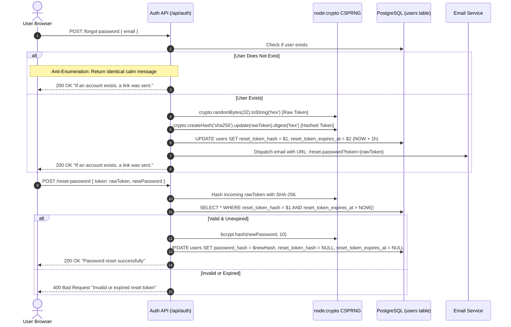

# TripFlow Security & Access Control Architecture

> **Enterprise Information Security Specification & Threat Model**  
> *Target System:* TripFlow Corporate Travel & Expense Governance Platform  
> *Classification:* Confidential / Internal Corporate Standard  
> *Compliance Alignment:* OWASP Top 10 (2021/2025), SOC 2 Type II Controls, GDPR & Data Privacy

---

## 🔒 1. Security Philosophy & Threat Modeling

The TripFlow platform processes sensitive corporate information: travel schedules, employee PII (names, contact numbers, emergency contacts), merchant invoices, and fiscal budget allocations. The platform is designed according to **Defense-in-Depth** and **Least Privilege** principles.

```
       [Untrusted Internet / Corporate LAN]
                        │
                        ▼
       ┌─────────────────────────────────┐
       │ Edge / Reverse Proxy (TLS 1.3)  │  --> SSL Termination, Strict CORS, Rate Limiting
       └────────────────┬────────────────┘
                        │
                        ▼
       ┌─────────────────────────────────┐
       │ Express Security Pipeline       │  --> CookieParser, Helmet, Input Sanitizers
       └────────────────┬────────────────┘
                        │
                        ▼
       ┌─────────────────────────────────┐
       │ Authentication Guard            │  --> HttpOnly Cookie Verification, Expiry Check
       └────────────────┬────────────────┘
                        │
                        ▼
       ┌─────────────────────────────────┐
       │ Multi-Tier RBAC & Tenant Scoping│  --> Role Match & Subordinate ID Scoping
       └────────────────┬────────────────┘
                        │
                        ▼
       ┌─────────────────────────────────┐
       │ Parameterized SQL Engine        │  --> pg Connection Pool (Zero SQL Injection)
       └─────────────────────────────────┘
```

### STRIDE Threat Modeling Analysis

| Threat Category | Potential Attack Vector | TripFlow Architectural Mitigation |
| :--- | :--- | :--- |
| **Spoofing** | Attacker impersonates an employee or approving manager | Statistically unforgeable HMAC SHA-256 JWTs stored in `HttpOnly` cookies; strict password hashing via Bcrypt (10 rounds). |
| **Tampering** | User alters expense amounts or bypasses manager review | Invariant 1 enforcement: employee resubmission strictly forces transition to `PENDING_MANAGER_REVIEW`; immutable append-only timeline. |
| **Repudiation** | Reviewer claims they did not reject or authorize an expense | Atomic event logging in `request_timeline_events` with actor ID, actor role, timestamp, and signed comment. |
| **Information Disclosure** | Unauthorized user views other departments' travel or quotes | Row-level data scoping: employees query only own requests; managers query only assigned subordinates; password reset anti-enumeration. |
| **Denial of Service** | Resource exhaustion via massive proof uploads or login loops | Multer 10MB memory limits, MIME type filtering, connection pooling, and auth rate limiting recommendations. |
| **Elevation of Privilege** | Employee issues manager approval or manipulates user roles | Backend role guard middleware (`requireRole`); self-registration disabled; user provisioning restricted strictly to `ADMIN`. |

---

## 🔑 2. Authentication Architecture & Credential Security

TripFlow enforces modern web application credential management and session hygiene.

### 2.1 HttpOnly Cookie Session Architecture
Unlike legacy SPAs that store authentication tokens in `localStorage` (which are vulnerable to Cross-Site Scripting / XSS attacks), TripFlow delivers JWT sessions via browser cookies with protective security flags:

```typescript
// server/src/features/auth/auth.controller.ts
const getCookieOptions = (): CookieOptions => ({
  httpOnly: true,                          // Blocks JavaScript access (XSS mitigation)
  secure: process.env.NODE_ENV === 'production', // Enforces TLS in production
  sameSite: 'lax',                         // Mitigates Cross-Site Request Forgery (CSRF)
  maxAge: 7 * 24 * 60 * 60 * 1000,         // 7-day session validity window
  path: '/',
});
```

- **`httpOnly: true`**: Prohibits malicious scripts injected via DOM injection from reading or transmitting the authentication token.
- **`secure: true` (Production)**: Ensures the cookie is only transmitted over encrypted HTTPS channels.
- **`sameSite: 'lax'`**: Provides defense against cross-site request forgery while preserving seamless navigation from email links.

---

### 2.2 JWT Verification Pipeline
Authentication tokens are signed using HMAC SHA-256 (`HS256`) with a high-entropy secret (`JWT_SECRET`):

```typescript
// Token Claims Structure
export interface JwtPayload {
  userId: string;
  email: string;
  role: 'EMPLOYEE' | 'MANAGER' | 'ADMIN';
  department: string;
}
```

#### Dual Token Resolution Strategy (`auth.middleware.ts`):
1. **Primary**: Extracts the token from the `req.cookies.token` HttpOnly cookie.
2. **Secondary Fallback**: Evaluates the `Authorization: Bearer <token>` header (for automated testing and script access).
3. If token verification fails, expired, or is missing, the request terminates with `401 Unauthorized`.

---

### 2.3 Password Hashing with Bcrypt
- User passwords are never stored in plaintext or reversible encryption.
- Passwords are salted and hashed using **Bcrypt** with **10 rounds of work factor** ($2^{10} = 1024$ key derivations):
  ```typescript
  const saltRounds = 10;
  const passwordHash = await bcrypt.hash(password, saltRounds);
  ```
- Password comparison uses `bcrypt.compare()` which executes in constant time to prevent side-channel timing attacks.

---

### 2.4 Cryptographic Password Recovery Pipeline
TripFlow implements a multi-tier cryptographic password reset flow that ensures leaked database backups do not expose usable password reset tokens.



#### Security Properties:
1. **Raw Token Generation**: 32-byte cryptographically secure pseudo-random number generator (`crypto.randomBytes(32)`), generating 256 bits of entropy.
2. **Digest-Only Storage**: The raw token is **never persisted**. Only its **SHA-256 hash** is saved in `users.reset_token_hash`. If the database is compromised, attackers cannot reconstruct the valid link token.
3. **Strict 1-Hour Time Window**: Tokens expire automatically after 60 minutes (`reset_token_expires_at = NOW() + INTERVAL '1 hour'`).
4. **Single-Use Invalidation**: Upon successful reset, the token fields are immediately set to `NULL`, preventing replay attacks.
5. **Anti-Account Enumeration**: The endpoint returns an identical generic response regardless of whether the submitted email address exists in the corporate directory.

---

### 2.5 Account Lifecycle & Deactivation Safeguards
- The `users` table contains an `is_active BOOLEAN DEFAULT true` flag (Migration `004`).
- **Immediate Session Revocation**: The sign-in controller verifies `user.is_active !== false`. If an employee leaves the company or is suspended, their account is flagged inactive. Future authentication attempts are instantly denied with HTTP 401.

---

## 🛡️ 3. Authorization & Multi-Tier RBAC

TripFlow implements strict Role-Based Access Control enforced at the route and service layers.

### 3.1 Role Hierarchy & Permissions

| Feature / Resource | `EMPLOYEE` | `MANAGER` | `ADMIN` |
| :--- | :---: | :---: | :---: |
| View Own Travel Requests | ✅ | ✅ | ✅ |
| Create Travel Request (Draft / Submit) | ✅ | ✅ | ✅ |
| Cancel Own Pending Request | ✅ | ✅ | ✅ |
| View Direct Subordinates' Queue | ❌ | ✅ | ✅ |
| Audit Subordinates (Tier 1 Review) | ❌ | ✅ | ✅ |
| Access Corporate Clearance Queue (Tier 2) | ❌ | ❌ | ✅ |
| Grant Travel Clearance (`APPROVED`) | ❌ | ❌ | ✅ |
| Authorize Reimbursement (`SETTLED`) | ❌ | ❌ | ✅ |
| Override Department Budget Headroom | ❌ | ❌ | ✅ |
| Provision / Deactivate Corporate Users | ❌ | ❌ | ✅ |
| Manage Department Quarterly Allocations | ❌ | ❌ | ✅ |

---

### 3.2 Role Guard Middleware (`role.middleware.ts`)
Protected endpoints enforce role restrictions using the `requireRole` middleware:

```typescript
export function requireRole(allowedRoles: TravelRole[]) {
  return async (req: AuthenticatedRequest, res: Response, next: NextFunction) => {
    // 1. Ensure user is authenticated
    if (!req.user?.userId) return sendError(res, 'Authentication required', 401);

    // 2. Resolve role from JWT payload or fresh DB check
    let role = req.user.role as TravelRole | undefined;
    if (!role) {
      const userRes = await query('SELECT role, department FROM users WHERE id = $1', [req.user.userId]);
      role = userRes.rows[0]?.role as TravelRole;
    }

    // 3. Verify role inclusion
    if (!allowedRoles.includes(role)) {
      return sendError(
        res,
        `Access forbidden: requires role [${allowedRoles.join(', ')}]. Current role: ${role}`,
        403
      );
    }
    next();
  };
}
```

---

### 3.3 Row-Level Tenant & Relationship Scoping
RBAC checks alone do not prevent Horizontal Privilege Escalation (IDOR). TripFlow enforces data scoping in the repository layer:

1. **Employee Scoping**:
   ```sql
   -- Employees can only view requests matching their user ID
   SELECT * FROM travel_requests WHERE user_id = $1;
   ```
2. **Manager Scoping**:
   ```sql
   -- Managers only see requests submitted by their assigned subordinates
   SELECT tr.* FROM travel_requests tr
   JOIN users u ON tr.user_id = u.id
   WHERE u.manager_id = $1 AND tr.status IN ('PENDING_MANAGER_REVIEW', ...);
   ```
3. **Self-Review Prevention (Segregation of Duties)**:
   ```typescript
   if (request.userId === managerId) {
     throw new Error('Self-review blocked: Managers cannot audit or approve their own personal travel requests');
   }
   ```

---

## 🗃️ 4. Data Protection & Injection Defense

### 4.1 SQL Injection (SQLi) Defense
TripFlow uses the `pg` driver with **100% Parameterized Prepared Statements**. Raw string interpolation or concatenation in SQL statements is strictly prohibited.

```typescript
// ✅ SECURE: Fully parameterized SQL query
await client.query(
  `UPDATE travel_requests 
   SET status = $1, revision_target = $2, updated_at = CURRENT_TIMESTAMP 
   WHERE id = $3`,
  [toStatus, revisionTarget, requestId]
);

// ❌ BANNED: String concatenation (Never permitted)
// await client.query(`UPDATE travel_requests SET status = '${toStatus}' WHERE id = '${requestId}'`);
```

---

### 4.2 Comprehensive Input Validation (Zod & Custom Validators)
All incoming payloads are strictly validated before business execution:
- **Phone Number Validation**: ITU-T compliant regex covering dial codes and national numbering rules across 30+ countries.
- **Date Boundary Enforcement**:
  - Upcoming travel departure dates cannot be in the past.
  - Reimbursement return dates cannot be in the future.
  - Line item expense dates must fall strictly between `departure_date` and `return_date`.
- **Merchant Validation**: Merchant names must contain at least 2 alphabetic characters to prevent numeric dummy entries.
- **Monetary Validation**: Line item expense amounts must be strictly positive finite numbers.

---

## 📁 5. File Upload & Document Attachment Security

Travel claims require supporting receipts, quotes, and tax invoices. File uploads represent a high-risk attack surface (malicious executables, web shells, storage exhaustion).

```
   [Uploaded File Stream]
             │
             ▼
   [Multer Memory Storage] ────► In-memory buffer only (No disk writes)
             │
             ▼
   [MIME Type Filter]     ────► Whitelist: PDF, PNG, JPG, JPEG, WEBP
             │
             ▼
   [Size Limit Check]     ────► Strict 10MB ceiling
             │
             ▼
   [Cloudinary Streaming] ────► Streamed via TLS with randomized public_id
```

### Protective Controls (`upload.middleware.ts`):
1. **In-Memory Buffering**: Uploads are processed via `multer.memoryStorage()`. No untrusted files are ever written to the host filesystem.
2. **Strict MIME Whitelist**:
   ```typescript
   const ALLOWED_MIME_TYPES = new Set([
     'application/pdf',
     'image/png',
     'image/jpeg',
     'image/jpg',
     'image/webp',
   ]);
   ```
3. **Payload Size Caps**: Enforces an explicit 10MB threshold (`limits: { fileSize: 10 * 1024 * 1024 }`).
4. **Cloudinary Asset Sanitization**: Files are streamed directly to Cloudinary storage under randomized UUID names (`Date.now() + crypto.randomBytes(4).toString('hex')`), ensuring malicious executable filenames cannot be executed.
5. **Local Storage Fallback Hardening**: If Cloudinary is unavailable, files are written to an isolated `uploads/` directory with randomized names and sanitized extensions.

---

## 🌐 6. Network Security & Browser Hardening

### 6.1 Cross-Origin Resource Sharing (CORS)
TripFlow configures CORS strictly to prevent malicious third-party websites from making authenticated requests on behalf of users:

```typescript
app.use(
  cors({
    origin: config.clientUrl, // Bound strictly to trusted frontend URL
    credentials: true,        // Permits HttpOnly cookie transmission
    methods: ['GET', 'POST', 'PUT', 'PATCH', 'DELETE', 'OPTIONS'],
    allowedHeaders: ['Content-Type', 'Authorization'],
  })
);
```

### 6.2 Recommended HTTP Security Headers
In production environments, the reverse proxy or Express pipeline should enforce standard security headers:

| Header | Production Setting | Purpose |
| :--- | :--- | :--- |
| `Strict-Transport-Security` | `max-age=63072000; includeSubDomains; preload` | Forces HTTPS and prevents SSL stripping attacks. |
| `X-Content-Type-Options` | `nosniff` | Prevents browser MIME-type sniffing. |
| `X-Frame-Options` | `DENY` | Prevents clickjacking by blocking iframe embedding. |
| `Referrer-Policy` | `strict-origin-when-cross-origin` | Protects sensitive URL query parameters. |
| `Content-Security-Policy` | `default-src 'self'; img-src 'self' data: https://res.cloudinary.com;` | Mitigates XSS and unauthorized asset loading. |

---

## 📜 7. Forensic Auditability & Non-Repudiation

TripFlow maintains an immutable, append-only ledger in PostgreSQL (`request_timeline_events`).

### Immutable Audit Properties:
1. **Transactional Coherence**: Status updates and timeline entries are executed within the same database transaction (`BEGIN ... COMMIT`). If the audit entry fails to write, the status update rolls back.
2. **Actor Attribution**: Every event records the user's UUID, their assigned role at that moment, the before-and-after status, and written reviewer comments.
3. **No Mutations**: Application repositories do not expose `UPDATE` or `DELETE` methods for `request_timeline_events`.

---

## 🚨 8. Vulnerability Disclosure & Incident Response

### Reporting a Vulnerability
If you discover a security vulnerability in TripFlow, please do not disclose it publicly or file a public GitHub issue. Send a report to:
- **Security Contact**: `security@tripflow.com`
- **PGP Key**: Available upon request
- **Response SLA**: Initial triage within 24 hours; remediation plan within 72 hours.

### Incident Response Protocol
In the event of an authentication compromise or suspected credential breach:
1. **User Invalidation**: Set `is_active = false` on compromised accounts via `/api/users/:id/status`.
2. **Token Revocation**: Rotate `JWT_SECRET` in environment configuration to immediately invalidate all active JWT sessions.
3. **Database Audit**: Query `request_timeline_events` for abnormal state transitions or unauthorized approvals.
