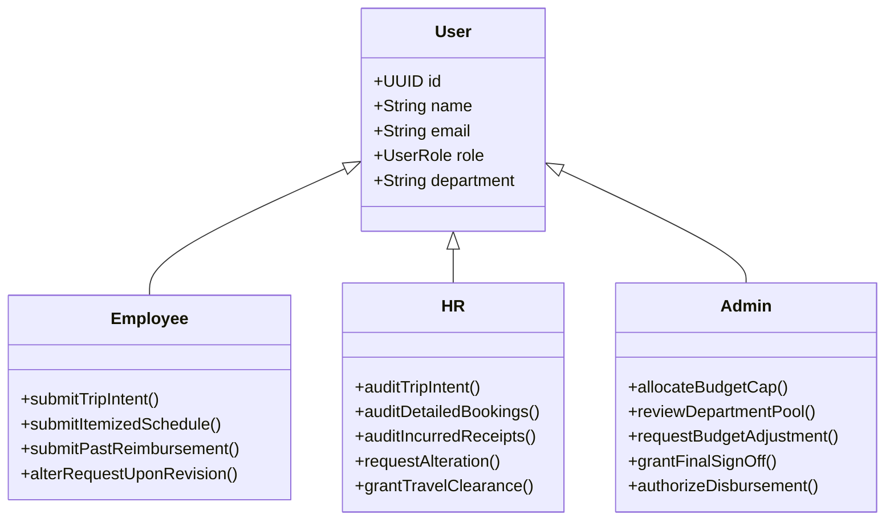
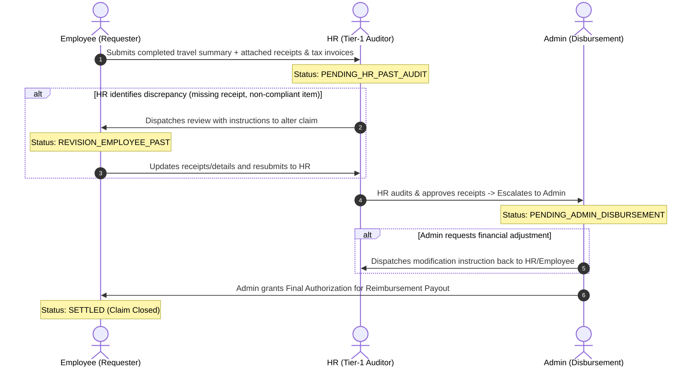
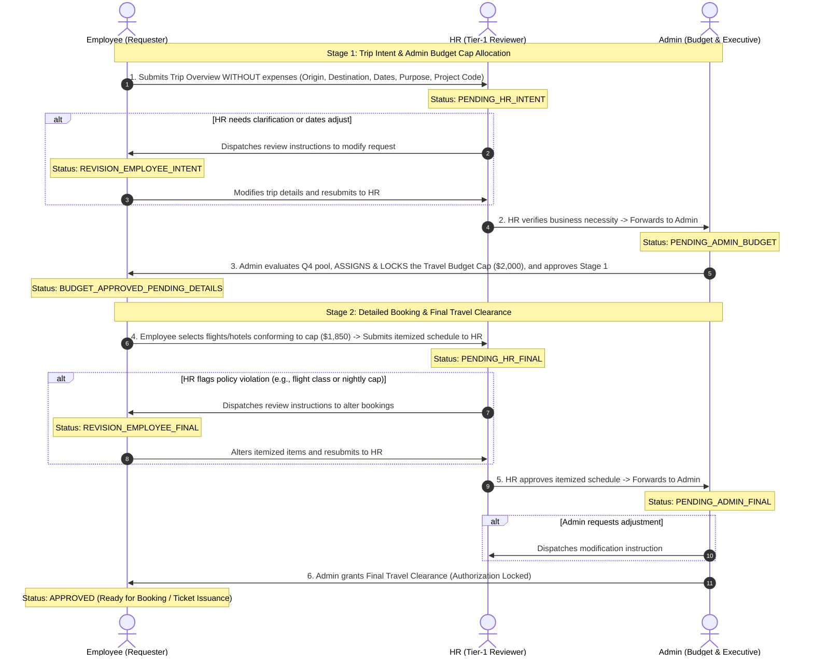

# TripFlow — Corporate Travel & Expense Management System Specification

* **Document Version**: 1.0.0
* **Date**: 2026-11-06
* **Status**: Approved for Implementation Planning
* **Target Branch**: `feature/travel-request-system`

---

## 1. Executive Summary & Product Vision

**TripFlow** is an enterprise-grade corporate travel and expense governance platform designed to replace ad-hoc spreadsheet tracking with an auditable, multi-tier approval lifecycle. Built on modern web architecture (**React 19**, **Tailwind CSS v4**, **Express 5**, **TypeScript**, and **PostgreSQL**), TripFlow enforces strict fiscal policy compliance while maintaining high operational velocity.

The system addresses two distinct corporate travel scenarios:
1. **Case 1: Already Travelled (Post-Trip Reimbursement)** — Direct single-cycle receipt reconciliation and payout.
2. **Case 2: Upcoming Travel (Pre-Trip Planning)** — A two-stage governance workflow separating travel intent and budget cap allocation from detailed flight and accommodation bookings.

The user interface adheres to the **Warm Storycraft** design system (`#F7F4EE`, `#2B231D`, `#8A582B`, Poppins typography), entirely eliminating generic "AI slop" patterns.

---

## 2. Actors & Role-Based Permissions

TripFlow defines three distinct organizational personas:



### 2.1 Employee (Requester)
* Submits upcoming trip intent with project code, destination, dates, and purpose (without expenses).
* Modifies intent upon HR or Admin revision requests.
* After Admin budget cap allocation, itemizes flights, lodging, and daily per-diem conforming to the budget ceiling.
* Submits retrospective reimbursement claims with attached tax invoice receipts for completed trips.

### 2.2 HR (Tier 1 Reviewer & Policy Auditor)
* Audits upcoming trip intent for business validity and release schedule conflicts.
* Audits itemized booking schedules against company travel policy (economy airfare, nightly lodging caps, meal per-diem).
* Audits completed travel tax invoices for retrospective claims.
* Dispatches revision instructions with mandatory audit remarks.
* Grants final travel clearance for compliant upcoming trips.

### 2.3 Admin (Executive & Budget Authority)
* Evaluates department quarterly travel budget capacity.
* Allocates and locks the authorized travel budget cap for upcoming trips.
* Dispatches instruction notes to Employee/HR if project estimation exceeds acceptable thresholds.
* Grants final executive sign-off and authorizes payout disbursements for retrospective claims.

---

## 3. Operational Workflows & Lifecycle State Machines

### 3.1 Case 1: Already Travelled Flow (Post-Trip Reimbursement)



### 3.2 Case 2: Upcoming Travel Flow (2-Stage Governance)



---

## 4. Lifecycle Status Dictionary

| Status Code | Stage | Meaning | Actionable By |
| :--- | :--- | :--- | :--- |
| `DRAFT` | Initial | Request created but not yet submitted | Employee |
| `PENDING_HR_INTENT` | Upcoming (Stage 1) | Trip intent submitted without expenses; awaiting HR verification | HR |
| `REVISION_EMPLOYEE_INTENT` | Upcoming (Stage 1) | HR requested modification of trip dates, purpose, or details | Employee |
| `PENDING_ADMIN_BUDGET` | Upcoming (Stage 1) | HR verified intent; awaiting Admin budget cap assignment | Admin |
| `BUDGET_APPROVED_PENDING_DETAILS` | Upcoming (Stage 2) | Admin assigned budget cap; awaiting Employee itemized booking | Employee |
| `PENDING_HR_FINAL` | Upcoming (Stage 2) | Itemized expenses submitted; awaiting HR policy audit | HR |
| `REVISION_EMPLOYEE_FINAL` | Upcoming (Stage 2) | HR requested changes to itemized flight or hotel bookings | Employee |
| `PENDING_ADMIN_FINAL` | Upcoming (Stage 2) | HR verified compliance; awaiting Admin final clearance | Admin |
| `APPROVED` | Upcoming (Terminal) | Final travel clearance granted; booking authorized | None (Terminal) |
| `PENDING_HR_PAST_AUDIT` | Past (Reimbursement) | Retrospective claim submitted with receipts; awaiting HR audit | HR |
| `REVISION_EMPLOYEE_PAST` | Past (Reimbursement) | HR requested alterations to submitted receipts | Employee |
| `PENDING_ADMIN_DISBURSEMENT` | Past (Reimbursement) | Receipts validated by HR; awaiting Admin payout sign-off | Admin |
| `SETTLED` | Past (Terminal) | Reimbursement payment released and closed | None (Terminal) |
| `REJECTED` | Both (Terminal) | Request formally denied with feedback reasons | None (Terminal) |
| `CANCELLED` | Both (Terminal) | Request withdrawn by Employee | None (Terminal) |

---

## 5. PostgreSQL Database Architecture

### 5.1 Schema DDL

```sql
-- 1. Users & Roles
CREATE TABLE users (
    id UUID PRIMARY KEY DEFAULT gen_random_uuid(),
    name VARCHAR(255) NOT NULL,
    email VARCHAR(255) UNIQUE NOT NULL,
    password_hash VARCHAR(255) NOT NULL,
    role VARCHAR(50) NOT NULL CHECK (role IN ('EMPLOYEE', 'HR', 'ADMIN')) DEFAULT 'EMPLOYEE',
    department VARCHAR(100) NOT NULL DEFAULT 'General',
    reset_token VARCHAR(255),
    reset_token_expires_at TIMESTAMP WITH TIME ZONE,
    created_at TIMESTAMP WITH TIME ZONE DEFAULT NOW(),
    updated_at TIMESTAMP WITH TIME ZONE DEFAULT NOW()
);

-- 2. Department Budgets
CREATE TABLE department_budgets (
    id UUID PRIMARY KEY DEFAULT gen_random_uuid(),
    department VARCHAR(100) NOT NULL,
    fiscal_year INT NOT NULL,
    fiscal_quarter VARCHAR(20) NOT NULL,
    total_allocation NUMERIC(14, 2) NOT NULL DEFAULT 50000.00,
    utilized_amount NUMERIC(14, 2) NOT NULL DEFAULT 0.00,
    created_at TIMESTAMP WITH TIME ZONE DEFAULT NOW(),
    updated_at TIMESTAMP WITH TIME ZONE DEFAULT NOW(),
    CONSTRAINT uq_dept_quarter UNIQUE (department, fiscal_year, fiscal_quarter)
);

-- 3. Travel Requests
CREATE TABLE travel_requests (
    id UUID PRIMARY KEY DEFAULT gen_random_uuid(),
    user_id UUID NOT NULL REFERENCES users(id) ON DELETE CASCADE,
    travel_type VARCHAR(50) NOT NULL CHECK (travel_type IN ('UPCOMING', 'ALREADY_TRAVELLED')),
    title VARCHAR(255) NOT NULL,
    purpose TEXT NOT NULL,
    project_code VARCHAR(100) NOT NULL,
    origin VARCHAR(150) NOT NULL,
    destination VARCHAR(150) NOT NULL,
    departure_date DATE NOT NULL,
    return_date DATE NOT NULL,
    emergency_contact_name VARCHAR(150) NOT NULL,
    emergency_contact_phone VARCHAR(50) NOT NULL,
    supporting_doc_url VARCHAR(500),
    status VARCHAR(50) NOT NULL DEFAULT 'DRAFT',
    admin_allocated_budget NUMERIC(12, 2) DEFAULT NULL,
    admin_budget_memo TEXT DEFAULT NULL,
    total_itemized_expenses NUMERIC(12, 2) NOT NULL DEFAULT 0.00,
    overrun_justification TEXT DEFAULT NULL,
    currency VARCHAR(10) NOT NULL DEFAULT 'USD',
    created_at TIMESTAMP WITH TIME ZONE DEFAULT NOW(),
    updated_at TIMESTAMP WITH TIME ZONE DEFAULT NOW()
);

-- 4. Travel Expenses (Line Items)
CREATE TABLE travel_expenses (
    id UUID PRIMARY KEY DEFAULT gen_random_uuid(),
    travel_request_id UUID NOT NULL REFERENCES travel_requests(id) ON DELETE CASCADE,
    category VARCHAR(50) NOT NULL CHECK (category IN ('FLIGHT', 'HOTEL', 'MEALS_PER_DIEM', 'TRANSIT', 'MISC')),
    merchant VARCHAR(150) NOT NULL,
    amount NUMERIC(10, 2) NOT NULL,
    expense_date DATE NOT NULL,
    receipt_url VARCHAR(500),
    notes TEXT,
    created_at TIMESTAMP WITH TIME ZONE DEFAULT NOW()
);

-- 5. Request Timeline Events (Audit & Communication Ledger)
CREATE TABLE request_timeline_events (
    id UUID PRIMARY KEY DEFAULT gen_random_uuid(),
    travel_request_id UUID NOT NULL REFERENCES travel_requests(id) ON DELETE CASCADE,
    actor_id UUID NOT NULL REFERENCES users(id),
    actor_name VARCHAR(255) NOT NULL,
    actor_role VARCHAR(50) NOT NULL CHECK (actor_role IN ('EMPLOYEE', 'HR', 'ADMIN')),
    event_type VARCHAR(60) NOT NULL,
    comments TEXT,
    allocated_amount NUMERIC(12, 2) DEFAULT NULL,
    created_at TIMESTAMP WITH TIME ZONE DEFAULT NOW()
);
```

---

## 6. REST API Specification

### 6.1 Authentication & Session
* `POST /api/auth/signup` — Registers user (requires explicit sign-in; no auto-cookie).
* `POST /api/auth/signin` — Authenticates credentials & sets `HttpOnly` JWT cookie.
* `POST /api/auth/signout` — Clears authentication cookie.
* `GET /api/auth/me` — Fetches authenticated profile with role & department.

### 6.2 Employee Endpoints (`/api/travel/requests`)
* `POST /` — Creates a travel request draft.
* `GET /my` — Lists employee's requests with status, dates, and amounts.
* `GET /:id` — Retrieves complete request details, budget cap, expenses, and timeline.
* `PUT /:id/intent` — Edits trip intent when `DRAFT` or `REVISION_EMPLOYEE_INTENT`.
* `POST /:id/submit-intent` — Submits intent to HR (`PENDING_HR_INTENT`).
* `POST /:id/expenses` — Adds, modifies, or deletes itemized expenses.
* `POST /:id/submit-schedule` — Submits itemized bookings to HR (`PENDING_HR_FINAL`).
* `POST /:id/submit-past` — Submits retrospective claim with receipts (`PENDING_HR_PAST_AUDIT`).
* `POST /:id/cancel` — Cancels request before final clearance.

### 6.3 HR Endpoints (`/api/travel/hr`)
* `GET /queue` — Lists requests awaiting HR action across intent, final, and past queues.
* `POST /:id/approve-intent` — Approves intent $\rightarrow$ `PENDING_ADMIN_BUDGET`.
* `POST /:id/request-revision-intent` — Requests intent alteration $\rightarrow$ `REVISION_EMPLOYEE_INTENT`.
* `POST /:id/approve-schedule` — Approves itemized schedule $\rightarrow$ `PENDING_ADMIN_FINAL`.
* `POST /:id/request-revision-schedule` — Requests booking alteration $\rightarrow$ `REVISION_EMPLOYEE_FINAL`.
* `POST /:id/approve-past` — Approves retrospective claim $\rightarrow$ `PENDING_ADMIN_DISBURSEMENT`.
* `POST /:id/request-revision-past` — Requests receipt alteration $\rightarrow$ `REVISION_EMPLOYEE_PAST`.
* `POST /:id/reject` — Rejects request with mandatory reason.

### 6.4 Admin Endpoints (`/api/travel/admin`)
* `GET /queue` — Lists requests awaiting budget cap allocation or final clearance.
* `POST /:id/allocate-budget` — Sets budget cap $\rightarrow$ `BUDGET_APPROVED_PENDING_DETAILS`.
* `POST /:id/request-revision-budget` — Dispatches instruction note to Employee $\rightarrow$ `REVISION_EMPLOYEE_INTENT`.
* `POST /:id/approve-final` — Grants final travel clearance $\rightarrow$ `APPROVED`.
* `POST /:id/request-revision-final` — Dispatches schedule modification instructions.
* `POST /:id/settle-past` — Authorizes payout $\rightarrow$ `SETTLED`.
* `GET /budgets` — Department Q4 budget utilization analytics.
* `POST /:id/reject` — Rejects request with mandatory reason.

---

## 7. Frontend UI & Design System Conformance

The frontend strictly implements the **Warm Storycraft** design system (`client/docs/DESIGN_SYSTEM.md`):

1. **Color Tokens**:
   * Canvas: `#F7F4EE`
   * Card Surfaces: Pure `#FFFFFF` and Muted `#FAF8F5`
   * Hairline Border: `#E8DFD3`
   * Primary Brand Accent: `#8A582B` (Hover: `#754820`)
   * Primary Ink Text: `#2B231D`
   * Subtext: `#756F68`
   * Success: `#2E7D32` (Background: `#F1F8F1`)
   * Warning: `#B9770E` (Background: `#FEF9E7`)
   * Danger: `#9E2A2B` (Background: `#FDF2F2`)

2. **Typography**:
   * Primary Font: **Poppins** (400, 500, 600, 700).
   * Monospace Tabular Figures: `font-mono tabular-nums` for all financial figures and dates.

3. **Anti-AI-Slop Governance**:
   * Zero emojis as interface icons (replaced with clean inline SVG or typographic indicators).
   * Zero welded arrow glyphs (`→`) on button labels.
   * Zero pastel floating icon chips or 4-bar rainbow meters.
   * Zero multi-level nested card sandwiches.
   * Quiet 7px circular status dots (`●`) replacing large neon pill badges.

4. **Reference Mockup**:
   * Live interactive implementation available at [`docs/mockups/tripflow-full-mockup.html`](file:///c:/Users/SudalaimaniKannan/Documents/Codings/Readventure/docs/mockups/tripflow-full-mockup.html).

---

## 8. Verification & Test Plan

1. **Unit Testing**:
   * State machine status transition matrix (verifying disallowed transitions throw `400 Bad Request`).
   * Budget variance calculation and overrun justification enforcement.
2. **Integration Testing**:
   * Case 1: Post-trip claim creation $\rightarrow$ HR receipt approval $\rightarrow$ Admin settlement.
   * Case 2: Upcoming trip intent $\rightarrow$ HR verification $\rightarrow$ Admin budget cap lock $\rightarrow$ Itemized booking $\rightarrow$ HR policy clearance $\rightarrow$ Admin sign-off.
   * Revision loops: Admin and HR feedback instructions properly change state and notify Employee.
3. **Security Testing**:
   * Role-based route authorization guards (`requireRole`).
   * CSRF protection via `SameSite=Lax` cookies.
   * Server-side budget cap enforcement preventing client tampering.
