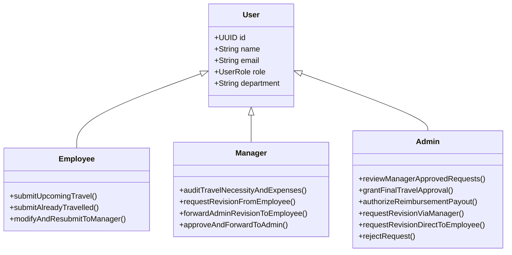
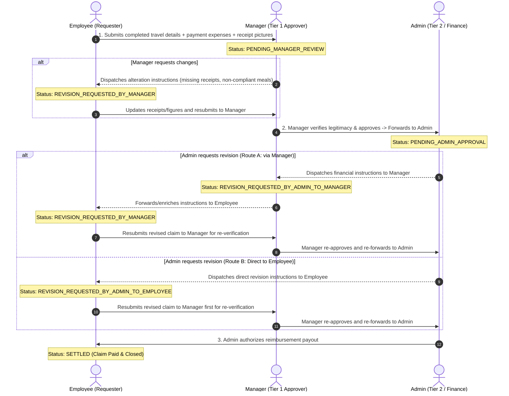
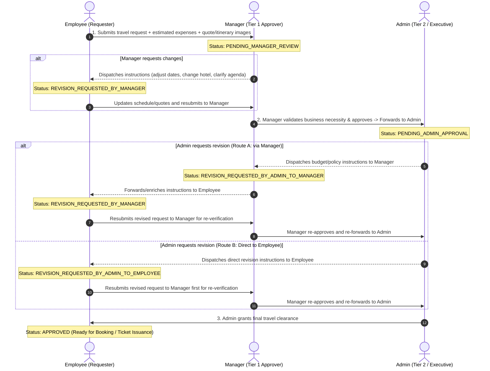

# TripFlow — Corporate Travel & Expense Management System Specification

* **Document Version**: 2.0.0
* **Date**: 2026-11-09
* **Status**: Approved Specification (Reflects Manager & Admin 2-Tier Governance)
* **Target Branch**: `feature/travel-request-system`

---

## 1. Executive Summary & Product Vision

**TripFlow** is an enterprise-grade corporate travel and expense governance platform built with **React 19**, **Tailwind CSS v4**, **Express 5**, **TypeScript**, and **PostgreSQL**. The platform provides an auditable, multi-tier approval lifecycle where reporting **Managers** act as Tier 1 operational approvers and **Admins** serve as Tier 2 executive and finance governance authorities.

The system addresses two distinct corporate travel scenarios with a unified upfront expense & proof attachment model:
1. **Case 1: Already Travelled (Post-Trip Reimbursement)** — Employee submits completed travel summary, actual incurred payment expenses, and receipt photos/tax invoices for Manager verification $\rightarrow$ Admin payout settlement.
2. **Case 2: Upcoming Travel (Pre-Trip Authorization)** — Employee submits planned travel details, estimated payment expenses, and booking/quote reference images for Manager operational necessity check $\rightarrow$ Admin executive clearance.

In both cases, when the Admin requires revisions, they can dispatch instructions either **via the Manager** or **directly to the Employee**. In all revision scenarios, once the Employee modifies the request, it **returns to the Manager first for re-verification** before progressing back to the Admin.

The user interface adheres to the **Warm Storycraft** design system (`#F7F4EE`, `#2B231D`, `#8A582B`, Poppins typography, monospace tabular figures, clean typographic status tags without colored dots).

---

## 2. Actors & Role-Based Permissions

TripFlow defines three primary personas:



### 2.1 Employee (Requester)
* Submits travel requests for either **Upcoming Travel** (with estimated expenses & quote images) or **Already Travelled** (with actual incurred expenses & receipt images).
* Receives revision instructions from Manager or Admin.
* Modifies request details, expenses, or supporting attachments and **resubmits back to the Manager for re-verification**.

### 2.2 Manager (Tier 1 Approver & Direct Line Authority)
* Evaluates business necessity, project cost code, dates, and itemized expenses with proof photos.
* **Approve & Forward**: Approves compliant requests and forwards them to Admin.
* **Request Revision**: Sends instructions to the Employee to alter dates, downgrade flights/hotels, or supply missing receipts.
* **Re-verify Resubmissions**: Re-audits altered requests returned by the Employee (including alterations prompted by Admin reviews) before escalating back to Admin.

### 2.3 Admin (Tier 2 Executive & Financial Authority)
* Audits department budget impact and policy compliance for Manager-approved requests.
* **Final Approval / Settlement**:
  * For *Upcoming Travel*: Grants final travel authorization (`APPROVED`).
  * For *Already Travelled*: Authorizes payment payout and closes claim (`SETTLED`).
* **Flexible Revision Routing**:
  * **Route A (via Manager)**: Dispatches revision instructions to Manager (who enriches notes and coordinates with Employee).
  * **Route B (direct to Employee)**: Dispatches instructions directly to the Employee.
  * *Rule*: In both routes, the Employee's updated submission returns to the **Manager first** for re-verification.
* **Reject**: Formally denies requests that violate corporate travel policies.

---

## 3. Operational Workflows & Sequence Diagrams

### 3.1 Case 1: Already Travelled (Post-Trip Reimbursement Flow)



---

### 3.2 Case 2: Upcoming Travel (Pre-Trip Authorization Flow)



---

## 4. Lifecycle Status Dictionary

| Status Code | Applicable Flow | Meaning | Actionable By |
| :--- | :--- | :--- | :--- |
| `DRAFT` | Both | Request drafted but not yet submitted | Employee |
| `PENDING_MANAGER_REVIEW` | Both | Travel request submitted with expenses & proof; awaiting Manager audit | Manager |
| `REVISION_REQUESTED_BY_MANAGER` | Both | Manager requested alterations from Employee | Employee |
| `PENDING_ADMIN_APPROVAL` | Both | Manager approved; awaiting Tier 2 Admin executive clearance | Admin |
| `REVISION_REQUESTED_BY_ADMIN_TO_MANAGER` | Both | Admin sent revision instructions back to Manager | Manager |
| `REVISION_REQUESTED_BY_ADMIN_TO_EMPLOYEE` | Both | Admin sent revision instructions directly to Employee | Employee |
| `APPROVED` | Upcoming (Terminal) | Admin granted final travel authorization; booking cleared | None (Terminal) |
| `SETTLED` | Past (Terminal) | Admin approved payment disbursement; reimbursement paid | None (Terminal) |
| `REJECTED` | Both (Terminal) | Formally denied by Manager or Admin with audit rationale | None (Terminal) |
| `CANCELLED` | Both (Terminal) | Request withdrawn by Employee | None (Terminal) |

---

## 5. PostgreSQL Database Architecture

### 5.1 Schema DDL

```sql
-- 1. Users & Roles
CREATE TABLE users (
    id UUID PRIMARY KEY DEFAULT gen_random_uuid(),
    name VARCHAR(255) NOT NULL,
    email VARCHAR(255) UNIQUE NOT NULL,
    password_hash VARCHAR(255) NOT NULL,
    role VARCHAR(50) NOT NULL CHECK (role IN ('EMPLOYEE', 'MANAGER', 'ADMIN')) DEFAULT 'EMPLOYEE',
    department VARCHAR(100) NOT NULL DEFAULT 'Engineering',
    manager_id UUID REFERENCES users(id) ON DELETE SET NULL,
    created_at TIMESTAMP WITH TIME ZONE DEFAULT NOW(),
    updated_at TIMESTAMP WITH TIME ZONE DEFAULT NOW()
);

-- 2. Department Budgets
CREATE TABLE department_budgets (
    id UUID PRIMARY KEY DEFAULT gen_random_uuid(),
    department VARCHAR(100) NOT NULL,
    fiscal_year INT NOT NULL,
    fiscal_quarter VARCHAR(20) NOT NULL,
    total_allocation NUMERIC(14, 2) NOT NULL DEFAULT 3500000.00,
    utilized_amount NUMERIC(14, 2) NOT NULL DEFAULT 0.00,
    created_at TIMESTAMP WITH TIME ZONE DEFAULT NOW(),
    updated_at TIMESTAMP WITH TIME ZONE DEFAULT NOW(),
    CONSTRAINT uq_dept_quarter UNIQUE (department, fiscal_year, fiscal_quarter)
);

-- 3. Travel Requests
CREATE TABLE travel_requests (
    id UUID PRIMARY KEY DEFAULT gen_random_uuid(),
    user_id UUID NOT NULL REFERENCES users(id) ON DELETE CASCADE,
    manager_id UUID REFERENCES users(id) ON DELETE SET NULL,
    admin_id UUID REFERENCES users(id) ON DELETE SET NULL,
    travel_type VARCHAR(50) NOT NULL CHECK (travel_type IN ('UPCOMING', 'ALREADY_TRAVELLED')),
    title VARCHAR(255) NOT NULL,
    purpose TEXT NOT NULL,
    project_code VARCHAR(100) NOT NULL,
    origin VARCHAR(150) NOT NULL,
    destination VARCHAR(150) NOT NULL,
    departure_date DATE NOT NULL,
    return_date DATE NOT NULL,
    emergency_contact_name VARCHAR(150) NOT NULL,
    emergency_contact_phone VARCHAR(50) NOT NULL,
    supporting_doc_url VARCHAR(500),
    total_expenses NUMERIC(12, 2) NOT NULL DEFAULT 0.00,
    status VARCHAR(60) NOT NULL DEFAULT 'DRAFT',
    revision_target VARCHAR(50) DEFAULT NULL CHECK (revision_target IN ('MANAGER', 'EMPLOYEE')),
    manager_remarks TEXT DEFAULT NULL,
    manager_reviewed_at TIMESTAMP WITH TIME ZONE DEFAULT NULL,
    admin_remarks TEXT DEFAULT NULL,
    admin_reviewed_at TIMESTAMP WITH TIME ZONE DEFAULT NULL,
    currency VARCHAR(10) NOT NULL DEFAULT 'INR',
    created_at TIMESTAMP WITH TIME ZONE DEFAULT NOW(),
    updated_at TIMESTAMP WITH TIME ZONE DEFAULT NOW()
);

-- 4. Travel Expenses (Itemized Line Items with Receipts / Quotes)
CREATE TABLE travel_expenses (
    id UUID PRIMARY KEY DEFAULT gen_random_uuid(),
    travel_request_id UUID NOT NULL REFERENCES travel_requests(id) ON DELETE CASCADE,
    category VARCHAR(50) NOT NULL CHECK (category IN ('FLIGHT', 'HOTEL', 'MEALS_PER_DIEM', 'TRANSIT', 'MISC')),
    merchant VARCHAR(150) NOT NULL,
    amount NUMERIC(10, 2) NOT NULL,
    expense_date DATE NOT NULL,
    receipt_image_url VARCHAR(500),
    notes TEXT,
    created_at TIMESTAMP WITH TIME ZONE DEFAULT NOW()
);

-- 5. Request Timeline Events (Immutable Audit & Instruction Ledger)
CREATE TABLE request_timeline_events (
    id UUID PRIMARY KEY DEFAULT gen_random_uuid(),
    travel_request_id UUID NOT NULL REFERENCES travel_requests(id) ON DELETE CASCADE,
    actor_id UUID NOT NULL REFERENCES users(id),
    actor_name VARCHAR(255) NOT NULL,
    actor_role VARCHAR(50) NOT NULL CHECK (actor_role IN ('EMPLOYEE', 'MANAGER', 'ADMIN')),
    event_type VARCHAR(60) NOT NULL,
    comments TEXT,
    target_role VARCHAR(50) DEFAULT NULL CHECK (target_role IN ('EMPLOYEE', 'MANAGER')),
    created_at TIMESTAMP WITH TIME ZONE DEFAULT NOW()
);
```

---

## 6. REST API Specification

### 6.1 Authentication & Session
* `POST /api/auth/signup` — Registers user.
* `POST /api/auth/signin` — Authenticates credentials & sets `HttpOnly` cookie.
* `POST /api/auth/signout` — Clears authentication cookie.
* `GET /api/auth/me` — Fetches current authenticated profile with role (`EMPLOYEE`, `MANAGER`, `ADMIN`).

### 6.2 Employee Endpoints (`/api/travel/requests`)
* `POST /` — Creates a travel request with initial expenses and receipt/quote image URLs.
* `GET /my` — Lists employee's requests with status, dates, and amounts.
* `GET /:id` — Retrieves full request details, itemized expenses, receipts, and audit remarks timeline.
* `PUT /:id` — Updates details and itemized expenses (when in `DRAFT` or `REVISION_REQUESTED_*`).
* `POST /:id/submit` — Submits or resubmits request to Manager (`PENDING_MANAGER_REVIEW`).
* `POST /:id/cancel` — Cancels request before final clearance.

### 6.3 Manager Endpoints (`/api/travel/manager`)
* `GET /queue` — Lists requests awaiting Manager audit (`PENDING_MANAGER_REVIEW`).
* `POST /:id/approve` — Validates travel & expenses $\rightarrow$ escalates to `PENDING_ADMIN_APPROVAL`.
* `POST /:id/request-revision` — Dispatches alteration instructions to Employee $\rightarrow$ `REVISION_REQUESTED_BY_MANAGER`.
* `POST /:id/forward-admin-revision` — Forwards/enriches Admin revision instructions to Employee.
* `POST /:id/reject` — Rejects request with mandatory audit explanation.

### 6.4 Admin Endpoints (`/api/travel/admin`)
* `GET /queue` — Lists requests awaiting Tier 2 executive/financial decision (`PENDING_ADMIN_APPROVAL`).
* `POST /:id/approve` — Grants final authorization:
  * If `UPCOMING` $\rightarrow$ `APPROVED` (Booking clearance granted).
  * If `ALREADY_TRAVELLED` $\rightarrow$ `SETTLED` (Reimbursement payout executed).
* `POST /:id/request-revision` — Body: `{ target: 'MANAGER' | 'EMPLOYEE', instructions: '...' }`:
  * If `target === 'MANAGER'` $\rightarrow$ `REVISION_REQUESTED_BY_ADMIN_TO_MANAGER`.
  * If `target === 'EMPLOYEE'` $\rightarrow$ `REVISION_REQUESTED_BY_ADMIN_TO_EMPLOYEE`.
* `GET /budgets` — Department quarterly budget analytics and utilization rates.
* `POST /:id/reject` — Formally denies request with reason.

---

## 7. Frontend UI & Warm Storycraft Conformance

The UI strictly adheres to **Warm Storycraft** (`client/docs/DESIGN_SYSTEM.md`):

1. **Color Tokens**:
   * Canvas: `#F7F4EE`
   * Card Surfaces: Pure `#FFFFFF` and Muted `#FAF8F5`
   * Hairline Border: `#E8DFD3`
   * Primary Brand Accent: `#8A582B` (Hover: `#754820`)
   * Primary Ink Text: `#2B231D`
   * Subtext: `#756F68`
   * Monospace font for currency tabular alignment: `font-mono tabular-nums`.

2. **Clean Typographic Status**:
   * Zero colored circle dots (`●`). Statuses are represented with dignified, subtle bordered chips:
     * `Pending Manager Review`
     * `Pending Admin Approval`
     * `Revision Requested`
     * `Approved`
     * `Settled & Paid`

3. **Interactive Panels**:
   * **Manager Queue**: Prominent `[ Approve & Forward ]` and `[ Review / Revise ]` action buttons on each row and in the audit drawer.
   * **Admin Governance**: Prominent `[ Approve Clearance / Payout ]` and `[ Review / Revise ]` buttons. The Admin revision drawer includes a radio toggle:
     * `○ Send to Manager (Coordinated)`
     * `○ Send Direct to Employee (Immediate)`
     * Note clearly stating that employee resubmissions return to the **Manager first for re-verification**.

4. **Reference Mockup**:
   * Main workspace mockup: [`docs/mockups/tripflow-full-mockup.html`](file:///c:/Users/SudalaimaniKannan/Documents/Codings/TripFlow/docs/mockups/tripflow-full-mockup.html).

---

## 8. Verification & Test Plan

1. **Unit Testing**:
   * State machine transitions: ensure invalid status updates fail with `400 Bad Request`.
   * Ensure resubmission from `REVISION_REQUESTED_BY_ADMIN_TO_EMPLOYEE` transitions to `PENDING_MANAGER_REVIEW`, not directly to Admin.
2. **Integration Testing**:
   * Case 1: Post-trip claim creation (with receipts) $\rightarrow$ Manager verification $\rightarrow$ Admin payout settlement (`SETTLED`).
   * Case 2: Upcoming trip creation (with quotes) $\rightarrow$ Manager audit $\rightarrow$ Admin clearance (`APPROVED`).
   * Revision Loop A: Admin $\rightarrow$ Manager $\rightarrow$ Employee resubmits $\rightarrow$ Manager re-approves $\rightarrow$ Admin.
   * Revision Loop B: Admin $\rightarrow$ Employee directly $\rightarrow$ Employee resubmits to Manager $\rightarrow$ Manager re-approves $\rightarrow$ Admin.
3. **Security Testing**:
   * Role guards: Employees cannot access `/api/travel/manager/*` or `/api/travel/admin/*`. Managers cannot approve Tier 2 admin actions.
