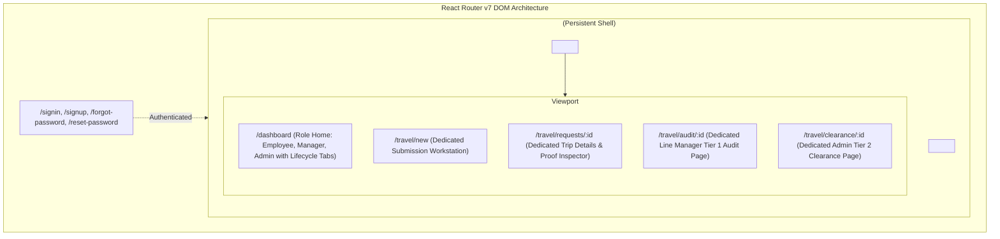
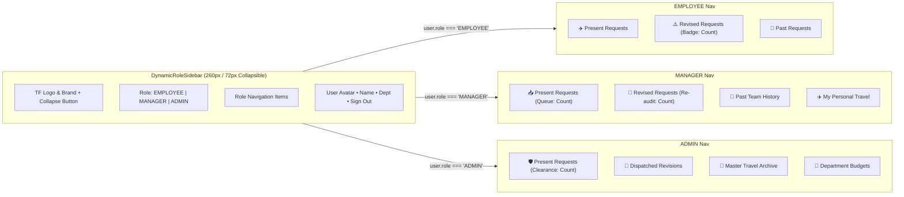

# TripFlow — Dynamic Role Sidebar & Dedicated Full-Page Architecture Specification

* **Document Version**: 1.0.0
* **Date**: 2026-11-11
* **Status**: Approved Design Specification
* **Target Branch**: `feature/dynamic-sidebar-and-full-pages`
* **Applicable Standards**: `/react-best-practices` & `/frontend-developer`

---

## 1. Executive Summary & Goals

This specification modernizes the TripFlow frontend architecture by addressing two critical architectural requirements:
1. **Full-Page Workstations Replacing Modals/Drawers**:
   - **Employee Submission**: Replaces the cramped `NewTravelRequestModal` popup with a dedicated, spacious creation page at `/travel/new`.
   - **Tier 1 Manager Audit**: Replaces the slide-over `ManagerAuditDrawer` with a full-width audit workstation page at `/travel/audit/:id` for proof inspection and decision dispatch.
   - **Tier 2 Admin Clearance**: Replaces the slide-over `AdminGovernanceDrawer` with an executive clearance workstation page at `/travel/clearance/:id` featuring real-time budget impact analysis and settlement controls.
2. **Dynamic Role-Governed Sidebar**:
   - Introduces a persistent, collapsible sidebar (`260px` expanded / `72px` icon-only) wrapping the application in a unified `<DashboardLayout />`.
   - Dynamically renders navigation links tailored strictly to the authenticated user's database role (`EMPLOYEE`, `MANAGER`, `ADMIN`) organized by lifecycle states: **Present Requests**, **Revised Requests (Action Required)**, and **Past Requests (History)**.
3. **Strict Modular Component Architecture (<100–120 lines per file)**:
   - Decomposes existing monolithic components (which ranged from 250 to 430 lines) into granular, single-responsibility presentational subcomponents and dedicated custom logic hooks (`useTravelForm`, `useAuditDecision`).

---

## 2. Route Architecture & Shell Layout



### Route Table & Permissions

| Path | Component | Allowed Roles | Description |
|---|---|---|---|
| `/dashboard` | `DashboardPage` | `EMPLOYEE`, `MANAGER`, `ADMIN` | Role home with Present / Revisions / Past lifecycle navigation. |
| `/travel/new` | `NewTravelRequestPage` | `EMPLOYEE`, `MANAGER` (Personal) | Full-page creation workstation with live INR calculation. |
| `/travel/requests/:id` | `TravelDetailPage` | `EMPLOYEE`, `MANAGER`, `ADMIN` | Deep-linkable inspection page with receipt and quote previews. |
| `/travel/audit/:id` | `ManagerAuditPage` | `MANAGER`, `ADMIN` | Tier 1 audit workstation (Approve & Forward / Request Changes). |
| `/travel/clearance/:id` | `AdminClearancePage` | `ADMIN` | Tier 2 clearance workstation with budget impact and settlement. |

---

## 3. Dynamic Sidebar Navigation Design

The `<DynamicRoleSidebar />` inspects `user.role` from `useAuth()` and renders role-specific items:



---

## 4. Dedicated Full-Page Workstation Specs

### 4.1 New Travel Request Page (`/travel/new`)
* **Header**: Breadcrumbs (`Dashboard > New Travel Request`) + "← Back to Dashboard" CTA.
* **Layout**:
  * **Top**: Case 1 (Post-Trip Reimbursement) vs. Case 2 (Pre-Trip Authorization) segmented pill toggle.
  * **Form Grid**:
    * Logistics Section: Title, Purpose, Project Code, Origin, Destination, Dates, Emergency Contact.
    * Live Budget Impact & Total Summary Card in `₹` with `font-mono tabular-nums`.
    * Upfront Proof Attachment input with instant image/document preview.
  * **Itemized Expense Table**: Dynamic line items (Flight, Hotel, Meals, Transit, Misc), merchant input, INR amount, and live sum.
  * **Bottom Sticky Bar**: "Save as Draft", "Cancel", and primary "Submit Travel Request" CTA.

### 4.2 Line Manager Audit Page (`/travel/audit/:id`)
* **Header**: Breadcrumbs (`Team Queue > Audit #${id.slice(0, 8)}`) + Employee Name & Department.
* **Split Workstation Layout**:
  * **Left Side (Proof Inspector)**: High-resolution preview of attached receipts, invoices, or quotes with zoom/expand link.
  * **Right Side (Audit & Decisions)**:
    * Request metadata, itinerary summary, and expense line items breakdown in `₹`.
    * Decision Action Card:
      * **Approve & Forward to Admin**: Submits approval with optional remarks.
      * **Request Alterations**: Form to specify required changes; prompts employee revision.
  * **Bottom**: Audit event timeline history.

### 4.3 Executive Admin Clearance Page (`/travel/clearance/:id`)
* **Header**: Breadcrumbs (`Governance Hub > Clearance #${id.slice(0, 8)}`).
* **Executive Workstation Layout**:
  * **Top**: Interactive **Budget Impact Gauge** (shows current utilized budget vs. projected headroom after approving this request out of the `₹35,00,000.00` pool).
  * **Left Side**: Line Manager's verification remarks, approval timestamp, and attached proof invoice.
  * **Right Side**: Itemized expenses audit and clearance actions:
    * For Case 1: **"Authorize Payout & Settle"** (`SETTLED`).
    * For Case 2: **"Grant Travel Clearance"** (`APPROVED`).
    * Revision Action: **"Request Alterations"** with Route A (via Manager) or Route B (direct to Employee) selector.

---

## 5. Granular Component Decomposition (<100–120 Lines Each)

All bloated components exceeding 200 lines will be systematically refactored into focused, atomic units:

```
client/src/features/travel/
├── layout/
│   ├── DashboardLayout.tsx             # Persistent Shell (<80 lines)
│   ├── DynamicRoleSidebar.tsx          # Role-aware Sidebar container (<90 lines)
│   ├── SidebarNavItem.tsx              # Nav Link item with active badge (<45 lines)
│   └── SidebarUserProfile.tsx          # Bottom profile card with Sign Out (<50 lines)
│
├── pages/
│   ├── NewTravelRequestPage.tsx        # Dedicated creation page (<85 lines)
│   ├── ManagerAuditPage.tsx            # Dedicated Tier 1 audit page (<90 lines)
│   ├── AdminClearancePage.tsx          # Dedicated Tier 2 clearance page (<95 lines)
│   ├── TravelDetailPage.tsx            # Dedicated trip inspection page (<80 lines)
│   └── DepartmentBudgetsPage.tsx       # Dedicated Admin budgets page (<80 lines)
│
├── components/
│   ├── forms/
│   │   ├── TravelTypeToggle.tsx        # Case 1 vs Case 2 pill (<40 lines)
│   │   ├── TravelLogisticsFields.tsx   # Origin, destination, dates form (<75 lines)
│   │   ├── DynamicExpenseTable.tsx     # Table container (<60 lines)
│   │   ├── ExpenseRowItem.tsx          # Single expense row with category & INR (<70 lines)
│   │   └── ProofAttachmentField.tsx    # Proof URL input & image viewer (<60 lines)
│   ├── audit/
│   │   ├── ProofInspectorViewer.tsx    # High-res invoice/receipt viewer (<65 lines)
│   │   ├── ManagerDecisionCard.tsx     # Approve & Forward / Request Changes (<80 lines)
│   │   ├── AdminClearanceCard.tsx      # Settle / Grant Clearance (<80 lines)
│   │   ├── DualRouteSelector.tsx       # Route A / Route B revision selector (<65 lines)
│   │   └── BudgetImpactGauge.tsx       # Dynamic budget headroom bar (<65 lines)
│   ├── tables/
│   │   ├── TravelRequestsTable.tsx     # Generic table with sorting (<80 lines)
│   │   └── TravelTableRow.tsx          # Single row with status badge & actions (<70 lines)
│   └── shared/
│       ├── TravelStatusBadge.tsx       # Zero-dot typographic badge (<60 lines)
│       └── TravelMetricsGrid.tsx       # Stat cards with monospace INR (<55 lines)
│
└── hooks/
    ├── useTravelForm.ts                # RHF + Zod logic & calculations (<90 lines)
    └── useAuditDecision.ts             # Approval / revision dispatch handlers (<75 lines)
```

---

## 6. Implementation & Verification Plan

1. **Phase 1**: Layout Shell & Dynamic Role Sidebar (`DashboardLayout`, `DynamicRoleSidebar`, `SidebarNavItem`, `SidebarUserProfile`).
2. **Phase 2**: Form Extraction & Dedicated New Request Page (`/travel/new`, `TravelTypeToggle`, `TravelLogisticsFields`, `DynamicExpenseTable`, `useTravelForm`).
3. **Phase 3**: Dedicated Manager Audit Workstation (`/travel/audit/:id`, `ProofInspectorViewer`, `ManagerDecisionCard`).
4. **Phase 4**: Dedicated Admin Clearance Workstation (`/travel/clearance/:id`, `BudgetImpactGauge`, `AdminClearanceCard`, `DualRouteSelector`).
5. **Phase 5**: Full Integration Testing & TypeScript Compilation (`tsc -b && vite build` passing with 0 errors).
