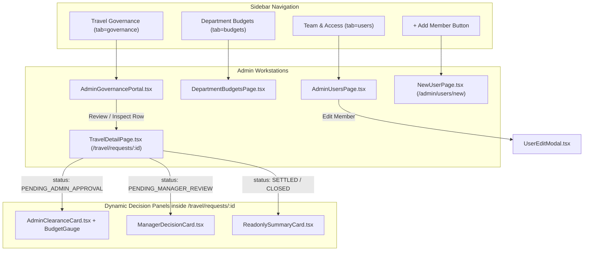

# Design Specification: Admin Pages & Workflow Consolidation

- **Date:** 2026-11-16
- **Topic:** Admin Surfaces Redundancy Elimination & Workflow Consolidation
- **Target Surfaces:** Admin Sidebar, Governance Portal, Travel Workstation, User Onboarding

---

## 1. Problem Statement & Motivation

During a comprehensive architecture and design audit of TripFlow's Admin experience, significant surface fragmentation and functional redundancy were identified across 7 different views/pages:
1. **Queue Fragmentation:** The Admin has 3 separate sidebar tabs (`Clearance Queue`, `Revised Requests`, `Past Requests`) that operate on the exact same underlying `adminQueue` dataset, repeating the exact same KPI metric strip, search bar, department filters, and table shell.
2. **Review Workstation Duplication:** The Admin is redirected between 3 separate routes (`/travel/clearance/:id`, `/travel/audit/:id`, `/travel/requests/:id`) that share ~85% identical markup (trip summary, PDF proof viewer, expense breakdown, and audit timeline log), differing only by their bottom decision card.
3. **User Onboarding Duplication:** The Admin has both a full-page creation route (`/admin/users/new`) and a modal component (`UserFormModal.tsx`) with duplicate input forms, validation schemas, and password strength meters.

This design consolidates these 7 fragmented surfaces into **3 clean, high-density, and non-redundant workflows**.

---

## 2. Architecture & Design Decisions

### 2.1 Dynamic Role Sidebar Consolidation
For `role === 'ADMIN'`, [DynamicRoleSidebar.tsx](file:///c:/Users/SudalaimaniKannan/Documents/Codings/Readventure/client/src/features/travel/layout/DynamicRoleSidebar.tsx) consolidates navigation items from 5 down to 3:
- **`governance`**: *"Travel Governance"* (icon: `ShieldCheck`) — Unified request queue with status segmentation chips.
- **`budgets`**: *"Department Budgets"* (icon: `PieChart`) — Department quarterly allocations, headroom gauges, and burn charts.
- **`users`**: *"Team & Access"* (icon: `Users`) — Member directory, lifecycle status management, and department assignments.
- **Top Quick Action CTA**: Retains the dedicated `+ Add Member` button (`UserPlus` icon, navigating to `/admin/users/new`).

**Backward Compatibility:**
Incoming URLs with legacy query parameters (`?tab=present`, `?tab=revisions`, `?tab=past`) automatically resolve to `?tab=governance` with the respective status filter pre-selected.

---

### 2.2 Unified Governance Hub (`AdminGovernancePortal.tsx`)
Rather than switching tabs and unmounting/mounting separate table instances, [AdminGovernancePortal.tsx](file:///c:/Users/SudalaimaniKannan/Documents/Codings/Readventure/client/src/features/travel/components/AdminGovernancePortal.tsx) renders a single high-efficiency governance workspace:
- **Pinned Executive KPI Strip:** Real-time visibility into *Awaiting Clearance*, *Tier 1 Oversight*, *Active Revisions*, and *Total Disbursed Spend*.
- **Universal Multi-Facet Filter Bar:** Global text search + Department dropdown + Trip type pills (`All Types`, `Upcoming`, `Claims`).
- **Status Filter Segment Chips:**
  - `All Requests` (total count)
  - `Awaiting Clearance` (`PENDING_ADMIN_APPROVAL` count)
  - `Tier 1 Oversight` (`PENDING_MANAGER_REVIEW` count)
  - `In Revision` (`REVISION_REQUESTED_BY_ADMIN_...` count)
  - `Settled & Closed` (`APPROVED`, `SETTLED`, `REJECTED`, `CANCELLED` count)
- **Unified Table Row Actions:** Contextual labels navigating directly to `/travel/requests/:id`:
  - *"Review & Clear"* $\rightarrow$ for requests pending Admin clearance.
  - *"Advance / Audit"* $\rightarrow$ for Tier 1 oversight requests.
  - *"Inspect"* $\rightarrow$ for in-revision and settled requests.

---

### 2.3 Polymorphic Request Workstation (`TravelDetailPage.tsx`)
[TravelDetailPage.tsx](file:///c:/Users/SudalaimaniKannan/Documents/Codings/Readventure/client/src/features/travel/pages/TravelDetailPage.tsx) (`/travel/requests/:id`) becomes the canonical workstation for reviewing, auditing, and inspecting travel requests:
- **Shared Core:**
  - Standardized trip header (requester name, department, status badge, route pill, dates, origin/destination, total amount).
  - Multi-proof quotation & receipt viewer ([ProofInspectorViewer.tsx](file:///c:/Users/SudalaimaniKannan/Documents/Codings/Readventure/client/src/features/travel/components/audit/ProofInspectorViewer.tsx)).
  - Itemized expenses table and category spend breakdown.
  - Immutable audit history ([AuditTimelineLog.tsx](file:///c:/Users/SudalaimaniKannan/Documents/Codings/Readventure/client/src/features/travel/components/audit/AuditTimelineLog.tsx)).
- **Dynamic Decision Slot:**
  - **Admin Clearance Card:** Mounted when `user.role === 'ADMIN'` and `status === 'PENDING_ADMIN_APPROVAL'`. Includes clearance sign-off, Route A/B revision dispatch, rejection, and the Department Budget Headroom Gauge.
  - **Manager Decision Card:** Mounted when `status === 'PENDING_MANAGER_REVIEW'` (accessible by assigned managers and Admin oversight).
  - **Historical Summary:** Mounted when status is `APPROVED`, `SETTLED`, `REJECTED`, or `CANCELLED`.
- **Route Aliasing:**
  - `/travel/clearance/:id` $\rightarrow$ redirects to `/travel/requests/:id` with `{ replace: true }`.
  - `/travel/audit/:id` $\rightarrow$ redirects to `/travel/requests/:id` with `{ replace: true }`.

---

### 2.4 Single Source of Truth for Member Onboarding
- **Canonical Creation Route:** [NewUserPage.tsx](file:///c:/Users/SudalaimaniKannan/Documents/Codings/Readventure/client/src/features/users/pages/NewUserPage.tsx) (`/admin/users/new`) serves as the sole workstation for provisioning team members. It features full room for validation, password strength meters, role assignment (restricted to `EMPLOYEE` or `MANAGER`), and department assignments.
- **Edit Modal Streamlining:** [UserFormModal.tsx](file:///c:/Users/SudalaimaniKannan/Documents/Codings/Readventure/client/src/features/users/components/UserFormModal.tsx) removes duplicate creation code, becoming a focused `UserEditModal` for in-place member updates (department, reporting manager, and role modifications for non-admins).

---

## 3. Data Flow & State Management

---

## 4. Verification & Testing Strategy

1. **Sidebar Tests (`sidebar-nav.test.ts`):**
   - Assert `getRoleNavItems('ADMIN')` returns exactly 3 items (`governance`, `budgets`, `users`).
   - Assert `getRoleQuickAction('ADMIN')` points to `/admin/users/new`.
2. **Unified Queue & Filter Tests:**
   - Verify filter chips correctly segment the unified `adminQueue`.
   - Verify row action buttons navigate directly to `/travel/requests/:id`.
3. **Polymorphic Workstation Tests:**
   - Verify `/travel/requests/:id` mounts `AdminClearanceCard` when `PENDING_ADMIN_APPROVAL`.
   - Verify `/travel/requests/:id` mounts `ManagerDecisionCard` when `PENDING_MANAGER_REVIEW`.
   - Verify route redirects from `/travel/clearance/:id` and `/travel/audit/:id`.
4. **User Management Tests (`users-management.test.ts`):**
   - Confirm `/admin/users/new` is the canonical creation route.
   - Confirm `UserEditModal` cleanly updates existing members.
5. **Build Checks:**
   - `npm run build` in `client/` and `server/` with zero TypeScript or bundling errors.
