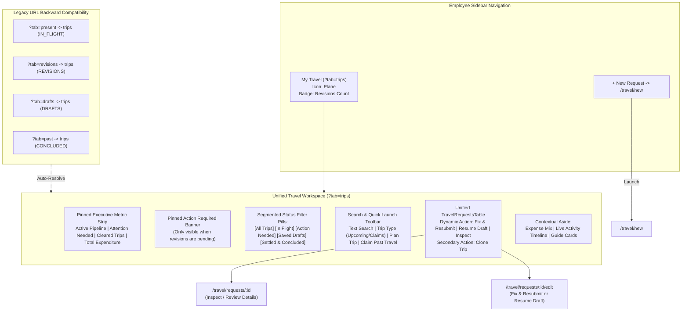

# Employee Pages & Workflows Consolidation Design Specification

**Date:** 2026-11-16  
**Status:** Pending User Approval  
**Target Architecture:** 1 High-Density Workspace for Employees (`My Travel` / `trips`)  
**Context:** Consolidation of 4 fragmented Employee sidebar tabs (`present`, `revisions`, `drafts`, `past`) down to 1 unified, non-redundant workspace with segmented status pills, pinned metrics, contextual actions, and 100% backward compatibility for legacy tab parameters.

---

## 1. Problem Statement & Motivation

During our systematic audit of the TripFlow application, the Employee user role was found to suffer from high fragmentation, redundancy, and navigation friction across 4 separate sidebar tabs:

1. **Monolithic Data Source Fragmentation:** All 4 tabs (`present`, `revisions`, `drafts`, `past`) query the exact same data endpoint (`requests` via `useTravel()`). Each tab re-renders `TravelRequestsTable` with nearly identical table columns, but forces full page unmounting and context switching.
2. **Duplicated & Disjointed Context Cards:** Ancillary widgets such as `RecentTripsSnapshotCard`, `CategorySpendBreakdownCard`, and `PolicyChecklistCard` are repeated across multiple tabs in different configurations.
3. **Metric Card Trampolining:** On `tab=present`, the KPI cards ("Needs Attention", "Settled / Approved") act as trampolines with `navigate('/dashboard?tab=revisions')` and `navigate('/dashboard?tab=past')`, kicking the employee out of their active workspace rather than filtering the current view.
4. **Single-Persona Simplicity Overkill:** An Employee has only one primary persona: **The Traveler / Reimbursant**. Unlike Admins (who juggle clearance, budgets, and users) or Managers (who juggle team audits vs personal travel), an employee's requests follow a linear lifecycle:
   $$\text{Draft} \longrightarrow \text{Submitted / In Flight} \longrightarrow \text{Action Needed (Revisions)} \longrightarrow \text{Settled / Concluded}$$
   Splitting this linear lifecycle across 4 distinct sidebar items adds unnecessary cognitive overhead and violates modern high-density UX principles.

---

## 2. Target Unified Workspace Architecture

Instead of navigating between 4 disjointed tabs, Employees will operate within **1 unified, high-density workspace**:

---

## 3. Detailed Workspace Specifications

### 3.1 Sidebar Navigation Consolidation

- **Role:** `EMPLOYEE`
- **Navigation Items:** Exactly **1 item**:
  - `id`: `'trips'`
  - `label`: `'My Travel'`
  - `icon`: `Plane`
  - `count`: Badge showing pending revision count (`allRevisions.length > 0 ? allRevisions.length : null`) with `countType: 'danger'`.
- **Quick Action CTA:**
  - `label`: `'New Request'`
  - `icon`: `PlusCircle`
  - `path`: `'/travel/new'`
  - `tooltip`: `'New Travel Request'`

### 3.2 Workspace Layout & Pinned Metrics Strip

- **Route:** `/dashboard?tab=trips` (Default tab for `user.role === 'EMPLOYEE'`).
- **Header:**
  - Title: "My Travel Workspace"
  - Subtitle: "Track active travel requests, resolve returned revisions, resume drafts, and view spend history."
  - Search input: Full-text search across Title, Origin, Destination, and Project Code.
  - Trip Type selector: `[All]` `[Upcoming]` `[Claims]`.
  - Quick Launch CTAs:
    - `Plan Upcoming Trip` (`/travel/new?type=UPCOMING`)
    - `Claim Past Travel` (`/travel/new?type=ALREADY_TRAVELLED`)
- **Pinned Metric Strip (Top):**
  1. `Active in Review`: Count of requests in pipeline (`allActive.length`), with breakdown pills for Manager Review vs Admin Approval.
  2. `Attention Required`: Count of action items (`allRevisions.length + allDrafts.length`), highlighted in amber if revisions exist. Clicking switches segment pill to `REVISIONS` or `DRAFTS`.
  3. `Cleared Trips`: Count of `APPROVED` + `SETTLED` trips (`clearedCount`), displaying average spend per trip. Clicking switches segment pill to `CONCLUDED`.
  4. `Total Expenditure`: Cumulative non-draft spend (`formatINR(totalSpent)`), with category progress bar distribution.

### 3.3 Pinned Attention Banner

- Appears directly above the status pills when `allRevisions.length > 0`:
  - Amber background (`bg-amber-50/80 border-amber-200 text-ink`).
  - Icon: `AlertCircle` (amber-700).
  - Copy: *"{N} request(s) require your revisions. Resubmissions strictly return to your Line Manager for verification."*
  - CTA button: `"View Revisions"` (one-click filter to the `REVISIONS` segment).

### 3.4 Status Segment Filter Pills

The table is filtered by an interactive segment bar:

| Segment ID | Pill Label | Count Filter Logic |
| :--- | :--- | :--- |
| `ALL` | **All Trips** | All user requests (`requests.length`) |
| `IN_FLIGHT` | **In Flight** | Requests currently in pipeline: `SUBMITTED`, `PENDING_MANAGER_REVIEW`, `PENDING_ADMIN_APPROVAL` |
| `REVISIONS` | **Action Needed** | Requests returned for corrections: `status.includes('REVISION_REQUESTED')` |
| `DRAFTS` | **Saved Drafts** | Unsubmitted local drafts: `status === 'DRAFT'` |
| `CONCLUDED` | **Settled & Concluded** | Completed requests: `['APPROVED', 'SETTLED', 'REJECTED', 'CANCELLED']` |

### 3.5 Dynamic Row Actions & Contextual Table Display

The single `TravelRequestsTable` provides clear contextual actions based on each request's state:

1. **For Revisions (`status.includes('REVISION')`):**
   - Action Button: `"Fix & Resubmit"` $\rightarrow$ `/travel/requests/:id/edit?tab=revisions`
   - Remarks preview: Displays reviewer's rejection/revision note directly in the table row.
2. **For Drafts (`status === 'DRAFT'`):**
   - Action Button: `"Resume Draft"` $\rightarrow$ `/travel/requests/:id/edit?tab=drafts`
3. **For Concluded / In-Flight (`APPROVED`, `SETTLED`, `SUBMITTED`, etc.):**
   - Action Button: `"Inspect"` $\rightarrow$ `/travel/requests/:id`
   - Secondary Action: `"Clone"` $\rightarrow$ `/travel/new?clone=:id` (enables 1-click duplication for repeat trips).
4. **Header Actions:**
   - `"Export CSV"` button (`exportRequestsToCsv`) enabled on all views to export the currently filtered table dataset.

### 3.6 Contextual Aside Sidebar

The right-hand aside adapts intelligently to the active segment:
- **Always visible:** `CategorySpendBreakdownCard` (My Expense Mix) & `RecentActivityFeedCard` (Timeline).
- **When `REVISIONS` segment is active:** Renders `RevisionWorkflowGuideCard`.
- **When `DRAFTS` segment is active:** Renders `DraftReadinessSummaryCard` & `PolicyChecklistCard`.
- **When `CONCLUDED` segment is active:** Renders `PolicyChecklistCard` / project summaries.

### 3.7 Backward Compatibility Matrix

To prevent breaking existing bookmarks, back buttons, and navigations from `NewTravelRequestPage`, `ResubmitTravelRequestPage`, and `TravelDetailPage`:

| Incoming URL Parameter | Resolved Segment | Effective Title / State |
| :--- | :--- | :--- |
| `?tab=present` | `IN_FLIGHT` | Active in-flight pipeline |
| `?tab=revisions` | `REVISIONS` | Requests requiring corrections |
| `?tab=drafts` | `DRAFTS` | Saved drafts and cloneable trips |
| `?tab=past` | `CONCLUDED` | Concluded, settled, or closed trips |
| `?tab=trips` | Preserves `segment` state or defaults to `ALL` | Full unified workspace |

---

## 4. Verification & Testing Strategy

1. **Unit & Navigation Tests:**
   - Update `client/tests/sidebar-nav.test.ts` to assert that `getRoleNavItems('EMPLOYEE')` returns exactly 1 item (`trips`, "My Travel", `Plane`).
   - Create `client/tests/employee-governance-unified.test.ts` testing:
     - Segment pill filtering logic (`ALL`, `IN_FLIGHT`, `REVISIONS`, `DRAFTS`, `CONCLUDED`).
     - Legacy tab resolution (`present`, `revisions`, `drafts`, `past`).
     - Contextual button labeling (`Fix & Resubmit`, `Resume Draft`, `Inspect`).
2. **Full Regression Suite:**
   - Execute all client test suites: `sidebar-nav`, `employee-governance-unified`, `manager-governance-unified`, `admin-governance-unified`, `travel-detail-polymorphic`, `budget-analytics`, `expense-subtotal`, etc.
   - Run server test suites (`test-e2e-full-flow.ts`, `test-travel-e2e.ts`).
3. **Typecheck & Production Build:**
   - Execute `npm --prefix client run build` (`tsc -b && vite build`).
   - Execute `npm --prefix server run build` (`tsc`).
