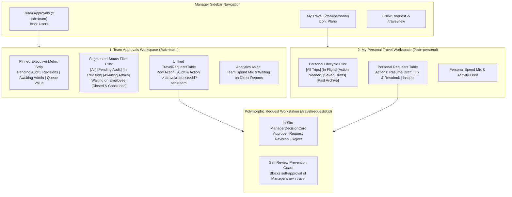

# Manager Pages & Workflows Consolidation Design Specification

**Date:** 2026-11-16  
**Status:** Approved by User  
**Target Architecture:** 2 Unified Workspaces for Line Managers (`Team Approvals` & `My Travel`)  
**Context:** Consolidation of 5 fragmented Manager sidebar tabs down to 2 high-density, non-redundant surfaces with polymorphic workstation review at `/travel/requests/:id`.

---

## 1. Problem Statement & Motivation

During a comprehensive architectural and UX audit of the TripFlow application, the Manager user role was found to suffer from substantial fragmentation and redundancy across 5 separate sidebar tabs and a disconnected full-page audit route:

1. **Artificial Team Queue Fragmentation:** The approval responsibilities for direct reports were split across 3 separate tabs: `present` (initial audits), `revisions` (resubmissions), and `past` (historical records).
2. **Semantic Contradiction in "Past Team History":** In `tab=past`, the view displayed requests that were **actively in-flight**—specifically requests forwarded to Corporate Admin awaiting executive clearance (`PENDING_ADMIN_APPROVAL`) and requests returned to direct reports awaiting employee corrections (`REVISION_REQUESTED_BY_MANAGER`). Calling this tab "Past Team History" hid active operational obligations.
3. **Disjointed Personal Travel Workflow:** A Manager is both an approver of team requests and an applicant for personal travel. Splitting unsubmitted drafts into a standalone 5th tab (`tab=drafts`) isolated drafts from the personal travel lifecycle (`tab=personal`) and created confusion over whether drafts belonged to the manager or direct reports.
4. **Duplicate Review Page:** `ManagerAuditPage.tsx` (279 lines) was a standalone duplicate of `TravelDetailPage.tsx`. Because `TravelDetailPage.tsx` now supports in-situ decision mounting via `ManagerDecisionCard` and enforces self-review prevention guards, `ManagerAuditPage.tsx` is completely redundant.

---

## 2. Target 2-Workspace Architecture

Instead of navigating between 5 disjointed tabs, Line Managers will operate across **2 streamlined, high-density workspaces**:

---

## 3. Detailed Workspace Specifications

### 3.1 Workspace 1: Team Approvals & Governance (`tab=team`)

- **Route:** `/dashboard?tab=team` (Default tab for `user.role === 'MANAGER'`).
- **Core Purpose:** Single surface for auditing, reviewing revisions, tracking requests forwarded to Admin, monitoring employee edits, and referencing concluded team travel.
- **Pinned Metric Strip (Top):**
  1. `Pending Audit`: Count of direct report requests awaiting initial review (`classified.initialAudit.length`).
  2. `Team Revisions`: Count of requests with Admin directives or employee resubmissions (`classified.revisions.length`).
  3. `Awaiting Admin`: Count of requests approved by manager, now pending executive clearance (`awaitingAdminCount`).
  4. `Total Queue Value`: Monetary commitment of all pending reviews (`formatINR(queueTotal)`).
- **Segmented Status Filter Pills:**
  - `ALL`: **All Team Requests** (`classified.teamQueue.length`)
  - `AUDIT`: **Pending Audit** (`classified.initialAudit.length`)
  - `REVISIONS`: **In Revision** (`classified.revisions.length`)
  - `AWAITING_ADMIN`: **Awaiting Admin** (`awaitingAdminCount`)
  - `WAITING_EMPLOYEE`: **Waiting on Employee** (`waitingEmployeeCount`)
  - `CONCLUDED`: **Settled & Closed** (`concludedCount`)
- **Search & Filters Toolbar:**
  - Full-text search (requester name, title, destination city, project code).
  - Trip Type filter (`ALL`, `UPCOMING`, `ALREADY_TRAVELLED`).
  - Export CSV button (`exportRequestsToCsv`).
- **Unified Table (`TravelRequestsTable`):**
  - Title reflects active segment (e.g. `Team Queue: Pending Audit`).
  - Displays requester name, department, route, dates, amount, and status badge.
  - Action button: `"Audit & Action"` or `"Inspect"` $\rightarrow$ navigates directly to `/travel/requests/${req.id}?tab=team`.
- **Right Analytics Aside (`lg:col-span-4`):**
  - `CategorySpendBreakdownCard`: "Team Spend Mix" across submitted team requests.
  - `WaitingOnEmployeeCard`: Highlights direct reports with pending revision requests.

### 3.2 Workspace 2: My Personal Travel (`tab=personal`)

- **Route:** `/dashboard?tab=personal`
- **Core Purpose:** Centralized management of the Manager’s own travel applications, drafts, expense receipts, and revision cycles.
- **Segmented Personal Filter Pills:**
  - `ALL`: **All Trips** (`requests.length`)
  - `ACTIVE`: **In Flight** (`SUBMITTED`, `PENDING_MANAGER_REVIEW`, `PENDING_ADMIN_APPROVAL`)
  - `REVISIONS`: **Action Needed** (Personal revisions requested by Admin)
  - `DRAFTS`: **Saved Drafts** (`DRAFT` requests)
  - `ARCHIVE`: **Past Archive** (`APPROVED`, `SETTLED`, `REJECTED`, `CANCELLED`)
- **Revision Alert Banner:**
  - Appears whenever `personalRevisionRequests.length > 0` with quick action to `"Fix & Resubmit"`.
- **Table Actions:**
  - For `DRAFT`: `"Resume Draft"` $\rightarrow$ `/travel/requests/${req.id}/edit?tab=personal`.
  - For `REVISION`: `"Fix & Resubmit"` $\rightarrow$ `/travel/requests/${req.id}/edit?tab=personal`.
  - For submitted/concluded: `"Inspect"` $\rightarrow$ `/travel/requests/${req.id}?tab=personal`.
- **Right Analytics Aside (`lg:col-span-4`):**
  - `CategorySpendBreakdownCard`: "Personal Spend Mix".
  - `RecentActivityFeedCard`: Personal status timeline.

---

## 4. Backward Compatibility & Route Aliasing

To ensure existing bookmarks, email notifications, and legacy links do not break:

1. **Legacy Tab Resolution:**
   - Navigating to `/dashboard?tab=present` smoothly resolves to `tab=team` with the `AUDIT` segment pre-selected.
   - Navigating to `/dashboard?tab=revisions` smoothly resolves to `tab=team` with the `REVISIONS` segment pre-selected.
   - Navigating to `/dashboard?tab=past` smoothly resolves to `tab=team` with the `CONCLUDED` segment pre-selected (or `AWAITING_ADMIN` if `bucket=AWAITING_ADMIN`).
   - Navigating to `/dashboard?tab=drafts` smoothly resolves to `tab=personal` with the `DRAFTS` segment pre-selected.
2. **Workstation Route Aliasing:**
   - In [`AppRoutes.tsx`](file:///c:/Users/SudalaimaniKannan/Documents/Codings/Readventure/client/src/routes/AppRoutes.tsx), `/travel/audit/:id` redirects with query params to `/travel/requests/:id`.
   - [`TravelDetailPage.tsx`](file:///c:/Users/SudalaimaniKannan/Documents/Codings/Readventure/client/src/features/travel/pages/TravelDetailPage.tsx) mounts `ManagerDecisionCard` in-situ.
   - `ManagerAuditPage.tsx` is completely deprecated and safely archived/deleted.

---

## 5. Security & Self-Review Governance Guardrails

1. **Manager Self-Review Prevention:**
   - When a manager views their own personal travel request (`request.userId === user.id`), `ManagerDecisionCard` is NEVER mounted.
   - Instead, an alert banner displays:
     > *"Self-Review Guard: You submitted this travel request. Line managers cannot audit or clear their own travel. This request has been escalated to Corporate Admin for Tier 1 clearance."*
2. **Team Queue Isolation:**
   - `classifyManagerQueue(managerQueue, user.id)` explicitly excludes `request.userId === user.id` from `teamQueue`, ensuring a manager never sees their own trip in the team audit queue.

---

## 6. Testing & Verification Strategy

Following strict Test-Driven Development (TDD):

1. **Sidebar Navigation Test (`client/tests/sidebar-nav.test.ts`):**
   - Assert `getRoleNavItems('MANAGER')` returns exactly 2 items: `['team', 'personal']`.
   - Assert quick action for `MANAGER` is `New Request` pointing to `/travel/new`.
2. **Unified Manager Queue Test (`client/tests/manager-governance-unified.test.ts`):**
   - Assert `ManagerQueuePortal` supports `tab=team` and `tab=personal`.
   - Assert legacy tabs (`present`, `revisions`, `past`, `drafts`) resolve to the correct segments.
   - Assert all row actions route to `/travel/requests/:id`.
3. **Polymorphic Workstation Test (`client/tests/travel-detail-polymorphic.test.ts`):**
   - Confirm in-situ decision card mounting and self-review protection.
4. **End-to-End Build Verification:**
   - Client production build (`tsc -b && vite build`) passes with zero errors.
   - Server compilation (`tsc`) passes with zero errors.
