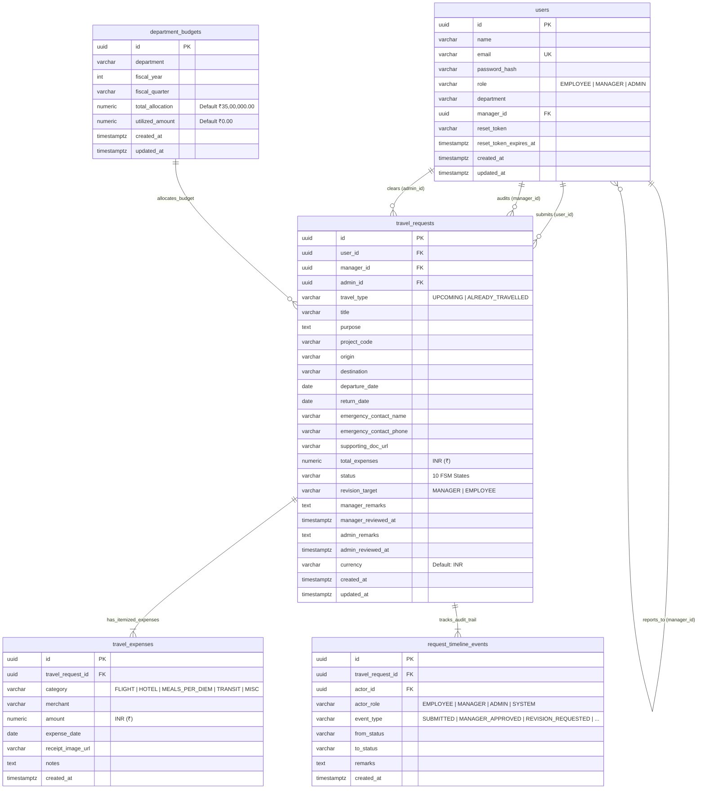

# TripFlow Database Schema Documentation

This document describes the PostgreSQL database schema, relational architecture, constraints, indexes, and cryptographic security designs utilized in the **TripFlow** Corporate Travel & Expense Governance platform.

---

## 🗄️ Database Architecture & Tech Stack

* **Database Engine**: PostgreSQL 14+
* **Primary Key Strategy**: UUID v4 (`gen_random_uuid()`) to prevent enumeration attacks and simplify distributed replication.
* **Timestamps**: All timestamps stored as `TIMESTAMPTZ` (UTC with timezone).
* **Currency Standard**: Default currency `INR`. All financial balances, estimates, and expenses are stored as `NUMERIC(12, 2)` or `NUMERIC(14, 2)` to eliminate floating-point rounding errors.
* **Migration Runner**: Transactional runner in `server/src/shared/db/migrate.ts` executing ordered SQL files from `server/src/shared/db/migrations/`.

---

## 📊 Entity-Relationship Diagram (ERD)



---

## 📋 Table Definitions & DDL

### 1. `users` (Identities & Roles)
Stores employee, line manager, and admin authentication credentials, reporting hierarchy, and recovery tokens.

```sql
CREATE TABLE IF NOT EXISTS users (
    id UUID PRIMARY KEY DEFAULT gen_random_uuid(),
    name VARCHAR(255) NOT NULL,
    email VARCHAR(255) UNIQUE NOT NULL,
    password_hash VARCHAR(255) NOT NULL,
    role VARCHAR(50) NOT NULL CHECK (role IN ('EMPLOYEE', 'MANAGER', 'ADMIN')) DEFAULT 'EMPLOYEE',
    department VARCHAR(100) NOT NULL DEFAULT 'Engineering',
    manager_id UUID REFERENCES users(id) ON DELETE SET NULL,
    reset_token VARCHAR(255),
    reset_token_expires_at TIMESTAMPTZ,
    created_at TIMESTAMPTZ NOT NULL DEFAULT CURRENT_TIMESTAMP,
    updated_at TIMESTAMPTZ NOT NULL DEFAULT CURRENT_TIMESTAMP
);
```

#### Column Reference
| Column | Type | Nullable | Default | Description |
| :--- | :--- | :--- | :--- | :--- |
| `id` | `UUID` | No | `gen_random_uuid()` | Immutable unique identifier |
| `name` | `VARCHAR(255)` | No | None | Full display name |
| `email` | `VARCHAR(255)` | No | None | Unique login email (case-insensitive) |
| `password_hash`| `VARCHAR(255)` | No | None | Salted bcrypt hash (10 rounds) |
| `role` | `VARCHAR(50)` | No | `'EMPLOYEE'` | Role guard: `EMPLOYEE`, `MANAGER`, or `ADMIN` |
| `department` | `VARCHAR(100)` | No | `'Engineering'` | Employee's business unit (e.g., Engineering, Sales, Product) |
| `manager_id` | `UUID` | Yes | `NULL` | Foreign key referencing line manager's `users.id` |
| `reset_token` | `VARCHAR(255)` | Yes | `NULL` | SHA-256 digest of 32-byte password reset token |
| `reset_token_expires_at` | `TIMESTAMPTZ` | Yes | `NULL` | 1-hour expiration timestamp |
| `created_at` | `TIMESTAMPTZ` | No | `CURRENT_TIMESTAMP` | Account creation timestamp |
| `updated_at` | `TIMESTAMPTZ` | No | `CURRENT_TIMESTAMP` | Last profile update |

---

### 2. `department_budgets` (Fiscal Guardrails)
Tracks quarterly travel budgets and utilized allocations in Indian Rupees (`₹`).

```sql
CREATE TABLE IF NOT EXISTS department_budgets (
    id UUID PRIMARY KEY DEFAULT gen_random_uuid(),
    department VARCHAR(100) NOT NULL,
    fiscal_year INT NOT NULL,
    fiscal_quarter VARCHAR(20) NOT NULL,
    total_allocation NUMERIC(14, 2) NOT NULL DEFAULT 3500000.00,
    utilized_amount NUMERIC(14, 2) NOT NULL DEFAULT 0.00,
    created_at TIMESTAMPTZ NOT NULL DEFAULT CURRENT_TIMESTAMP,
    updated_at TIMESTAMPTZ NOT NULL DEFAULT CURRENT_TIMESTAMP,
    CONSTRAINT uq_dept_quarter UNIQUE (department, fiscal_year, fiscal_quarter)
);
```

#### Column Reference
| Column | Type | Nullable | Default | Description |
| :--- | :--- | :--- | :--- | :--- |
| `id` | `UUID` | No | `gen_random_uuid()` | Unique budget record ID |
| `department` | `VARCHAR(100)` | No | None | Department name (e.g. `Engineering`) |
| `fiscal_year` | `INT` | No | None | Year (e.g. `2026`) |
| `fiscal_quarter` | `VARCHAR(20)` | No | None | Quarter (e.g. `'Q4'`) |
| `total_allocation` | `NUMERIC(14, 2)`| No | `3500000.00` | Total approved allocation (`₹35,00,000.00`) |
| `utilized_amount` | `NUMERIC(14, 2)`| No | `0.00` | Sum of cleared/approved expenditures (`₹`) |

---

### 3. `travel_requests` (Core Governance Entity)
Represents both pre-trip authorization requests (`UPCOMING`) and post-trip reimbursement claims (`ALREADY_TRAVELLED`).

```sql
CREATE TABLE IF NOT EXISTS travel_requests (
    id UUID PRIMARY KEY DEFAULT gen_random_uuid(),
    user_id UUID NOT NULL REFERENCES users(id) ON DELETE CASCADE,
    manager_id UUID REFERENCES users(id) ON DELETE SET NULL,
    admin_id UUID REFERENCES users(id) ON DELETE SET NULL,
    travel_type VARCHAR(50) NOT NULL CHECK (travel_type IN ('UPCOMING', 'ALREADY_TRAVELLED')),
    title VARCHAR(255) NOT NULL,
    purpose TEXT NOT NULL,
    project_code VARCHAR(100) NOT NULL,
    origin VARCHAR(150) NOT NULL,
    destination VARCHAR(150) NOT NULL,
    departure_date DATE NOT NULL,
    return_date DATE NOT NULL,
    emergency_contact_name VARCHAR(150) NOT NULL,
    emergency_contact_phone VARCHAR(50) NOT NULL,
    supporting_doc_url VARCHAR(500),
    total_expenses NUMERIC(12, 2) NOT NULL DEFAULT 0.00,
    status VARCHAR(60) NOT NULL DEFAULT 'DRAFT' CHECK (status IN (
        'DRAFT',
        'PENDING_MANAGER_REVIEW',
        'REVISION_REQUESTED_BY_MANAGER',
        'PENDING_ADMIN_APPROVAL',
        'REVISION_REQUESTED_BY_ADMIN_TO_MANAGER',
        'REVISION_REQUESTED_BY_ADMIN_TO_EMPLOYEE',
        'APPROVED',
        'SETTLED',
        'REJECTED',
        'CANCELLED'
    )),
    revision_target VARCHAR(50) DEFAULT NULL CHECK (revision_target IN ('MANAGER', 'EMPLOYEE')),
    manager_remarks TEXT DEFAULT NULL,
    manager_reviewed_at TIMESTAMPTZ DEFAULT NULL,
    admin_remarks TEXT DEFAULT NULL,
    admin_reviewed_at TIMESTAMPTZ DEFAULT NULL,
    currency VARCHAR(10) NOT NULL DEFAULT 'INR',
    created_at TIMESTAMPTZ NOT NULL DEFAULT CURRENT_TIMESTAMP,
    updated_at TIMESTAMPTZ NOT NULL DEFAULT CURRENT_TIMESTAMP
);
```

---

### 4. `travel_expenses` (Itemized Line Items & Proof)
Stores itemized expenses with merchant details, category, date, amount, and receipt/quotation images.

```sql
CREATE TABLE IF NOT EXISTS travel_expenses (
    id UUID PRIMARY KEY DEFAULT gen_random_uuid(),
    travel_request_id UUID NOT NULL REFERENCES travel_requests(id) ON DELETE CASCADE,
    category VARCHAR(50) NOT NULL CHECK (category IN (
        'FLIGHT', 'HOTEL', 'MEALS_PER_DIEM', 'TRANSIT', 'MISC'
    )),
    merchant VARCHAR(150) NOT NULL,
    amount NUMERIC(10, 2) NOT NULL,
    expense_date DATE NOT NULL,
    receipt_image_url VARCHAR(500),
    notes TEXT,
    created_at TIMESTAMPTZ NOT NULL DEFAULT CURRENT_TIMESTAMP
);
```

---

### 5. `request_timeline_events` (Immutable Audit Ledger)
Audit trail logging every state change, instruction dispatch, approval, and settlement.

```sql
CREATE TABLE IF NOT EXISTS request_timeline_events (
    id UUID PRIMARY KEY DEFAULT gen_random_uuid(),
    travel_request_id UUID NOT NULL REFERENCES travel_requests(id) ON DELETE CASCADE,
    actor_id UUID NOT NULL REFERENCES users(id) ON DELETE CASCADE,
    actor_role VARCHAR(50) NOT NULL,
    event_type VARCHAR(100) NOT NULL,
    from_status VARCHAR(60),
    to_status VARCHAR(60) NOT NULL,
    remarks TEXT,
    created_at TIMESTAMPTZ NOT NULL DEFAULT CURRENT_TIMESTAMP
);
```

---

## ⚡ Performance Indexes

```sql
-- Users Indexes
CREATE INDEX IF NOT EXISTS idx_users_email ON users(email);
CREATE INDEX IF NOT EXISTS idx_users_role ON users(role);
CREATE INDEX IF NOT EXISTS idx_users_manager ON users(manager_id);
CREATE INDEX IF NOT EXISTS idx_users_reset_token ON users(reset_token);

-- Travel Requests Indexes
CREATE INDEX IF NOT EXISTS idx_travel_requests_user ON travel_requests(user_id);
CREATE INDEX IF NOT EXISTS idx_travel_requests_manager ON travel_requests(manager_id);
CREATE INDEX IF NOT EXISTS idx_travel_requests_status ON travel_requests(status);
CREATE INDEX IF NOT EXISTS idx_travel_requests_travel_type ON travel_requests(travel_type);
CREATE INDEX IF NOT EXISTS idx_travel_requests_created_at ON travel_requests(created_at DESC);

-- Travel Expenses Indexes
CREATE INDEX IF NOT EXISTS idx_travel_expenses_req_id ON travel_expenses(travel_request_id);

-- Timeline Events Indexes
CREATE INDEX IF NOT EXISTS idx_timeline_req_id ON request_timeline_events(travel_request_id);
CREATE INDEX IF NOT EXISTS idx_timeline_created_at ON request_timeline_events(created_at ASC);

-- Budgets Index
CREATE INDEX IF NOT EXISTS idx_dept_budgets_lookup ON department_budgets(department, fiscal_year, fiscal_quarter);
```

---

## 🛡️ Business Invariants Enforced in Database

1. **Foreign Key Cascades**:
   - Deleting a `travel_request` automatically cascades and purges its associated line items in `travel_expenses` and audit logs in `request_timeline_events`.
   - Deleting a `user` sets `manager_id` or `admin_id` in `travel_requests` to `NULL` to preserve historical audit continuity.
2. **Numeric Financial Precision**:
   - Amounts use fixed-precision `NUMERIC(10, 2)` / `NUMERIC(12, 2)` / `NUMERIC(14, 2)` to eliminate floating-point arithmetic errors.
3. **Monetary Default**:
   - `currency` column in `travel_requests` defaults to `'INR'`.
4. **Finite State Machine Integrity**:
   - Checked constraints enforce 10 valid status values (`DRAFT`, `PENDING_MANAGER_REVIEW`, `REVISION_REQUESTED_BY_MANAGER`, `PENDING_ADMIN_APPROVAL`, `REVISION_REQUESTED_BY_ADMIN_TO_MANAGER`, `REVISION_REQUESTED_BY_ADMIN_TO_EMPLOYEE`, `APPROVED`, `SETTLED`, `REJECTED`, `CANCELLED`).
5. **Manager Re-verification Rule**:
   - When employee modifies a revised request, status updates strictly to `PENDING_MANAGER_REVIEW`.

---

## 🔄 Migration History

Migrations are executed in sequential order by `server/src/shared/db/migrate.ts`:

1. `001_create_users_table.sql`: Base user registration, passwords, and cryptographic reset tokens.
2. `002_create_travel_governance_tables.sql`: Role expansion (`MANAGER`, `ADMIN`), department budgets, travel requests, itemized expenses, and timeline event tables.

### Running Database Migrations
```bash
cd server
npm run migrate
```
